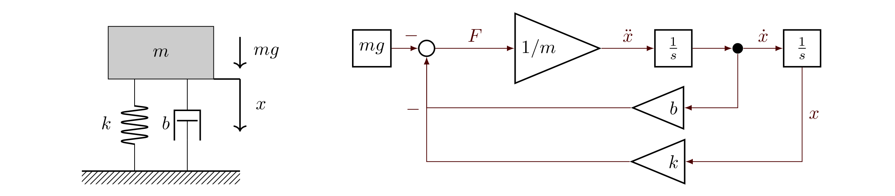

[Русский](lecture_notes.md) | **English**

# Simulation and Analytical Modeling of Mechatronic and Robotic Systems

**Interactive HTML presentation:** [open slides](presentation/index.en.html) · [controls and experiments](presentation/README.en.md).

Introductory lecture notes.

## 1. What we mean by a model

**A model represents a system while highlighting what interests us.** It describes properties relevant to the task and omits the rest. We therefore choose a model for the question we want to answer. A CAD model, a printed figurine, and a cardboard building are all models: each represents a particular interest. In this course, a model means a mathematical representation of a robot or mechatronic device used to solve kinematics and dynamics problems.

For example, the same robot link can be represented as:

- a rigid body when studying manipulator motion;
- an elastic body when studying deformation and vibration;
- a thermal system when studying actuator heating;
- a geometric envelope when checking collisions.

**Modeling** is the act of creating a model: choosing system boundaries, assumptions, variables, parameters, and their relationships.

Which model should represent a resistor? Ohm's law may come to mind. However, if the task is to throw the resistor toward a classmate, Newton's second law is more relevant. Choose the model for the task.

**Simulation** is the process of using a model to understand the behavior and performance of a proposed or existing system. This course focuses on kinematics, dynamics, and control of technical systems.

The question “Which equations describe robot motion?” concerns model creation. “Can the robot complete the motion in two seconds, and what torques will it require?” concerns using the model.

Here, *performance* means task-related measures such as motion time, accuracy, energy consumption, maximum loads, and oscillations.

### 1.1. Analytical modeling and analytical solutions

Analytical modeling expresses relationships mathematically: equilibrium equations, equations of motion, circuit equations, and so on. **Building an analytical model does not mean obtaining an explicit solution.**

Distinguish three activities:

1. Build a mathematical model, for example $m\ddot x+b\dot x+kx=u(t)-mg$.
2. Analyze it: find equilibria, natural frequencies, stability conditions, or an exact solution when available.
3. Run a numerical simulation: approximately compute a trajectory for specific parameters and inputs.

An analytical model can underpin a simulation. The approaches complement each other: formulas reveal dependencies and check computations, while numerical experiments explore complex regimes without convenient explicit solutions.

### 1.2. Components of a mechanical dynamics model

| Component | Meaning | Translational example |
|---|---|---|
| Coordinates | System configuration | Displacement $x$ |
| State | Data sufficient to determine future evolution for a given input | Position and velocity $(x,v)$ |
| Parameters | Properties of the model and environment | Mass $m$, stiffness $k$, damping $b$, gravitational acceleration $g$ |
| Input | Specified external or control action | Additional force $u(t)$; constant gravity $mg$ is accounted for separately |
| Equations | Relationships between quantities | Newton's second law |
| Initial conditions | State at the start of the experiment | $x(0)=x_0$, $v(0)=v_0$ |
| Output | Observed quantity | Position, acceleration, support force |

A mechatronic model often combines mechanics, an electric drive, sensors, and a controller. Motor torque depends on current; current depends on voltage and rotational speed. The model boundary determines which relationships must be included.

### 1.3. Why simulate, and what are the limits?

Simulation lets us test ideas before building hardware, reproduce conditions, study hazardous regimes, and compare designs or control laws. It also exposes quantities that are difficult to measure physically.

Computations can be expensive and parameters uncertain. Unmodeled backlash, friction, delays, and compliance create a *sim-to-real gap*. An accurate numerical solution cannot repair an inappropriate physical model.

## 2. Vertical mass–spring–damper motion

Consider a mass moving vertically. A spring and viscous damper connect it to a fixed support in parallel. Gravity $mg$ acts downward. An additional control force $u(t)$ may be applied; it is absent from the figure, so the illustrated case has $u=0$.



**Coordinate convention.** In the equations below, $x$ is positive **upward**, and $x=0$ is the position with an undeformed spring. Control force $u$ is also positive upward. Compression under the mass's weight therefore corresponds to $x<0$.

The arrow on the left indicates **downward body motion**, rather than the positive coordinate direction. With $x$ pointing upward, that motion has $\dot x<0$: the coordinate decreases. Velocity direction does not determine acceleration sign: a descending mass may speed up or slow down. Gravity acts downward, so its projection is $-mg$, as in the block diagram and Python scripts.

Assume constant mass, a linear bilateral spring, viscous damping, and an ideal guide. Motion has one degree of freedom; separation from the spring is excluded.

Notation and SI units:

- $m>0$ — mass, kg;
- $k>0$ — stiffness, N/m;
- $b\geq0$ — viscous damping coefficient, N·s/m;
- $x$ — displacement, m; $\dot x$ — velocity, m/s; $\ddot x$ — acceleration, m/s²;
- $u$ — additional external force, N;
- $g\approx9.8$ — gravitational acceleration, m/s²;
- $mg$ — gravity magnitude, N; its upward-axis projection is $F_g=-mg$.

### 2.1. Derivation using Newton's second law

The spring force opposes deformation:

$$F_k=-kx.$$

The damper force opposes relative velocity between the mass and support. Since the support is fixed,

$$F_b=-b\dot x.$$

Gravity in the chosen coordinate is $F_g=-mg$. The sum of forces equals mass times acceleration:

$$m\ddot x=u(t)-b\dot x-kx-mg.$$

The **equation of motion** is:

$$\boxed{m\ddot x+b\dot x+kx+mg=u(t).}$$

Every term has force units. The equation determines acceleration from current position, velocity, and input:

$$\ddot x=\frac{u(t)-b\dot x-kx-mg}{m}.$$

Two initial conditions uniquely specify the motion: $x(0)=x_0$ and $\dot x(0)=v_0$.

### 2.2. Static equilibrium and oscillations about it

With no additional input, $u=0$, equilibrium has zero velocity and acceleration:

$$kx_{\mathrm{eq}}=-mg,\qquad x_{\mathrm{eq}}=-\frac{mg}{k}.$$

A negative coordinate means compression relative to the undeformed spring. Introducing displacement from equilibrium $\xi=x-x_{\mathrm{eq}}$ gives $\dot\xi=\dot x$, $\ddot\xi=\ddot x$, and

$$\boxed{m\ddot\xi+b\dot\xi+k\xi=u(t).}$$

Gravity disappears from the equilibrium-relative equation because its constant effect is already included in static compression. The original coordinate $x$ retains $-mg$. The initial condition must also change: $\xi_0=x_0+mg/k$.

With constant input $u=u_0$, equilibrium becomes $x_{\mathrm{eq}}=(u_0-mg)/k$. Measuring $\xi$ from this new equilibrium yields the homogeneous equation $m\ddot\xi+b\dot\xi+k\xi=0$.

## 3. The Euler–Lagrange equation

### 3.1. Why use energy?

For one mass, summing forces is convenient. A multilink robot also involves constraints and reactions between bodies. Lagrange's method builds equations from energies using independent **generalized coordinates** $q_1,\ldots,q_n$.

A generalized coordinate may be a translation, rotation angle, or another independent configuration variable. For the holonomically constrained system considered here, the number of independent coordinates equals the number of degrees of freedom.

Introduce kinetic energy $T$, potential energy $V$, and the **Lagrangian**

$$L(q,\dot q,t)=T(q,\dot q,t)-V(q,t).$$

Write one equation for each coordinate:

$$\boxed{\frac{d}{dt}\left(\frac{\partial L}{\partial\dot q_i}\right)
-\frac{\partial L}{\partial q_i}=Q_i^{\mathrm{nc}},\qquad i=1,\ldots,n.}$$

Here $Q_i^{\mathrm{nc}}$ denotes generalized forces not represented by potential energy, such as actuator forces and viscous resistance. They are forces for translational coordinates and torques for angular coordinates, and follow from virtual work:

$$\delta W_{\mathrm{nc}}=\sum_i Q_i^{\mathrm{nc}}\,\delta q_i.$$

Do not include the same force both in $V$ and on the right-hand side: that would count it twice.

### 3.2. What does the equation mean?

The quantity $p_i=\partial L/\partial\dot q_i$ is generalized momentum. The equation relates its rate of change to configuration dependence of the Lagrangian and applied generalized forces. For a particle's Cartesian coordinate, it becomes Newton's second law.

For a conservative system, these equations also follow from the **principle of stationary action**:

$$S[q]=\int_{t_0}^{t_1}L(q,\dot q,t)\,dt,\qquad \delta S=0.$$

For small trajectory variations with fixed endpoints, the first variation of action vanishes. Action need not be a minimum. Integrating the term containing $\delta\dot q_i$ by parts gives

$$\delta S=\int_{t_0}^{t_1}\sum_i
\left[\frac{\partial L}{\partial q_i}
-\frac{d}{dt}\left(\frac{\partial L}{\partial\dot q_i}\right)\right]\delta q_i\,dt=0.$$

Since the interior variations $\delta q_i$ are arbitrary, each bracketed expression vanishes. Nonpotential forces are included through virtual work:

$$\delta S+\int_{t_0}^{t_1}\sum_iQ_i^{\mathrm{nc}}\delta q_i\,dt=0.$$

This yields the equation above with $Q_i^{\mathrm{nc}}$ on the right.

### 3.3. Step-by-step derivation for vertical motion with gravity

**Step 1. Coordinate.** A single upward coordinate $q=x$ describes the vertical system.

**Step 2. Kinetic energy.**

$$T=\frac12m\dot x^2.$$

For constant mass in this example, $T$ depends only on velocity $\dot x$. General robot coordinates can also introduce configuration dependence: $T(q,\dot q)=\tfrac12\dot q^{\mathsf T}M(q)\dot q$.

**Step 3. Potential energy.**

$$V=\frac12kx^2+mgx.$$

The first term is spring deformation energy; the second is gravitational potential energy. The latter increases with height; zero energy is chosen at $x=0$.

**Step 4. Lagrangian and nonpotential force.**

$$L=\frac12m\dot x^2-\frac12kx^2-mgx,\qquad Q^{\mathrm{nc}}=u(t)-b\dot x.$$

**Step 5. Derivatives.** In partial differentiation, $x$ and $\dot x$ are independent arguments:

$$\frac{\partial L}{\partial\dot x}=m\dot x,\qquad
\frac{d}{dt}\left(\frac{\partial L}{\partial\dot x}\right)=m\ddot x,\qquad
\frac{\partial L}{\partial x}=-kx-mg.$$

**Step 6. Substitution.**

$$m\ddot x-(-kx-mg)=u(t)-b\dot x,$$

$$\boxed{m\ddot x+b\dot x+kx+mg=u(t).}$$

The result agrees with the force balance. Gravity is already included in potential $mgx$, so it must not be added again to $Q^{\mathrm{nc}}$.

Viscous resistance can alternatively be represented by the **Rayleigh dissipation function** $\mathcal R=\frac12b\dot x^2$:

$$\frac{d}{dt}\frac{\partial L}{\partial\dot x}
-\frac{\partial L}{\partial x}
+\frac{\partial\mathcal R}{\partial\dot x}=u(t).$$

$\mathcal R$ is not potential energy. The dissipated power here is $b\dot x^2=2\mathcal R$.

### 3.4. Checking the energy balance

Total mechanical energy of the vertical system:

$$E=T+V=\frac12m\dot x^2+\frac12kx^2+mgx.$$

Its derivative along a solution:

$$\dot E=\dot x(m\ddot x+kx+mg)=u\dot x-b\dot x^2.$$

The first term is external input power; the second is damper loss. Energy is conserved for $u=0$, $b=0$, and is nonincreasing for $u=0$, $b>0$. This balance checks signs and simulation results.

**Energy and its zero level.** For $u=0$, numerical examples conveniently use nonnegative energy relative to equilibrium:

$$E_{\mathrm{rel}}=\frac12m\dot x^2+\frac12k\left(x+\frac{mg}{k}\right)^2
=E+\frac{(mg)^2}{2k}.$$

It differs from $E$ by a constant, so $\dot E_{\mathrm{rel}}=\dot E$. However, the final-to-initial energy ratio depends on the zero level. Numerical comparisons below use $E_{\mathrm{rel}}$; Section 10.4 extends the definition to a nonzero constant force.

### 3.5. From a mass to a robot

Many rigid multilink robot models take the form

$$M(q)\ddot q+C(q,\dot q)\dot q+g(q)+\tau_f(q,\dot q)
=\tau+J(q)^TF_{\mathrm{ext}}.$$

Here $M$ is the inertia matrix; $C\dot q$ contains Coriolis and centrifugal terms; $g(q)$ is the vector of gravitational generalized forces, distinct from scalar acceleration $g$ in the mass example; $\tau_f$ is resistance; $\tau$ is actuator effort; and $J^TF_{\mathrm{ext}}$ represents external generalized forces. Contacts and closed kinematic chains additionally require constraint equations.

## 4. Differential equations and initial-value problems

A **differential equation** relates an unknown function to its derivatives. In dynamics, that function describes state evolution over time.

Equation $m\ddot x+b\dot x+kx=u(t)-mg$ is a second-order ordinary differential equation (ODE): its highest derivative is second order. It is linear in $x$ and its derivatives, with constant coefficients when $m,b,k$ are constant.

A nonlinear force such as $F_k=-kx-\alpha x^3$ produces a nonlinear ODE. When the unknown depends on several independent variables, as with a rod deformation field $w(s,t)$, partial differential equations arise.

An **initial-value problem** seeks a differential-equation solution satisfying specified initial conditions. Numerical solvers usually work with first-order systems:

$$\dot y=f(t,y),\qquad y(t_0)=y_0.$$

For the mass and spring, introduce velocity $v=\dot x$ and the state vector:

$$y=\begin{bmatrix}x\\v\end{bmatrix},\qquad
\dot y=\begin{bmatrix}v\$u(t)-bv-kx-mg)/m\end{bmatrix}.$$

Equivalent matrix form:

$$\dot y=Ay+Bu(t)+c,\qquad
A=\begin{bmatrix}0&1\\-k/m&-b/m\end{bmatrix},\quad
B=\begin{bmatrix}0\\1/m\end{bmatrix},\quad c=\begin{bmatrix}0\\-g\end{bmatrix}.$$

The constant term $c$ makes the right-hand side affine in state. Shifting to equilibrium with constant input yields a homogeneous linear system. For continuous specified input, a unique solution exists on every finite interval. For general nonlinear ODEs, a standard sufficient condition for local uniqueness is continuity of $f$ in time and local Lipschitz continuity in state.

### 4.1. Analytical solution of free motion

An **exact solution of an initial-value problem** is a function that satisfies the differential equation and the prescribed initial conditions. Verify it by differentiation and substitution. In this lecture, the exact solution is available as an analytical formula: evaluate it directly at any time without successive integrator steps. It has no time-discretization error, although evaluating the formula on a computer still involves rounding.

Let $u=0$ with initial conditions at $t=0$. Set $\xi=x+mg/k$, giving $m\ddot\xi+b\dot\xi+k\xi=0$. Substitution $\xi=e^{rt}$ yields the characteristic equation:

$$mr^2+br+k=0,\qquad r_{1,2}=\frac{-b\pm\sqrt{b^2-4mk}}{2m}.$$

Define natural frequency and damping ratio:

$$\omega_n=\sqrt{\frac{k}{m}},\qquad
\zeta=\frac{b}{2\sqrt{mk}}.$$

For $0\leq\zeta<1$ the motion is oscillatory. Let $\omega_d=\omega_n\sqrt{1-\zeta^2}$. Then

$$\xi(t)=e^{-\zeta\omega_n t}\left[
 \xi_0\cos(\omega_dt)
 +\frac{v_0+\zeta\omega_n\xi_0}{\omega_d}\sin(\omega_dt)\right],\qquad \xi_0=x_0+\frac{mg}{k}.$$

Recover the original position as $x(t)=-mg/k+\xi(t)$.

At $\zeta=0$ oscillations do not decay. At $\zeta=1$ the equilibrium-relative displacement is $\xi(t)=(c_1+c_2t)e^{-\omega_nt}$. For $\zeta>1$, $\xi(t)$ is a sum of two decaying exponentials with distinct real exponents. In both cases the original coordinate is $x(t)=x_{\mathrm{eq}}+\xi(t)$. The latter two regimes have no oscillatory component.

For constant input $u=u_0$, equilibrium is $x_{\mathrm{eq}}=(u_0-mg)/k$. Substitution $\xi=x-x_{\mathrm{eq}}$ reduces the problem to free motion. For arbitrary input, a linear system solution can be written using a matrix exponential and integral:

$$y(t)=e^{A(t-t_0)}y_0+\int_{t_0}^{t}e^{A(t-s)}[Bu(s)+c]\,ds.$$

This integral is not always convenient to evaluate analytically; numerical integration provides another way to obtain the trajectory.

### 4.2. Why the exact solution is a reference

Consider vertical motion with x upward, no damping and no additional external force: b=0, u=0. Gravity remains in the equation:

$$m\ddot x+kx=-mg,\qquad x(0)=x_0,\quad \dot x(0)=v_0.$$

The exact solution is

$$\boxed{x(t)=x_{\mathrm{eq}}+(x_0-x_{\mathrm{eq}})\cos(\omega_nt)+\frac{v_0}{\omega_n}\sin(\omega_nt),\quad
x_{\mathrm{eq}}=-\frac{mg}{k},\quad \omega_n=\sqrt{\frac{k}{m}}.}$$

**Verification by substitution.** At t=0, the formula gives x(0)=x₀ and velocity v₀. Differentiating twice gives \(\ddot x=-\omega_n^2(x-x_{\mathrm{eq}})$. Thus $m\ddot x+kx=kx_{\mathrm{eq}}=-mg$: the function solves the original initial-value problem.

For example, with m=1 kg, k=4 N/m, g=9.8 m/s², x₀=−1.45 m and v₀=0:

$$x(t)=-2.45+\cos(2t),\qquad v(t)=-2\sin(2t).$$

Here t is in seconds, x in metres and v in m/s. At t=0.1 s, the formula gives x≈−1.469933 m. Forward Euler with h=0.1 s gives x₁=x₀+hv₀=−1.45 m: the position error is already about 0.019933 m.

On the plots, **the black curve is the exact solution of the same problem**; colored curves or points are Euler and RK4 approximations. A fair comparison uses identical parameters, forces and initial conditions. The error at a grid point is

$$e_n=x_n-x(t_n).$$

Reduce h to check convergence toward the reference. For a damped system, the reference uses §4.1 rather than the undamped formula above. **An exact solution is exact for the chosen model**: agreement verifies numerical integration but does not establish that the model matches the real device. More complex systems may have no convenient analytical formula; use step-size convergence, balance laws and independent solutions as additional checks.

## 5. Numerical integration

Choose a grid $t_n=t_0+nh$ with step $h>0$. Denote the approximation to $y(t_n)$ by $y_n$.

Integral form of the ODE:

$$y(t_{n+1})=y(t_n)+\int_{t_n}^{t_{n+1}}f(t,y(t))\,dt.$$

Numerical methods approximate this integral in different ways. Reducing the step usually improves accuracy but increases computation. Stability matters as well as accuracy.

### 5.1. Forward Euler: an explicit method

Replace the integrand by its value at the start of the step:

$$\boxed{y_{n+1}=y_n+h f(t_n,y_n).}$$

Geometrically, extend the trajectory along its current tangent. The next state is computed directly.

For the mass–spring–damper system:

$$x_{n+1}=x_n+hv_n,$$

$$v_{n+1}=v_n+\frac{h}{m}(u_n-bv_n-kx_n-mg),\qquad u_n=u(t_n).$$

Both formulas use **old** values $x_n,v_n$. Using the updated velocity in the position formula gives a different method, semi-implicit Euler. For the conservative case ($b=0$, $u=0$), this is a symplectic Euler variant; no symplectic preservation is claimed with viscous friction.

For a sufficiently smooth solution, the local error of a step starting from the exact value is $O(h^2)$; global error over a fixed interval is $O(h)$. This is a first-order method.

Advantages are simplicity and one evaluation of $f$ per step. Disadvantages are low accuracy and stability restrictions on the step.

### 5.2. Backward Euler: an implicit method

Use the slope at the end of the step:

$$\boxed{y_{n+1}=y_n+h f(t_{n+1},y_{n+1}).}$$

The unknown $y_{n+1}$ appears on both sides: each step requires an algebraic solve. The global order is also $1$.

For this system:

$$x_{n+1}=x_n+hv_{n+1},$$

$$v_{n+1}=v_n+\frac{h}{m}(u_{n+1}-bv_{n+1}-kx_{n+1}-mg).$$

Eliminating $x_{n+1}$ gives an explicit solution formula for this particular linear problem:

$$\boxed{v_{n+1}=\frac{mv_n+h(u_{n+1}-mg)-hkx_n}{m+hb+h^2k},\qquad
x_{n+1}=x_n+hv_{n+1}.}$$

In matrix form:

$$(I-hA)y_{n+1}=y_n+h(Bu_{n+1}+c).$$

In practice, solve a linear system rather than forming its inverse. For a nonlinear model, solve $F(z)=z-y_n-hf(t_{n+1},z)=0$, for example using Newton's method:

$$[I-hJ_f(t_{n+1},z^{(j)})]\,\Delta z=-F(z^{(j)}),\qquad
z^{(j+1)}=z^{(j)}+\Delta z.$$

Here $J_f$ is the state Jacobian. A stopping criterion and convergence checks are required.

Backward Euler strongly damps rapidly decaying components and often suits stiff problems. A large step may still distort motion even if the computation is stable.

#### 5.2.1. What is a solver, and what does it solve?

The word **solver** can refer to two algorithmic levels:

- An **ODE solver** advances time: it selects a step, applies an integration method, and in adaptive schemes estimates error and accepts or rejects steps.
- An **algebraic solver** inside an implicit step finds a new state satisfying the discretization equation. For nonlinear models, this is usually iterative.

Backward Euler is a discretization rule; Newton's method is one way of solving the resulting equation. Newton is not another time-integration method.

At the current step, $y_n$, $t_{n+1}$, and $h$ are known. Denote the unknown new state by $z$ and define the **residual**:

$$F(z)=z-y_n-hf(t_{n+1},z).$$

Find a root $F(z)=0$. At an arbitrary approximation $z$, vector $F(z)$ measures violation of the backward Euler equation. Here $F$ means a residual vector, not a physical force from the block diagram.

For a linear model, one linear solve suffices. Nonlinear models generally lack a convenient explicit formula, so a solver iteratively refines a root approximation.

#### 5.2.2. Newton's method

First consider a scalar equation $F(z)=0$. Near the current approximation $z^{(j)}$, replace the function by its tangent:

$$F(z^{(j)}+\Delta z)\approx F(z^{(j)})+F'(z^{(j)})\Delta z.$$

Set this linear model to zero. Then

$$\Delta z=-\frac{F(z^{(j)})}{F'(z^{(j)})},\qquad
\boxed{z^{(j+1)}=z^{(j)}-\frac{F(z^{(j)})}{F'(z^{(j)})}.}$$

Geometrically, the new approximation is the tangent's intersection with the argument axis. A zero derivative makes the formula unusable; a very small derivative can produce an excessively large correction.

For a system, replace the derivative with the **Jacobian**:

$$[J_F(z)]_{ij}=\frac{\partial F_i}{\partial z_j}.$$

At each iteration, solve a linear system for the correction:

$$\boxed{J_F(z^{(j)})\Delta z=-F(z^{(j)}),\qquad
z^{(j+1)}=z^{(j)}+\Delta z.}$$

For backward Euler,

$$J_F(z)=I-hJ_f(t_{n+1},z),\qquad
[J_f]_{ij}=\frac{\partial f_i}{\partial y_j}.$$

No explicit inverse is needed: a linear solver finds $\Delta z$. Obtain the Jacobian analytically, by automatic differentiation, or approximately by finite differences. Our example allows a straightforward hand calculation.

#### 5.2.3. Two counters: time steps and iterations

Index $n$ denotes a time step, whereas $j$ refines **one** step. All $z^{(0)},z^{(1)},\ldots$ approximate the state at the same instant $t_{n+1}$; time does not advance during Newton iterations.

Choose $z^{(0)}=y_n$ as the initial approximation or use a forward Euler predictor:

$$z^{(0)}=y_n+hf(t_n,y_n).$$

This is only an initial guess. A forward Euler predictor does not make the final implicit method explicit.

```text
known: t_n, y_n, h
compute t_next = t_n + h
choose initial approximation z

repeat at most max_iter times:
    r = z - y_n - h*f(t_next, z)
    if the residual is sufficiently small:
        accept z as y_next and finish iterating
    J = I - h*Jacobian_f(t_next, z)
    solve J*delta = -r
    z = z + delta

if convergence fails, do not accept the step:
    reduce h and retry or report an error

advance to the next time instant only after a successful solve
```

Also check the residual after the last permitted correction: that correction may have reached the root.

#### 5.2.4. Newton for a vertical mass under gravity

In our model, $z=(X,V)^T$ contains the unknown end-of-step position and velocity. Capital letters denote solver unknowns: after solving, $X=x_{n+1}$, $V=v_{n+1}$. Only here does $V$ mean velocity rather than the potential energy of Section 3. Input $u_{n+1}$ is specified independently of $X,V$.

$$F(X,V)=\begin{bmatrix}
X-x_n-hV\\
V-v_n-\dfrac{h}{m}(u_{n+1}-bV-kX-mg)
\end{bmatrix}.$$

The first row checks position change, the second checks velocity change under all forces, including $mg$. The residual Jacobian is:

$$\boxed{J_F=\begin{bmatrix}
1&-h\\
hk/m&1+hb/m
\end{bmatrix}.}$$

Thus the correction solves

$$\begin{bmatrix}1&-h\\hk/m&1+hb/m\end{bmatrix}
\begin{bmatrix}\Delta X\\\Delta V\end{bmatrix}
=-\begin{bmatrix}F_1(X,V)\\F_2(X,V)\end{bmatrix}.$$

For this model, $F$ is affine and $J_F$ constant. In exact arithmetic, Newton reaches the root in **one correction** from any starting approximation. The matrix is invertible because

$$\det J_F=1+\frac{hb}{m}+\frac{h^2k}{m}>0.$$

**Numerical example.** Use the `notebook` scenario: $m=1$, $k=20$, $b=0.5$, $g=9.8$, $u=0$, $x_n=0.5$, $v_n=0$, $h=0.1$ in SI units. Initial guess $z^{(0)}=(0.5,0)^T$ gives

$$F(z^{(0)})=\begin{bmatrix}0\\1.98\end{bmatrix},\qquad
J_F=\begin{bmatrix}1&-0.1\\2&1.05\end{bmatrix}.$$

Solve $J_F\Delta z=-F$:

$$\Delta V=-1.584\ \text{m/s},\qquad \Delta X=-0.1584\ \text{m}.$$

New state:

$$\boxed{x_{n+1}=0.3416\ \text{m},\qquad v_{n+1}=-1.584\ \text{m/s}.}$$

Substitution gives zero residual in both rows. The direct formula in Section 5.2 gives the same result. Therefore the current `model.py` needs no Newton iterations for this linear system: it uses the derived direct solution.

#### 5.2.5. When iterations are actually needed

Now let the same vertical system have a nonlinear spring:

$$F_k=-kx-\alpha x^3,\qquad [\alpha]=\frac{\text{N}}{\text{m}^3}.$$

An extra term $h\alpha X^3/m$ appears in the second residual row:

$$F_2(X,V)=V-v_n-\frac{h}{m}(u_{n+1}-bV-kX-\alpha X^3-mg).$$

The Jacobian becomes

$$J_F(X,V)=\begin{bmatrix}
1&-h\\
h(k+3\alpha X^2)/m&1+hb/m
\end{bmatrix}.$$

It depends on the current approximation $X$, and the tangent no longer coincides with the function. Several iterations are generally needed. Gravity remains in the residual but not its state derivatives, because $mg$ is constant.

For a sufficiently smooth function, a nonsingular root Jacobian, and a good starting guess, Newton converges locally quadratically: the next error is of the order of the previous error squared. Convergence from arbitrary guesses is not guaranteed. Remedies include reducing the time step or using damped Newton:

$$z^{(j+1)}=z^{(j)}+\eta\Delta z,\qquad 0<\eta\leq1,$$

Here $\eta$ is selected, for example by a line search, to reduce the scaled residual. This algorithmic damping is unrelated to physical coefficient $b$.

#### 5.2.6. When should the solver stop?

A practical solver monitors residual, correction, and iteration count. A small correction alone is insufficient: poor conditioning or a very short line-search step can stall far from the root.

State components have different units: meters for position and m/s for velocity. Comparing their combined unscaled norm with a single dimensional threshold is inappropriate. Use separate absolute tolerances $a_x$ in meters and $a_v$ in m/s, plus a dimensionless relative tolerance $r$:

$$s_x=a_x+r\max(|x_n|,|X|),\qquad
s_v=a_v+r\max(|v_n|,|V|).$$

For the residual defined above, a dimensionless criterion is

$$\max\left(\frac{|F_1|}{s_x},\frac{|F_2|}{s_v}\right)\leq1.$$

Scale the correction similarly using $|\Delta X|/s_x$ and $|\Delta V|/s_v$. With an ill-conditioned Jacobian, a small residual can still mean appreciable state error. Near root $z_*$,

$$z-z_*\approx J_F(z_*)^{-1}F(z).$$

Distinguish **integration error** from **implicit-solve error**. The first comes from discretizing continuous dynamics; the second comes from stopping before the exact root. Internal tolerances should prevent the solve error from dominating the total error. As $h$ decreases, tighter tolerances may be necessary: a fixed per-step solve error can hide first-order convergence.

If the iteration limit is reached, the Jacobian is singular, or computations become nonfinite, never silently accept the last approximation. Reject the step and retry with smaller $h$, or stop with a clear message. **Backward Euler stability and algebraic-solver convergence are different properties.**

### 5.3. Runge–Kutta methods

Runge–Kutta methods evaluate several slopes within a step, increasing accuracy order without directly computing higher solution derivatives.

A second-order example is the **explicit midpoint method**:

$$k_1=f(t_n,y_n),$$

$$k_2=f\left(t_n+\frac h2,y_n+\frac h2 k_1\right),$$

$$y_{n+1}=y_n+hk_2.$$

Here $k_i$ are intermediate slopes, not spring stiffness $k$.

The best-known example is classical **fourth-order Runge–Kutta (RK4)**:

$$k_1=f(t_n,y_n),$$

$$k_2=f\left(t_n+\frac h2,y_n+\frac h2k_1\right),$$

$$k_3=f\left(t_n+\frac h2,y_n+\frac h2k_2\right),$$

$$k_4=f(t_n+h,y_n+hk_3),$$

$$\boxed{y_{n+1}=y_n+\frac h6(k_1+2k_2+2k_3+k_4).}$$

Evaluate a slope at the start, two midpoint slopes using different state predictions, and an end slope. Their weighted sum determines the increment.

For sufficiently smooth problems, local error is $O(h^5)$ and global error $O(h^4)$. Each step needs four evaluations of $f$. Time-dependent input must also be evaluated at each stage time.

For the same sufficiently small step, RK4 is usually much more accurate than Euler, but remains explicit with a bounded stability region. “Runge–Kutta” denotes a family that also includes implicit methods.

Adaptive schemes, such as embedded order-5/4 pairs, estimate error and adjust the step. Classical RK4 in this form contains no such estimator.

## 6. Accuracy and stability are different requirements

### 6.1. A decaying test mode

Consider the test equation

$$\dot y=\lambda y,\qquad \mathrm{Re}\lambda<0.$$

Its exact solution decays. A numerical method gives $y_{n+1}=R(h\lambda)y_n$. Numerical decay requires $|R(h\lambda)|<1$.

For forward Euler, $R(z)=1+z$. If $\lambda=-a$, $a>0$, the condition is

$$|1-ha|<1\quad\Longleftrightarrow\quad 0<h<\frac2a.$$

An excessively large step turns physical decay into numerical growth.

For backward Euler, $R(z)=1/(1-z)$. Its stability region includes the entire left half-plane: it is **A-stable**. This is a property of the linear test problem, not a guarantee of accuracy or nonlinear-solver convergence at arbitrary steps.

For RK4:

$$R(z)=1+z+\frac{z^2}{2}+\frac{z^3}{6}+\frac{z^4}{24}.$$

Its stability region is bounded. For $\dot y=Ay$, inspect eigenvalues of $A$; complicated matrix structure can also cause transient effects that eigenvalues alone do not describe.

### 6.2. Why forward Euler adds energy to an ideal spring

Let $b=0$, $u=0$, with gravity included. Consider displacement $\xi=x+mg/k$ from static equilibrium. Forward Euler gives

$$\xi_{n+1}=\xi_n+hv_n,\qquad v_{n+1}=v_n-h\frac{k}{m}\xi_n.$$

Define $E_{\mathrm{rel},n}=mv_n^2/2+k\xi_n^2/2$. Substituting the updated state yields:

$$E_{\mathrm{rel},n+1}=\frac12m v_{n+1}^2+\frac12k \xi_{n+1}^2
=\left(1+h^2\frac{k}{m}\right)E_{\mathrm{rel},n}.$$

For any $h>0$ and nonzero energy, the method adds energy every step even though the physical system conserves it. A small step reduces error over a fixed finite interval but does not eliminate systematic long-term growth.

For backward Euler in the same case:

$$E_{\mathrm{rel},n+1}=\frac{E_{\mathrm{rel},n}}{1+h^2k/m}.$$

Energy decreases artificially: **numerical damping**. A stable solution can still be physically inaccurate.

For RK4 on the imaginary axis, $|R(ih\omega_n)|\leq1$ holds for $|h\omega_n|\leq2\sqrt2$. Accurate amplitude and phase usually require a step well below the stability limit. RK4 does not conserve energy exactly.

### 6.3. Stiff problems

Stiffness involves rapidly decaying processes that impose tiny explicit stability steps even when the motion of interest changes slowly.

Examples include fast electrical and slow mechanical dynamics, stiff contacts, and strong damping. High spring stiffness and ODE stiffness are related but distinct: time scales and decay matter.

| Method | Global order* | Work per step | Practical property |
|---|---:|---|---|
| Forward Euler | 1 | One evaluation of $f$ | Simple; step selection requires care |
| Backward Euler | 1 | Algebraic solve | Suitable for stiff decaying modes; adds damping |
| Explicit midpoint RK | 2 | Two evaluations of $f$ | More accurate than Euler on smooth nonstiff problems |
| Classical RK4 | 4 | Four evaluations of $f$ | High accuracy on smooth nonstiff problems |

*Assuming sufficient smoothness and convergence conditions. Input discontinuities, impacts, and inaccurate implicit solves can reduce observed order.

## 7. One numerical step with gravity

Let

$$m=1\ \text{kg},\quad k=4\ \text{N/m},\quad b=0,\quad g=9.8\ \text{m/s}^2,\quad u=0.$$

Equilibrium is $x_{\mathrm{eq}}=-mg/k=-2.45$ m. Displace the mass 1 m upward from equilibrium:

$$x_0=-1.45\ \text{m},\quad \xi_0=x_0-x_{\mathrm{eq}}=1\ \text{m},\quad v_0=0,\quad h=0.1\ \text{s}.$$

Equation and exact solution:

$$\ddot x=-4x-9.8,\qquad x(t)=-2.45+\cos(2t),\qquad v(t)=-2\sin(2t).$$

Initial acceleration is $-4(-1.45)-9.8=-4$ m/s², including both spring force and gravity.

Forward Euler:

$$x_1=-1.45,\qquad v_1=0+0.1[-4(-1.45)-9.8]=-0.4.$$

Backward Euler:

$$v_1=\frac{0-0.1\cdot9.8-0.1\cdot4(-1.45)}{1+0.1^2\cdot4}
=\frac{-0.4}{1.04}\approx-0.384615,$$

$$x_1=-1.45+0.1v_1\approx-1.488462.$$

For RK4, right-hand side $f(t,y)=(v,-4x-9.8)^T$ gives the slopes

$$k_1=\begin{bmatrix}0\\-4\end{bmatrix},\quad
k_2=\begin{bmatrix}-0.2\\-4\end{bmatrix},\quad
k_3=\begin{bmatrix}-0.2\\-3.96\end{bmatrix},\quad
k_4=\begin{bmatrix}-0.396\\-3.92\end{bmatrix}.$$

Compare energy relative to gravitational equilibrium: $E_{\mathrm{rel}}=mv^2/2+k(x+mg/k)^2/2$.

| Solution at $t=0.1$ s | $x$, m | $v$, m/s | $E_{\mathrm{rel}}$, J |
|---|---:|---:|---:|
| Exact | −1.469933 | −0.397339 | 2.000000 |
| Forward Euler | −1.450000 | −0.400000 | 2.080000 |
| Backward Euler | −1.488462 | −0.384615 | 1.923077 |
| RK4 | −1.469933 | −0.397333 | 1.999998 |

Initial equilibrium-relative energy is $2$ J. Gravity shifts equilibrium but does not change a linear spring's natural frequency. Forward Euler growth and backward Euler damping therefore remain. RK4 is much more accurate here.

## 8. Organizing a computational experiment

1. **State the question.** For example: how does damping affect settling time and maximum deformation?
2. **Choose the model and assumptions.** Specify degrees of freedom, forces, constraints, units, and validity range.
3. **Derive equations.** Use force balance or Lagrange's method; check signs and dimensions.
4. **Specify the experiment.** Choose parameters, initial conditions, input, duration, and output measures.
5. **Choose states and an integrator.** Account for fast processes, accuracy, and cost.
6. **Verify implementation.** Compare with exact solutions, energy balance, and limiting cases.
7. **Check step convergence.** Repeat with $h/2$ and $h/4$; compare trajectories and target measures. In the asymptotic regime, halving the step reduces global error of order $p$ by approximately $2^p$.
8. **Validate the model.** Compare with physical experiments under its intended conditions, considering parameter and measurement uncertainty.
9. **Interpret the result.** State the conclusion and the assumptions supporting it.

For switching inputs, align steps with switching times where useful. Impacts may require event detection, velocity reset laws, and contact models: a single smooth ODE does not describe every regime.

## 9. From mathematical equations to a simulation model

This section incorporates material from the [first lecture notebook](../../SRS/lecture_1/modeling_n_simulation.ipynb).

### 9.1. Block diagram: forces, acceleration, and two integrators

The notebook equation and diagram use an upward coordinate. The downward motion arrow means negative velocity, as explained in Section 2:

$$m\ddot x=-b\dot x-kx-mg.$$

For the general model with extra force $u(t)$, the computational structure is as follows; the original case has $u=0$:

```text
u ────────→ [ sum of forces ] ──→ [ 1/m ] ──→ acceleration ──→ [ ∫ dt ] ──→ v ──→ [ ∫ dt ] ──→ x
                ↑                                                   │                   │
                ├──────────────────── [ −b ] ←──────────────────────┘                   │
                ├──────────────────── [ −k ] ←──────────────────────────────────────────┘
              −mg
```

The sum block computes $F=u-bv-kx-mg$. Block $1/m$ gives acceleration. The first integrator reconstructs velocity; the second reconstructs position. Position and velocity feed back into spring and damper forces. Initialize the integrators with $v_0$ and $x_0$.

This is a **continuous-time** block diagram: an integration block alone specifies no numerical method. An implementation chooses a solver and step. State feedback here describes physical dynamics, not necessarily implicit integration.

The conventional workflow derives component equations, connects them, and represents the resulting system as blocks. For complex mechatronics, physical connection descriptions can also precede explicit equation derivation.

### 9.2. Bond graphs: connections through energy transfer

The notebook compares block diagrams with **bond graphs**. Components connect through energy bonds carrying effort $e$ and flow $f$, whose product is power $P=ef$.

| Physical domain | Effort $e$ | Flow $f$ | Power |
|---|---|---|---|
| Translational mechanics | Force | Velocity | $Fv$ |
| Rotation | Torque | Angular velocity | $\tau\omega$ |
| Electricity | Voltage | Current | $UI$ |
| Hydraulics | Pressure difference | Volumetric flow | $\Delta p\,Q$ |

Mass is an inertial **I** element; a spring is an energy-storage **C** element with compliance $1/k$; a damper is a dissipative **R** element. Sources prescribe effort or flow. **0** junctions enforce common effort and flow balance; **1** junctions enforce common flow and effort balance, accounting for bond orientation.

For a mass, spring, and damper attached to a fixed support, common flow is velocity $v$. Junction force balance reproduces Newton's equation. Constitutive laws and causality yield equations for numerical solution; these may be differential-algebraic.

Energy-based representations give mechanics, electricity, and other domains a shared language. A block diagram shows computational signal dependencies; a bond graph shows physical energy transfer and storage.

### 9.3. Continuous, control-affine, and discrete dynamics

The notebook uses $\dot y=f(y,u)$ and

$$\dot y=f_0(y)+B(y)u.$$

The second form is **control-affine**: input enters linearly even if state dependence is nonlinear. $f_0$ is the *drift*, and $B$ describes input action. Not every system has this form in its original variables.

For the vertical system with $y=(x,v)^T$:

$$f_0(y)=\begin{bmatrix}v\\-kx/m-bv/m-g\end{bmatrix},\qquad
B=\begin{bmatrix}0\\1/m\end{bmatrix}.$$

Zero actuator force $u=0$ alone does not imply rest: initial conditions, gravity, elasticity, and resistance also matter. Rest is possible at $x=x_{\mathrm{eq}}$ and $v=0$.

Choosing the step and input-hold rule produces a discrete model:

$$y_{n+1}=\Phi_h(y_n,u_n).$$

For example, with input held constant during the step, forward Euler defines $\Phi_h(y_n,u_n)=y_n+hf(y_n,u_n)$. An implicit scheme is defined by the residual:

$$G(y_{n+1};y_n,u_n)=y_{n+1}-y_n-hf(y_{n+1},u_n)=0.$$

Here $u_n$ means the held input. For a prescribed smooth signal $u(t)$, backward Euler uses $u(t_{n+1})$. Specify controller updates separately from physical-system integration.

### 9.4. Why the notebook iterations may fail

The notebook implements backward Euler by fixed-point iteration:

$$z^{(j+1)}=y_n+hf(z^{(j)}).$$

For a linear system, iteration error satisfies $e^{(j+1)}=hAe^{(j)}$. It converges from any initial guess if $\rho(hA)<1$, where $\rho$ is the largest eigenvalue magnitude. A sufficient nonlinear condition is contraction, for example $hL<1$ with Lipschitz constant $L$ in the relevant region.

**Backward Euler's A-stability does not guarantee fixed-point convergence.** A stiff-problem step may suit the integrator but not this inner solver. An unlimited loop can hang. Small inter-iteration changes must also be checked against accuracy and residual requirements.

The new scripts solve the linear implicit step directly using Section 5.2. This isolates integrator properties from iterative-solver error.

## 10. Lab: three Python methods for one system

Scripts are in [mass_spring_damper](mass_spring_damper/README.en.md). [model.py](mass_spring_damper/model.py) contains the shared physical model, exact solution, and three algorithms. Separate launchers use that same model to avoid parameter or initial-condition differences.

Both direct `.py` execution, including IDE Run, and module execution with `python3 -m` are supported. Run the following modules from the repository root:

```bash
# Three separate runs: tables and CSV, no third-party libraries.
python3 -m SRS_2026.lecture_1_modelling_n_simulation.mass_spring_damper.forward_euler
python3 -m SRS_2026.lecture_1_modelling_n_simulation.mass_spring_damper.backward_euler
python3 -m SRS_2026.lecture_1_modelling_n_simulation.mass_spring_damper.rk4

# All methods and three scenarios; --plot enables figures.
python3 -m SRS_2026.lecture_1_modelling_n_simulation.mass_spring_damper.experiments --scenario all
```

To generate PNG figures, install dependencies in your Python environment:

```bash
python3 -m pip install -r SRS_2026/lecture_1_modelling_n_simulation/mass_spring_damper/requirements.txt
python3 -m SRS_2026.lecture_1_modelling_n_simulation.mass_spring_damper.experiments --scenario all --plot
```

Results default to `SRS_2026/lecture_1_modelling_n_simulation/mass_spring_damper/results/`. The table reports maximum grid-point position/velocity errors and the final-to-initial equilibrium-relative energy $E_{\mathrm{rel}}$ ratio. CSV includes numerical and exact solutions. Separate plots show position, velocity, and energy; `symlog` is linear near zero and logarithmic in magnitude farther away, exposing numerical growth.

### 10.1. Scenario `notebook`: reproducing the original example

Notebook parameters: $m=1$ kg, $k=20$ N/m, $b=0.5$ N·s/m, $g=9.8$ m/s², $x_0=0.5$ m, $v_0=0$, $u=0$. Equilibrium is $x_{\mathrm{eq}}=-0.49$ m. Position is measured from the undeformed spring.

```bash
python3 -m SRS_2026.lecture_1_modelling_n_simulation.mass_spring_damper.experiments --scenario notebook --steps 0.1 0.05 0.01 --plot
```

Eigenvalues are $-0.25\pm i\sqrt{19.9375}$. Forward Euler stability requires

$$0<h<\frac{b}{k}=0.025\ \text{s}.$$

Thus at $h=0.1$ and $0.05$ s the numerical solution grows despite physical decay. At $h=0.01$ s it is stable but still appreciably less accurate than RK4. Backward Euler adds damping, especially with large steps.

Over 10 s with $h=0.1$ s, maximum position errors are approximately 768 m for forward Euler, 0.523 m for backward Euler, and 0.00221 m for RK4. The first large value indicates numerical instability.

To test order, use sufficiently small steps:

```bash
python3 -m SRS_2026.lecture_1_modelling_n_simulation.mass_spring_damper.experiments --scenario notebook --steps 0.01 0.005 0.0025 --duration 2
```

In the convergence regime, halving the step approximately halves Euler errors and divides RK4 error by 16. Compare identical physical intervals. RK4 evaluates the right-hand side four times per step: equal steps do not imply equal cost.

### 10.2. Scenario `undamped`: checking energy

$m=1$ kg, $k=4$ N/m, $b=0$, $g=9.8$ m/s², $x_0=-1.45$ m, $v_0=0$; duration 20 s. Equilibrium is $x_{\mathrm{eq}}=-2.45$ m; exact solution $x=-2.45+\cos(2t)$ conserves equilibrium-relative energy $E_{\mathrm{rel}}=2$ J.

```bash
python3 -m SRS_2026.lecture_1_modelling_n_simulation.mass_spring_damper.experiments --scenario undamped --steps 0.1 0.05 0.01 --plot
```

At $h=0.1$ s, ratio $E_{\mathrm{rel}}(T)/E_{\mathrm{rel}}(0)$ is approximately 2551 for forward Euler, 0.000392 for backward Euler, and 0.999823 for RK4. The first adds energy; the second damps physically undamped motion. RK4 captures motion well over this interval but does not conserve energy exactly.

### 10.3. Scenario `stiff`: high order does not replace stability

$m=1$ kg, $k=100$ N/m, $b=1000$ N·s/m, $g=9.8$ m/s², $x_0=0.902$ m, $v_0=0$; duration 0.2 s. Equilibrium is $x_{\mathrm{eq}}=-0.098$ m with an initial 1 m offset. Eigenvalues are approximately $-0.1$ and $-999.9$ s⁻¹: slow motion and fast decay span four orders of magnitude.

```bash
# Steps at which the explicit schemes are unstable.
python3 -m SRS_2026.lecture_1_modelling_n_simulation.mass_spring_damper.experiments --scenario stiff --steps 0.1 0.05 0.01 --plot

# Reduce the step to resolve the fast process.
python3 -m SRS_2026.lecture_1_modelling_n_simulation.mass_spring_damper.experiments --scenario stiff --steps 0.001 0.0005 --plot
```

Forward Euler requires $h\lesssim0.002$ s; RK4's negative-real-axis limit gives $h\lesssim0.00279$ s. Even RK4 therefore diverges at $h=0.01$ s. Backward Euler is stable at all listed steps, but a coarse grid poorly resolves the initial velocity transient.

Over a short interval, reducing $h$ increases the number of unstable steps. Within the unstable region, a smaller step can thus produce a **larger** final error. Monotonic improvement is expected only after entering a stable convergence regime.

### 10.4. What the scripts measure

For constant force $u_0$, use equilibrium-relative energy:

$$E_{\mathrm{rel}}=\frac12mv^2+\frac12k(x-x_{\mathrm{eq}})^2,\qquad
x_{\mathrm{eq}}=\frac{u_0-mg}{k}.$$

Its derivative is $\dot E_{\mathrm{rel}}=-bv^2$. At $u_0=0$ it equals mechanical energy including gravitational potential, up to a constant. A nonzero constant force also contributes its potential. For nonzero initial offset in a damped system, ratio $E_{\mathrm{rel}}(T)/E_{\mathrm{rel}}(0)$ should not equal one: compare with the exact trajectory. Conservation applies to the undamped scenario.

Inputs are constant; there are no contacts or controller. An analytical reference is therefore available, including critical and overdamped regimes. A varying input requires consistent changes to `rhs`, the implicit-step formula, and the reference; RK4 must evaluate it at each intermediate time.

**Student exercises:**

1. Locate the four RK4 slopes and the two old values used by forward Euler in `model.py`.
2. Derive `backward_euler` from the two implicit equations by eliminating the new position.
3. Explain the notebook's negative equilibrium and initial acceleration $-19.8$ m/s².
4. Plot maximum error against step size. Estimate order from the log–log slope on sufficiently fine grids.
5. Compare methods for roughly equal right-hand-side evaluation counts: try an RK4 step four times larger than forward Euler's. Check its stability.
6. For the stiff problem, explain why small position error does not guarantee accurate initial velocity evolution.
7. Replace the direct implicit solve with fixed-point iteration and impose an iteration limit. Find a step at which iteration fails although backward Euler remains stable.

## 11. Self-check questions

1. Why might one system require several different models?
2. How does creating a model differ from running a simulation?
3. Why is position alone insufficient to specify the mass–spring state?
4. How does the equation change if the spring/damper support moves according to $r(t)$?
5. Why is viscous friction excluded from ordinary potential energy?
6. How does partial derivative $\partial L/\partial\dot q$ differ from a total time derivative?
7. Why does a second-order equation require two initial conditions?
8. Why does numerical stability not guarantee accuracy?
9. Can numerical undamped oscillations decay or grow? What determines this?
10. How do physical-model error and integration error differ?

**Short exercise.** For $m=1$ kg, $k=100$ N/m, $b=2$ N·s/m, $g=9.8$ m/s², $u=0$, $x_0=0.1$ m, $v_0=0$, derive the analytical solution and compare all three methods with steps $0.1$, $0.05$, and $0.01$ s over $[0,10]$ s. Measure maximum position error and change in equilibrium-relative energy $E_{\mathrm{rel}}$. Also examine $b=0$ and distinguish physical from numerical damping.

## 12. References and documentation

1. **Kevin M. Lynch, Frank C. Park. _Modern Robotics: Mechanics, Planning, and Control_. Cambridge University Press, 2017.** [Book website and materials](https://modernrobotics.northwestern.edu/). See **Chapter 8, Dynamics of Open Chains**. Start with [§8.1, Lagrangian Formulation of Dynamics](https://modernrobotics.northwestern.edu/nu-gm-book-resource/chapter-8-1-lagrangian-formulation-of-dynamics-part-1-of-2/) for energy-based derivation, then [§8.5, Forward Dynamics of Open Chains](https://modernrobotics.northwestern.edu/nu-gm-book-resource/8-5-forward-dynamics-of-open-chains/) for accelerations from state/effort and motion simulation.

2. **MuJoCo Documentation. _Computation → Numerical integration_.** [Numerical integration](https://mujoco.readthedocs.io/en/latest/computation/#numerical-integration) and [Integrators](https://mujoco.readthedocs.io/en/latest/computation/#integrators) describe `Euler`, `RK4`, `implicit`, and `implicitfast`, including costs and stability. MuJoCo `Euler` updates position semi-implicitly and may treat joint damping implicitly; it is not our forward Euler. Methods `implicit` and `implicitfast` linearize in velocity and differ from full-state backward Euler in Section 5.2. The `latest` documentation changes over time; select your installed MuJoCo version for practical use.

