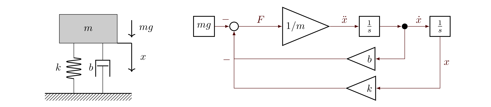

# Имитационное и аналитическое моделирование мехатронных и робототехнических систем

**Интерактивная HTML-презентация:** [открыть слайды](presentation/index.html) · [управление и эксперименты](presentation/README.md).

Конспект вводной лекции.

## 1. Что мы называем моделью

**Модель — представление системы, выделяющее то, что нас интересует.** Она описывает существенные для поставленной задачи свойства и опускает остальные. Поэтому модель выбирают относительно вопроса, на который хотят ответить. CAD-модель, отпечатанная фигурка, макет здания из картона — всё это модели, т. к. отражают предмет интереса. В рамках данного курса под моделью понимаем математическую модель робота или мехатронного устройства, которую мы можем использовать для решения задач кинематики и динамики.

Например, одно и то же звено робота можно представить:

- абсолютно твёрдым телом, если интересует движение манипулятора;
- упругим телом, если интересуют деформации и вибрации;
- тепловой системой, если интересует нагрев привода;
- геометрической оболочкой, если требуется проверять столкновения.

**Моделирование** — акт создания модели: выбор границ системы, допущений, переменных, параметров и связей между ними.

С помощью какой модели мы можем смоделировать резистор? Кто-то может вспомнить закон Ома. Только если наша задача кинуть резистор в товарища, то для этой задачи нам ближе второй закон Ньютона. Модель надо делать под задачку.

**Имитационное моделирование** — процесс использования модели для понимания поведения и показателей работы разрабатываемой или существующей системы. В рамках этого курса фокус на решении задач кинематики, динамики и управления технической системой.

Вопрос «какие уравнения описывают движение робота?» относится к построению модели. Вопрос «успеет ли робот выполнить движение за две секунды и какие моменты потребуются?» — к использованию модели.

Под *производительностью* здесь следует понимать показатели работы системы: время выполнения движения, точность, энергозатраты, максимальные нагрузки, колебательность и другие величины, связанные с целью исследования.

### 1.1. Аналитическое моделирование и аналитическое решение

При аналитическом моделировании связи между величинами задают математическими выражениями: уравнениями равновесия, движения, электрических цепей и т. д. **Построить аналитическую модель не означает получить её решение в явном виде.**

Нужно различать три действия:

1. Построить математическую модель, например $m\ddot x+b\dot x+kx=u(t)-mg$.
2. Исследовать её аналитически: найти равновесия, собственные частоты, условия устойчивости или точное решение, когда оно доступно.
3. Выполнить численную имитацию: приближённо вычислить траекторию при конкретных параметрах и воздействиях.

Аналитическая модель может лежать в основе имитационного моделирования. Эти подходы дополняют друг друга: формулы позволяют понять зависимости и проверить вычисления, а численные эксперименты — исследовать сложные режимы, для которых удобной явной формулы нет.

### 1.2. Из чего состоит динамическая модель механической системы

| Компонент | Смысл | Пример для поступательного движения |
|---|---|---|
| Координаты | Конфигурация системы | Смещение $x$ |
| Состояние | Данные, достаточные для определения дальнейшей эволюции при заданном входе | Положение и скорость $(x,v)$ |
| Параметры | Характеристики принятой модели и среды | Масса $m$, жёсткость $k$, демпфирование $b$, ускорение тяжести $g$ |
| Вход | Задаваемое внешнее или управляющее воздействие | Дополнительная сила $u(t)$; постоянная тяжесть $mg$ учитывается отдельно |
| Уравнения | Связи между величинами | Второй закон Ньютона |
| Начальные условия | Состояние в начале эксперимента | $x(0)=x_0$, $v(0)=v_0$ |
| Выход | Наблюдаемая величина | Положение, ускорение, сила в опоре |

Для мехатронной системы модель часто объединяет механику, электрический привод, датчики и регулятор. Например, механический момент двигателя зависит от тока, а ток — от напряжения и скорости вращения. Границы модели определяют, какие из этих связей нужно учитывать.

### 1.3. Зачем нужна симуляция и где её ограничения

Симуляция (имитационное моделирование) позволяет проверять идеи до изготовления устройства, воспроизводить одинаковые условия, исследовать опасные режимы и сравнивать варианты конструкции или управления. Можно наблюдать величины, которые трудно измерить в реальном эксперименте.

При этом вычисления могут быть дорогими, а параметры — неточными. Неучтённые люфты, трение, задержки и податливость создают разрыв между симуляцией и реальностью (*sim-to-real gap*). Высокая точность численного решения не исправляет неверно выбранную физическую модель.

## 2. Вертикальное движение системы «масса–пружина–демпфер»

Рассмотрим массу, которая движется по вертикали. Пружина и вязкий демпфер соединяют её с неподвижным основанием параллельно. На массу действует сила тяжести $mg$, направленная вниз. Дополнительно можно приложить управляющую силу $u(t)$; на рисунке она не показана, поэтому изображённому случаю соответствует $u=0$.



**Выбор координаты.** В дальнейших формулах $x$ положителен **вверх**, а $x=0$ соответствует положению массы при недеформированной пружине. Управляющая сила $u$ также положительна вверх. Поэтому сжатие пружины под весом массы соответствует $x<0$.

Стрелка слева на рисунке показывает **направление движения тела вниз**, а не положительное направление координатной оси. При выбранной оси $x$ вверх такому движению соответствует $\dot x<0$: координата уменьшается. Направление скорости не определяет знак ускорения — при движении вниз тело может как ускоряться, так и замедляться. Сила тяжести направлена вниз, поэтому её проекция равна $-mg$, как в блок-схеме и Python-скриптах.

Предположим, что масса постоянна, пружина линейная и двусторонняя, демпфер вязкий, а направляющая идеальная. Движение имеет одну степень свободы; отрыв массы от пружины не рассматривается.

Обозначения и единицы СИ:

- $m>0$ — масса, кг;
- $k>0$ — жёсткость, Н/м;
- $b\geq0$ — коэффициент вязкого сопротивления, Н·с/м;
- $x$ — смещение, м; $\dot x$ — скорость, м/с; $\ddot x$ — ускорение, м/с²;
- $u$ — дополнительная внешняя сила, Н;
- $g\approx9.8$ — ускорение свободного падения, м/с²;
- $mg$ — модуль силы тяжести, Н; её проекция на ось вверх равна $F_g=-mg$.

### 2.1. Вывод по второму закону Ньютона

Сила пружины направлена против деформации:

$$F_k=-kx.$$

Сила демпфера направлена против относительной скорости массы и основания. Основание неподвижно, поэтому

$$F_b=-b\dot x.$$

Сила тяжести в выбранной координате равна $F_g=-mg$. Сумма сил равна произведению массы на ускорение:

$$m\ddot x=u(t)-b\dot x-kx-mg.$$

Получаем **уравнение движения**:

$$\boxed{m\ddot x+b\dot x+kx+mg=u(t).}$$

Каждое слагаемое имеет размерность силы. Уравнение задаёт ускорение по текущим положению, скорости и внешнему воздействию:

$$\ddot x=\frac{u(t)-b\dot x-kx-mg}{m}.$$

Для однозначного определения движения нужно задать два начальных условия: $x(0)=x_0$ и $\dot x(0)=v_0$.

### 2.2. Статическое равновесие и колебания относительно него

При отсутствии дополнительного входа $u=0$ в равновесии скорость и ускорение равны нулю:

$$kx_{\mathrm{eq}}=-mg,\qquad x_{\mathrm{eq}}=-\frac{mg}{k}.$$

Отрицательная координата означает сжатие пружины относительно недеформированного состояния. Если ввести смещение от равновесия $\xi=x-x_{\mathrm{eq}}$, то $\dot\xi=\dot x$, $\ddot\xi=\ddot x$ и

$$\boxed{m\ddot\xi+b\dot\xi+k\xi=u(t).}$$

Тяжесть исчезает из уравнения относительно равновесия, поскольку её постоянное действие уже учтено в статическом сжатии пружины. В исходной координате $x$ член $-mg$ остаётся. Начальное условие также преобразуется: $\xi_0=x_0+mg/k$.

При постоянном входе $u=u_0$ точка равновесия меняется: $x_{\mathrm{eq}}=(u_0-mg)/k$. Если теперь отсчитывать $\xi$ от этой новой точки, получается однородное уравнение $m\ddot\xi+b\dot\xi+k\xi=0$.

## 3. Уравнение Эйлера–Лагранжа

### 3.1. Зачем нужен энергетический подход

Для одной массы удобно непосредственно сложить силы. В многозвенном роботе приходится учитывать связи и реакции между телами. Метод Лагранжа позволяет строить уравнения через энергии, используя независимые **обобщённые координаты** $q_1,\ldots,q_n$.

Обобщённая координата может быть линейным перемещением, углом поворота или другой независимой величиной, задающей конфигурацию. Число независимых координат равно числу степеней свободы для рассматриваемой системы с голономными связями.

Введём кинетическую энергию $T$, потенциальную энергию $V$ и **лагранжиан**

$$L(q,\dot q,t)=T(q,\dot q,t)-V(q,t).$$

Для каждой координаты записывают уравнение:

$$\boxed{\frac{d}{dt}\left(\frac{\partial L}{\partial\dot q_i}\right)
-\frac{\partial L}{\partial q_i}=Q_i^{\mathrm{nc}},\qquad i=1,\ldots,n.}$$

Здесь $Q_i^{\mathrm{nc}}$ — обобщённые силы, не учтённые через потенциальную энергию: например, силы приводов и вязкого сопротивления. Для линейной координаты это сила, для угловой — момент. Их определяют из виртуальной работы:

$$\delta W_{\mathrm{nc}}=\sum_i Q_i^{\mathrm{nc}}\,\delta q_i.$$

Нельзя одновременно включать одну и ту же силу и в $V$, и в правую часть: это удвоит её вклад.

### 3.2. Что означает это уравнение

Величина $p_i=\partial L/\partial\dot q_i$ называется обобщённым импульсом. Уравнение связывает скорость его изменения с зависимостью лагранжиана от конфигурации и приложенными обобщёнными силами. Для декартовой координаты материальной точки оно превращается во второй закон Ньютона.

В консервативной системе уравнения также следуют из **принципа стационарного действия**:

$$S[q]=\int_{t_0}^{t_1}L(q,\dot q,t)\,dt,\qquad \delta S=0.$$

При малом изменении траектории с закреплёнными концами первая вариация действия равна нулю. Действие не обязано быть минимальным. Интегрирование слагаемого с $\delta\dot q_i$ по частям даёт

$$\delta S=\int_{t_0}^{t_1}\sum_i
\left[\frac{\partial L}{\partial q_i}
-\frac{d}{dt}\left(\frac{\partial L}{\partial\dot q_i}\right)\right]\delta q_i\,dt=0.$$

Поскольку внутренние вариации $\delta q_i$ произвольны, выражения в квадратных скобках равны нулю. Для внешних непотенциальных сил используется расширение через виртуальную работу:

$$\delta S+\int_{t_0}^{t_1}\sum_iQ_i^{\mathrm{nc}}\delta q_i\,dt=0.$$

Оно приводит к приведённой выше форме с $Q_i^{\mathrm{nc}}$ справа.

### 3.3. Пошаговый вывод для вертикального движения с гравитацией

**Шаг 1. Координата.** Для вертикальной системы достаточно $q=x$, направленной вверх.

**Шаг 2. Кинетическая энергия.**

$$T=\frac12m\dot x^2.$$

В этом примере при постоянной массе $T$ зависит только от скорости $\dot x$. В общих координатах робота возможна также зависимость от конфигурации: $T(q,\dot q)=\tfrac12\dot q^{\mathsf T}M(q)\dot q$.

**Шаг 3. Потенциальная энергия.**

$$V=\frac12kx^2+mgx.$$

Первое слагаемое — энергия деформации пружины, второе — гравитационная потенциальная энергия. При движении вверх она увеличивается; нуль энергии выбран при $x=0$.

**Шаг 4. Лагранжиан и непотенциальная сила.**

$$L=\frac12m\dot x^2-\frac12kx^2-mgx,\qquad Q^{\mathrm{nc}}=u(t)-b\dot x.$$

**Шаг 5. Производные.** При частном дифференцировании $x$ и $\dot x$ рассматривают как независимые аргументы:

$$\frac{\partial L}{\partial\dot x}=m\dot x,\qquad
\frac{d}{dt}\left(\frac{\partial L}{\partial\dot x}\right)=m\ddot x,\qquad
\frac{\partial L}{\partial x}=-kx-mg.$$

**Шаг 6. Подстановка.**

$$m\ddot x-(-kx-mg)=u(t)-b\dot x,$$

$$\boxed{m\ddot x+b\dot x+kx+mg=u(t).}$$

Получен тот же результат, что и из баланса сил. Тяжесть уже учтена в потенциальной энергии $mgx$, поэтому повторно добавлять её в $Q^{\mathrm{nc}}$ не нужно.

Вязкое сопротивление можно также задать **диссипативной функцией Рэлея** $\mathcal R=\frac12b\dot x^2$:

$$\frac{d}{dt}\frac{\partial L}{\partial\dot x}
-\frac{\partial L}{\partial x}
+\frac{\partial\mathcal R}{\partial\dot x}=u(t).$$

$\mathcal R$ не является потенциальной энергией. В этом примере мощность потерь равна $b\dot x^2=2\mathcal R$.

### 3.4. Проверка через баланс энергии

Полная механическая энергия вертикальной системы:

$$E=T+V=\frac12m\dot x^2+\frac12kx^2+mgx.$$

Её производная вдоль решения:

$$\dot E=\dot x(m\ddot x+kx+mg)=u\dot x-b\dot x^2.$$

Первое слагаемое — мощность внешней силы; второе — потери в демпфере. При $u=0$, $b=0$ энергия сохраняется. При $u=0$, $b>0$ она не возрастает. Этот баланс полезен для проверки знаков и результатов симуляции.

**Энергия и выбор её нуля.** В численных примерах при $u=0$ удобна неотрицательная энергия относительно равновесия:

$$E_{\mathrm{rel}}=\frac12m\dot x^2+\frac12k\left(x+\frac{mg}{k}\right)^2
=E+\frac{(mg)^2}{2k}.$$

Она отличается от $E$ постоянной, поэтому $\dot E_{\mathrm{rel}}=\dot E$. Но отношение конечной энергии к начальной зависит от выбора нуля. Далее в численных сравнениях используем именно $E_{\mathrm{rel}}$; при ненулевой постоянной силе её определение обобщается в разделе 10.4.

### 3.5. Переход к роботу

Для многих моделей жёстких многозвенных роботов уравнения принимают вид

$$M(q)\ddot q+C(q,\dot q)\dot q+g(q)+\tau_f(q,\dot q)
=\tau+J(q)^TF_{\mathrm{ext}}.$$

Здесь $M$ — матрица инерции; $C\dot q$ — кориолисовы и центробежные слагаемые; $g(q)$ — вектор гравитационных обобщённых сил (это не скалярное ускорение $g$ из примера с массой); $\tau_f$ — сопротивление; $\tau$ — усилия приводов; $J^TF_{\mathrm{ext}}$ — обобщённые силы внешнего воздействия. Для контактов и замкнутых кинематических цепей дополнительно нужны уравнения связей.

## 4. Дифференциальные уравнения и задача Коши

**Дифференциальное уравнение** связывает неизвестную функцию с её производными. В динамике функция описывает изменение состояния во времени.

Уравнение $m\ddot x+b\dot x+kx=u(t)-mg$ — обыкновенное дифференциальное уравнение (ОДУ) второго порядка, поскольку старшая производная — вторая. Оно линейное по $x$ и его производным и имеет постоянные коэффициенты при постоянных $m,b,k$.

Введение нелинейной силы, например $F_k=-kx-\alpha x^3$, даёт нелинейное ОДУ. Если неизвестная функция зависит от нескольких независимых переменных, как поле деформации стержня $w(s,t)$, возникают уравнения в частных производных.

**Задача Коши** — найти решение дифференциального уравнения при заданных начальных условиях. Обычно численный решатель работает с системой первого порядка:

$$\dot y=f(t,y),\qquad y(t_0)=y_0.$$

Для массы и пружины введём скорость $v=\dot x$ и вектор состояния:

$$y=\begin{bmatrix}x\\v\end{bmatrix},\qquad
\dot y=\begin{bmatrix}v\$u(t)-bv-kx-mg)/m\end{bmatrix}.$$

Эквивалентная матричная запись:

$$\dot y=Ay+Bu(t)+c,\qquad
A=\begin{bmatrix}0&1\\-k/m&-b/m\end{bmatrix},\quad
B=\begin{bmatrix}0\\1/m\end{bmatrix},\quad c=\begin{bmatrix}0\\-g\end{bmatrix}.$$

Из-за постоянного слагаемого $c$ правая часть аффинна по состоянию; после сдвига к равновесию при постоянном входе она становится линейной однородной. При непрерывном заданном входе решение существует и единственно на любом конечном интервале. Для общего нелинейного ОДУ стандартное достаточное условие локальной единственности — непрерывность $f$ по времени и локальная липшицевость по состоянию.

### 4.1. Аналитическое решение свободного движения

**Точное решение задачи Коши** — функция, которая удовлетворяет дифференциальному уравнению и заданным начальным условиям. Проверить это можно дифференцированием и подстановкой. В этой лекции точное решение известно в виде аналитической формулы: значение в любой момент времени вычисляется непосредственно по ней, без последовательных шагов интегратора. Оно не содержит ошибки дискретизации времени, хотя вычисление формулы на компьютере всё равно связано с округлением.

Пусть $u=0$, начальные условия заданы при $t=0$. Перейдём к $\xi=x+mg/k$: тогда $m\ddot\xi+b\dot\xi+k\xi=0$. Подстановка $\xi=e^{rt}$ приводит к характеристическому уравнению:

$$mr^2+br+k=0,\qquad r_{1,2}=\frac{-b\pm\sqrt{b^2-4mk}}{2m}.$$

Определим собственную частоту и коэффициент относительного демпфирования:

$$\omega_n=\sqrt{\frac{k}{m}},\qquad
\zeta=\frac{b}{2\sqrt{mk}}.$$

При $0\leq\zeta<1$ движение колебательное. Обозначим $\omega_d=\omega_n\sqrt{1-\zeta^2}$. Тогда

$$\xi(t)=e^{-\zeta\omega_n t}\left[
 \xi_0\cos(\omega_dt)
 +\frac{v_0+\zeta\omega_n\xi_0}{\omega_d}\sin(\omega_dt)\right],\qquad \xi_0=x_0+\frac{mg}{k}.$$

Исходное положение восстанавливается как $x(t)=-mg/k+\xi(t)$.

При $\zeta=0$ колебания не затухают. При $\zeta=1$ отклонение от равновесия имеет вид $\xi(t)=(c_1+c_2t)e^{-\omega_nt}$. При $\zeta>1$ величина $\xi(t)$ представляет сумму двух затухающих экспонент с различными вещественными показателями. В обоих случаях исходная координата равна $x(t)=x_{\mathrm{eq}}+\xi(t)$. Последние два режима не имеют колебательной составляющей.

При постоянном входе $u=u_0$ равновесие равно $x_{\mathrm{eq}}=(u_0-mg)/k$. Замена $\xi=x-x_{\mathrm{eq}}$ сводит задачу к свободному движению. Для произвольного входа линейной системы можно записать решение через матричную экспоненту и интеграл:

$$y(t)=e^{A(t-t_0)}y_0+\int_{t_0}^{t}e^{A(t-s)}[Bu(s)+c]\,ds.$$

Вычислять этот интеграл аналитически удобно не всегда; численное интегрирование даёт другой способ получить траекторию.

### 4.2. Почему точное решение служит эталоном

Рассмотрим движение по вертикали с осью x вверх, без демпфирования и дополнительной внешней силы: b=0, u=0. Тяжесть остаётся в уравнении:

$$m\ddot x+kx=-mg,\qquad x(0)=x_0,\quad \dot x(0)=v_0.$$

Точное решение:

$$\boxed{x(t)=x_{\mathrm{eq}}+(x_0-x_{\mathrm{eq}})\cos(\omega_nt)+\frac{v_0}{\omega_n}\sin(\omega_nt),\quad
x_{\mathrm{eq}}=-\frac{mg}{k},\quad \omega_n=\sqrt{\frac{k}{m}}.}$$

**Проверка подстановкой.** При t=0 получаем x(0)=x₀ и скорость v₀. После двух дифференцирований получаем \(\ddot x=-\omega_n^2(x-x_{\mathrm{eq}})$. Поэтому $m\ddot x+kx=kx_{\mathrm{eq}}=-mg$: функция действительно решает исходную задачу.

Например, при m=1 кг, k=4 Н/м, g=9.8 м/с², x₀=−1.45 м, v₀=0:

$$x(t)=-2.45+\cos(2t),\qquad v(t)=-2\sin(2t).$$

Здесь t подставляется в секундах, x получается в метрах, v — в м/с. При t=0.1 с формула даёт x≈−1.469933 м. Прямой Эйлер с h=0.1 с даёт x₁=x₀+hv₀=−1.45 м: ошибка положения уже составляет примерно 0.019933 м.

На графиках **чёрная кривая — точное решение той же задачи**, а цветные кривые или точки — приближения методов Эйлера и RK4. Для честного сравнения совпадают параметры, силы и начальные условия. Ошибка в узле сетки определяется как

$$e_n=x_n-x(t_n).$$

Уменьшая h, проверяем, приближается ли численный результат к эталону. Для системы с демпфированием эталон вычисляется по формулам §4.1, а не по формуле незатухающих колебаний выше. **Точное решение точно для принятой модели**: совпадение с ним проверяет численный метод, но само по себе не доказывает соответствие модели реальному устройству. Для более сложной системы удобная аналитическая формула может быть недоступна; тогда используют другие проверки — сходимость по шагу, балансы и независимые решения.

## 5. Численное интегрирование

Выберем сетку $t_n=t_0+nh$ с шагом $h>0$. Через $y_n$ обозначим приближение к $y(t_n)$.

Интегральная форма ОДУ:

$$y(t_{n+1})=y(t_n)+\int_{t_n}^{t_{n+1}}f(t,y(t))\,dt.$$

Численные методы по-разному приближают этот интеграл. Уменьшение шага обычно повышает точность, но увеличивает число вычислений. Кроме точности необходимо учитывать устойчивость алгоритма.

### 5.1. Прямой Эйлер: явный метод

Заменим правую часть под интегралом её значением в начале шага:

$$\boxed{y_{n+1}=y_n+h f(t_n,y_n).}$$

Геометрически мы продолжаем траекторию по касательной, вычисленной в текущей точке. Следующее состояние вычисляется напрямую.

Для массы–пружины–демпфера:

$$x_{n+1}=x_n+hv_n,$$

$$v_{n+1}=v_n+\frac{h}{m}(u_n-bv_n-kx_n-mg),\qquad u_n=u(t_n).$$

Обе формулы используют **старые** значения $x_n,v_n$. Подстановка уже обновлённой скорости в формулу положения даёт другой метод, называемый полунеявным Эйлером. Для рассматриваемой консервативной системы ($b=0$, $u=0$) это вариант симплектического Эйлера; при наличии вязкого трения сохранение симплектической структуры не утверждается.

При достаточно гладком решении локальная ошибка одного шага, начатого с точного значения, равна $O(h^2)$; глобальная ошибка на фиксированном промежутке — $O(h)$. Это метод первого порядка.

Преимущества — простота и одно вычисление $f$ за шаг. Недостатки — невысокая точность и ограничения на шаг по устойчивости.

### 5.2. Обратный Эйлер: неявный метод

Используем наклон в конце шага:

$$\boxed{y_{n+1}=y_n+h f(t_{n+1},y_{n+1}).}$$

Неизвестное $y_{n+1}$ находится с обеих сторон: на каждом шаге решается алгебраическое уравнение. Метод также имеет глобальный порядок $1$.

Для рассматриваемой системы:

$$x_{n+1}=x_n+hv_{n+1},$$

$$v_{n+1}=v_n+\frac{h}{m}(u_{n+1}-bv_{n+1}-kx_{n+1}-mg).$$

После исключения $x_{n+1}$ получаем явную формулу решения именно этой линейной задачи:

$$\boxed{v_{n+1}=\frac{mv_n+h(u_{n+1}-mg)-hkx_n}{m+hb+h^2k},\qquad
x_{n+1}=x_n+hv_{n+1}.}$$

В матричной форме:

$$(I-hA)y_{n+1}=y_n+h(Bu_{n+1}+c).$$

На практике решают линейную систему, а не вычисляют обратную матрицу. Для нелинейной модели решают $F(z)=z-y_n-hf(t_{n+1},z)=0$, например методом Ньютона:

$$[I-hJ_f(t_{n+1},z^{(j)})]\,\Delta z=-F(z^{(j)}),\qquad
z^{(j+1)}=z^{(j)}+\Delta z.$$

Здесь $J_f$ — якобиан по состоянию. Нужны критерий остановки и контроль сходимости итераций.

Обратный Эйлер хорошо подавляет быстро затухающие компоненты и часто подходит для жёстких задач. При этом большой шаг может сильно исказить движение, даже если расчёт устойчив.

#### 5.2.1. Что такое солвер и что именно он решает

Словом **солвер** (*solver*, решатель) могут называть два разных уровня алгоритма:

- **Решатель ОДУ** продвигает решение по времени: выбирает шаг, применяет метод интегрирования, а в адаптивных схемах оценивает ошибку и принимает или отклоняет шаг.
- **Решатель алгебраических уравнений** внутри неявного шага находит новое состояние, удовлетворяющее уравнению метода. Для нелинейной модели это обычно итерационный алгоритм.

Неявный Эйлер — правило дискретизации, а метод Ньютона — один из способов решить получившееся уравнение. Ньютон не является ещё одним методом интегрирования по времени.

На текущем временном шаге $y_n$, $t_{n+1}$ и $h$ уже известны. Неизвестное новое состояние обозначим $z$. Введём **невязку**:

$$F(z)=z-y_n-hf(t_{n+1},z).$$

Нужно найти корень $F(z)=0$. Если подставить произвольное приближение $z$, вектор $F(z)$ показывает, насколько оно нарушает уравнение неявного Эйлера. В этой части $F$ — обозначение векторной невязки, а не физической силы из блок-схемы.

Для линейной модели достаточно решить одну линейную систему. Для нелинейной модели удобной явной формулы обычно нет: солвер последовательно уточняет приближение к корню.

#### 5.2.2. Идея метода Ньютона

Сначала рассмотрим одно скалярное уравнение $F(z)=0$. Вблизи текущего приближения $z^{(j)}$ заменим функцию касательной:

$$F(z^{(j)}+\Delta z)\approx F(z^{(j)})+F'(z^{(j)})\Delta z.$$

Потребуем, чтобы эта линейная модель была равна нулю. Тогда

$$\Delta z=-\frac{F(z^{(j)})}{F'(z^{(j)})},\qquad
\boxed{z^{(j+1)}=z^{(j)}-\frac{F(z^{(j)})}{F'(z^{(j)})}.}$$

Геометрически новое приближение — пересечение касательной с осью аргумента. Если производная равна нулю, такая формула неприменима; при очень малой производной поправка может оказаться слишком большой.

Для системы уравнений производную заменяет **якобиан**:

$$[J_F(z)]_{ij}=\frac{\partial F_i}{\partial z_j}.$$

На каждой итерации решаем линейную систему для поправки:

$$\boxed{J_F(z^{(j)})\Delta z=-F(z^{(j)}),\qquad
z^{(j+1)}=z^{(j)}+\Delta z.}$$

В записи неявного Эйлера

$$J_F(z)=I-hJ_f(t_{n+1},z),\qquad
[J_f]_{ij}=\frac{\partial f_i}{\partial y_j}.$$

Обратную матрицу явно вычислять не нужно: линейный солвер находит $\Delta z$ из системы. Якобиан можно получить аналитически, автоматическим дифференцированием или приближённо конечными разностями. Для учебной модели он легко вычисляется вручную.

#### 5.2.3. Два разных счётчика: время и итерации

Индекс $n$ обозначает временной шаг, а $j$ — уточнение внутри **одного** шага. Все $z^{(0)},z^{(1)},\ldots$ приближают состояние в один и тот же момент $t_{n+1}$; время во время итераций Ньютона не меняется.

Начальное приближение можно выбрать как $z^{(0)}=y_n$ или использовать прогноз прямым Эйлером:

$$z^{(0)}=y_n+hf(t_n,y_n).$$

Это только начальная догадка для солвера. Прогноз прямым Эйлером не превращает итоговый неявный метод в явный.

```text
известны: t_n, y_n, h
вычислить t_next = t_n + h
выбрать начальное приближение z

повторять не более max_iter раз:
    r = z - y_n - h*f(t_next, z)
    если невязка достаточно мала:
        принять z как y_next и завершить итерации
    J = I - h*Jacobian_f(t_next, z)
    решить J*delta = -r
    z = z + delta

если сходимости нет, шаг не принимать:
    уменьшить h и повторить шаг или сообщить об ошибке

только после успешного решения перейти к следующему моменту времени
```

При реализации после последней разрешённой поправки также проверяют невязку: корень мог быть получен именно этой поправкой.

#### 5.2.4. Ньютон для вертикальной массы с тяжестью

В нашей модели $z=(X,V)^T$ — искомые положение и скорость в конце шага. Заглавные буквы здесь обозначают неизвестные солвера; после решения $X=x_{n+1}$, $V=v_{n+1}$. Только в этом примере $V$ обозначает скорость, а не потенциальную энергию из раздела 3. Вход $u_{n+1}$ считаем заданным и не зависящим от $X,V$.

$$F(X,V)=\begin{bmatrix}
X-x_n-hV\\
V-v_n-\dfrac{h}{m}(u_{n+1}-bV-kX-mg)
\end{bmatrix}.$$

Первая строка проверяет изменение положения, вторая — изменение скорости с учётом всех сил, включая $mg$. Якобиан невязки:

$$\boxed{J_F=\begin{bmatrix}
1&-h\\
hk/m&1+hb/m
\end{bmatrix}.}$$

Поэтому поправка определяется системой

$$\begin{bmatrix}1&-h\\hk/m&1+hb/m\end{bmatrix}
\begin{bmatrix}\Delta X\\\Delta V\end{bmatrix}
=-\begin{bmatrix}F_1(X,V)\\F_2(X,V)\end{bmatrix}.$$

Для этой модели $F$ аффинна, а $J_F$ постоянен. Ньютон находит корень за **одну поправку** из любого начального приближения в точной арифметике. Матрица обратима, поскольку

$$\det J_F=1+\frac{hb}{m}+\frac{h^2k}{m}>0.$$

**Численный пример.** Возьмём параметры сценария `notebook`: $m=1$, $k=20$, $b=0.5$, $g=9.8$, $u=0$, $x_n=0.5$, $v_n=0$, $h=0.1$ в единицах СИ. Начальное приближение $z^{(0)}=(0.5,0)^T$ даёт

$$F(z^{(0)})=\begin{bmatrix}0\\1.98\end{bmatrix},\qquad
J_F=\begin{bmatrix}1&-0.1\\2&1.05\end{bmatrix}.$$

Решаем $J_F\Delta z=-F$:

$$\Delta V=-1.584\ \text{м/с},\qquad \Delta X=-0.1584\ \text{м}.$$

Новое состояние:

$$\boxed{x_{n+1}=0.3416\ \text{м},\qquad v_{n+1}=-1.584\ \text{м/с}.}$$

Подстановка даёт нулевые невязки обеих строк. Тот же результат получается из прямой формулы раздела 5.2. Поэтому в текущем `model.py` итерации Ньютона для линейной системы не нужны: используется уже выведенное решение.

#### 5.2.5. Когда действительно нужны итерации

Пусть у той же вертикальной системы пружина нелинейная:

$$F_k=-kx-\alpha x^3,\qquad [\alpha]=\frac{\text{Н}}{\text{м}^3}.$$

Тогда во второй строке невязки появляется дополнительное слагаемое $h\alpha X^3/m$:

$$F_2(X,V)=V-v_n-\frac{h}{m}(u_{n+1}-bV-kX-\alpha X^3-mg).$$

Теперь

$$J_F(X,V)=\begin{bmatrix}
1&-h\\
h(k+3\alpha X^2)/m&1+hb/m
\end{bmatrix}.$$

Якобиан зависит от текущего приближения $X$, а касательная больше не совпадает с самой функцией. Обычно нужно несколько итераций. Гравитация остаётся в невязке, но не появляется в её производных по состоянию, поскольку $mg$ постоянно.

При достаточно гладкой функции, невырожденном якобиане в корне и хорошем начальном приближении Ньютон сходится локально квадратично: ошибка следующей итерации имеет порядок квадрата предыдущей. Из произвольной начальной точки сходимость не гарантируется. При затруднениях применяют уменьшение временного шага или демпфированный Ньютон:

$$z^{(j+1)}=z^{(j)}+\eta\Delta z,\qquad 0<\eta\leq1,$$

где $\eta$ подбирают, например, поиском по направлению, чтобы уменьшить масштабированную невязку. Такое демпфирование относится к алгоритму Ньютона и не является физическим коэффициентом $b$.

#### 5.2.6. Когда солвер должен остановиться

Практический солвер контролирует невязку, поправку и число итераций. Простого условия «поправка мала» недостаточно: алгоритм может остановиться вдали от корня из-за плохой обусловленности или слишком короткого шага поиска.

Компоненты состояния имеют разные единицы: положение — метры, скорость — м/с. Поэтому сравнение их общей немасштабированной нормы с одним размерным порогом некорректно. Задают отдельные абсолютные допуски $a_x$ в метрах и $a_v$ в м/с, а также безразмерный относительный допуск $r$:

$$s_x=a_x+r\max(|x_n|,|X|),\qquad
s_v=a_v+r\max(|v_n|,|V|).$$

Для невязки в выбранной выше форме можно использовать безразмерный критерий

$$\max\left(\frac{|F_1|}{s_x},\frac{|F_2|}{s_v}\right)\leq1.$$

Аналогично оценивают поправку по $|\Delta X|/s_x$ и $|\Delta V|/s_v$. При плохо обусловленном якобиане малая невязка может соответствовать заметной ошибке состояния: вблизи корня $z_*$ выполняется приближение

$$z-z_*\approx J_F(z_*)^{-1}F(z).$$

Важно различать **ошибку интегрирования** и **ошибку решения неявного шага**. Первая обусловлена заменой непрерывной динамики методом Эйлера, вторая — тем, что солвер остановился до точного корня. Допуски внутреннего солвера выбирают так, чтобы его вклад не определял общую ошибку расчёта. При уменьшении $h$ может потребоваться ужесточать эти допуски: фиксированная ошибка решения каждого шага способна скрыть первый порядок сходимости интегратора.

Если исчерпан лимит итераций, якобиан вырожден или вычисления дали нечисловые значения, нельзя молча принимать последнее приближение. Нужно отклонить шаг и попробовать меньший $h$ либо завершить расчёт с понятным сообщением. **Устойчивость неявного Эйлера и сходимость его алгебраического солвера — разные свойства.**

### 5.3. Методы Рунге–Кутты

Методы Рунге–Кутты используют несколько оценок производной внутри шага. Это позволяет повысить порядок точности без непосредственного вычисления высших производных решения.

Пример второго порядка — **явный метод средней точки**:

$$k_1=f(t_n,y_n),$$

$$k_2=f\left(t_n+\frac h2,y_n+\frac h2 k_1\right),$$

$$y_{n+1}=y_n+hk_2.$$

Здесь $k_i$ обозначают промежуточные наклоны, а не жёсткость пружины $k$.

Наиболее известен классический **Рунге–Кутта четвёртого порядка (RK4)**:

$$k_1=f(t_n,y_n),$$

$$k_2=f\left(t_n+\frac h2,y_n+\frac h2k_1\right),$$

$$k_3=f\left(t_n+\frac h2,y_n+\frac h2k_2\right),$$

$$k_4=f(t_n+h,y_n+hk_3),$$

$$\boxed{y_{n+1}=y_n+\frac h6(k_1+2k_2+2k_3+k_4).}$$

Сначала оценивается наклон в начале, затем два наклона в середине по разным прогнозам состояния и один — в конце. Их взвешенная сумма задаёт приращение.

Для достаточно гладкой задачи локальная ошибка равна $O(h^5)$, а глобальная — $O(h^4)$. На шаг требуется четыре вычисления $f$. Если вход зависит от времени, его также вычисляют в соответствующие промежуточные моменты.

RK4 обычно существенно точнее Эйлера при одинаковом достаточно малом шаге, но остаётся явным методом с ограниченной областью устойчивости. Само название «Рунге–Кутта» обозначает семейство, в котором есть и неявные методы.

Адаптивные схемы, например вложенные пары порядков 5 и 4, оценивают ошибку и меняют шаг. Классический RK4 в приведённой форме сам по себе такой оценки не содержит.

## 6. Точность и устойчивость — разные требования

### 6.1. Проверка на затухающей моде

Рассмотрим тестовое уравнение

$$\dot y=\lambda y,\qquad \mathrm{Re}\lambda<0.$$

Точное решение затухает. Численный метод задаёт $y_{n+1}=R(h\lambda)y_n$. Для затухания численного решения необходимо $|R(h\lambda)|<1$.

Для прямого Эйлера $R(z)=1+z$. Если $\lambda=-a$, $a>0$, условие имеет вид

$$|1-ha|<1\quad\Longleftrightarrow\quad 0<h<\frac2a.$$

Слишком большой шаг превращает физическое затухание в численный рост.

Для обратного Эйлера $R(z)=1/(1-z)$. Вся левая полуплоскость входит в область устойчивости: метод **A-устойчив**. Это свойство относится к тестовой линейной задаче; оно не гарантирует точности или сходимости нелинейного решателя при произвольном шаге.

Для RK4:

$$R(z)=1+z+\frac{z^2}{2}+\frac{z^3}{6}+\frac{z^4}{24}.$$

Его область устойчивости ограничена. Для системы $\dot y=Ay$ такую проверку проводят по собственным значениям $A$; при сложной структуре матрицы возможны и переходные эффекты, которые простой анализ собственных значений не описывает.

### 6.2. Почему явный Эйлер разгоняет идеальную пружину

Пусть $b=0$, $u=0$, а гравитация включена. Рассмотрим смещение $\xi=x+mg/k$ от статического равновесия. Для него прямой Эйлер даёт

$$\xi_{n+1}=\xi_n+hv_n,\qquad v_{n+1}=v_n-h\frac{k}{m}\xi_n.$$

Обозначим $E_{\mathrm{rel},n}=mv_n^2/2+k\xi_n^2/2$. Подстановка обновлённого состояния показывает:

$$E_{\mathrm{rel},n+1}=\frac12m v_{n+1}^2+\frac12k \xi_{n+1}^2
=\left(1+h^2\frac{k}{m}\right)E_{\mathrm{rel},n}.$$

При любом $h>0$ и ненулевой энергии метод добавляет энергию на каждом шаге, хотя физическая система её сохраняет. Малый шаг уменьшает ошибку на заданном конечном интервале, но не устраняет систематический рост при длительном расчёте.

Для обратного Эйлера в том же случае:

$$E_{\mathrm{rel},n+1}=\frac{E_{\mathrm{rel},n}}{1+h^2k/m}.$$

Энергия искусственно убывает: возникает **численное демпфирование**. Устойчивое решение тоже может быть физически неточным.

У RK4 на мнимой оси условие $|R(ih\omega_n)|\leq1$ выполняется при $|h\omega_n|\leq2\sqrt2$. Для точной передачи амплитуды и фазы шаг обычно требуется существенно меньше границы устойчивости. RK4 не является методом точного сохранения энергии.

### 6.3. Жёсткие задачи

Жёсткость задачи связана с наличием быстро затухающих процессов, из-за которых явный метод требует очень малого шага по устойчивости, хотя интересующая нас часть движения меняется медленно.

В мехатронике это может возникать при сочетании быстрых электрических и медленных механических процессов, больших контактных жёсткостей и сильного демпфирования. Большая физическая жёсткость пружины и жёсткость ОДУ — связанные, но не тождественные понятия: важны временные масштабы и характер затухания.

| Метод | Глобальный порядок* | Работа за шаг | Практическое свойство |
|---|---:|---|---|
| Прямой Эйлер | 1 | Одно вычисление $f$ | Прост; требует осторожного выбора шага |
| Обратный Эйлер | 1 | Решение алгебраической системы | Подходит для затухающих жёстких мод; добавляет демпфирование |
| Явный РК средней точки | 2 | Два вычисления $f$ | Точнее Эйлера для гладких нежёстких задач |
| Классический RK4 | 4 | Четыре вычисления $f$ | Высокая точность на гладких нежёстких задачах |

*При достаточной гладкости и выполнении условий сходимости. Разрывы входа, удары и неточное решение неявных уравнений могут ухудшить наблюдаемый порядок.

## 7. Численный пример одного шага с гравитацией

Пусть

$$m=1\ \text{кг},\quad k=4\ \text{Н/м},\quad b=0,\quad g=9.8\ \text{м/с}^2,\quad u=0.$$

Равновесие $x_{\mathrm{eq}}=-mg/k=-2.45$ м. Отклоним массу на 1 м вверх от равновесия:

$$x_0=-1.45\ \text{м},\quad \xi_0=x_0-x_{\mathrm{eq}}=1\ \text{м},\quad v_0=0,\quad h=0.1\ \text{с}.$$

Уравнение и точное решение:

$$\ddot x=-4x-9.8,\qquad x(t)=-2.45+\cos(2t),\qquad v(t)=-2\sin(2t).$$

Начальное ускорение равно $-4(-1.45)-9.8=-4$ м/с²: в нём учтены и сила пружины, и тяжесть.

Прямой Эйлер:

$$x_1=-1.45,\qquad v_1=0+0.1[-4(-1.45)-9.8]=-0.4.$$

Обратный Эйлер:

$$v_1=\frac{0-0.1\cdot9.8-0.1\cdot4(-1.45)}{1+0.1^2\cdot4}
=\frac{-0.4}{1.04}\approx-0.384615,$$

$$x_1=-1.45+0.1v_1\approx-1.488462.$$

Для RK4 правая часть $f(t,y)=(v,-4x-9.8)^T$ даёт наклоны

$$k_1=\begin{bmatrix}0\\-4\end{bmatrix},\quad
k_2=\begin{bmatrix}-0.2\\-4\end{bmatrix},\quad
k_3=\begin{bmatrix}-0.2\\-3.96\end{bmatrix},\quad
k_4=\begin{bmatrix}-0.396\\-3.92\end{bmatrix}.$$

Энергию сравниваем относительно гравитационного равновесия: $E_{\mathrm{rel}}=mv^2/2+k(x+mg/k)^2/2$.

| Решение при $t=0.1$ с | $x$, м | $v$, м/с | $E_{\mathrm{rel}}$, Дж |
|---|---:|---:|---:|
| Точное | −1.469933 | −0.397339 | 2.000000 |
| Прямой Эйлер | −1.450000 | −0.400000 | 2.080000 |
| Обратный Эйлер | −1.488462 | −0.384615 | 1.923077 |
| RK4 | −1.469933 | −0.397333 | 1.999998 |

Начальная энергия относительно равновесия равна $2$ Дж. Гравитация сдвигает равновесие, но для линейной пружины не меняет собственную частоту. Поэтому численный разгон прямого Эйлера и искусственное демпфирование обратного сохраняются. В данном примере RK4 значительно точнее.

## 8. Как организовать вычислительный эксперимент

1. **Сформулировать вопрос.** Например: как демпфирование влияет на время затухания и максимальную деформацию?
2. **Выбрать модель и допущения.** Указать степени свободы, силы, связи, единицы и диапазон применимости.
3. **Получить уравнения.** Использовать баланс сил или метод Лагранжа; проверить знаки и размерности.
4. **Задать эксперимент.** Выбрать параметры, начальные условия, вход, длительность и наблюдаемые показатели.
5. **Перейти к состоянию и выбрать интегратор.** Учитывать быстрые процессы, точность и вычислительную стоимость.
6. **Выполнить верификацию.** Проверить, правильно ли реализованы уравнения: сравнить с точным решением, балансом энергии и предельными случаями.
7. **Проверить сходимость по шагу.** Повторить расчёт с $h/2$ и $h/4$, сравнить траектории и целевые показатели. В асимптотическом режиме уменьшение шага вдвое уменьшает глобальную ошибку метода порядка $p$ примерно в $2^p$ раз.
8. **Выполнить валидацию.** Сравнить модель с физическим экспериментом в условиях, для которых она предназначена. Учесть неопределённость параметров и измерений.
9. **Интерпретировать результат.** Указать, какой вывод следует из эксперимента и при каких допущениях он справедлив.

Если вход содержит переключения, полезно согласовать шаги с моментами переключений. При ударах могут понадобиться поиск событий, законы изменения скорости и модель контакта: одно гладкое ОДУ не описывает все такие режимы.

## 9. От математических уравнений к имитационной модели

Этот раздел дополняет конспект материалом из [ноутбука первой лекции](../../SRS/lecture_1/modeling_n_simulation.ipynb).

### 9.1. Блок-схема: силы, ускорение и два интегратора

Уравнение из ноутбука и блок-схема на рисунке используют положительное направление координаты вверх. Стрелка движения вниз соответствует отрицательной скорости, как пояснено в разделе 2:

$$m\ddot x=-b\dot x-kx-mg.$$

Для общей модели с дополнительной силой $u(t)$ вычислительная структура выглядит так; исходному случаю соответствует $u=0$:

```text
u ────────→ [ сумма сил ] ──→ [ 1/m ] ──→ ускорение ──→ [ ∫ dt ] ──→ v ──→ [ ∫ dt ] ──→ x
                ↑                                                   │                   │
                ├──────────────────── [ −b ] ←──────────────────────┘                   │
                ├──────────────────── [ −k ] ←──────────────────────────────────────────┘
              −mg
```

Блок суммы вычисляет $F=u-bv-kx-mg$. Блок $1/m$ даёт ускорение. Первый интегратор восстанавливает скорость, второй — положение. Через обратные связи положение и скорость определяют силы пружины и демпфера. Интеграторы необходимо инициализировать значениями $v_0$ и $x_0$.

Это **непрерывная** блок-схема: блок интегрирования ещё не определяет конкретный численный метод. При реализации выбирают решатель и его шаг. Обратные связи через состояния описывают физическую динамику; сами по себе они не означают, что выбран неявный метод.

Классический путь построения такой модели: получить уравнения компонентов, соединить их, затем представить полученную систему блоками. В сложной мехатронной системе полезны также способы описания физических связей до явного вывода всех уравнений.

### 9.2. Bond graphs: связи через передачу энергии

В ноутбуке блок-схемы сопоставляются с **bond graphs**, или графами связей. Здесь компоненты соединяются энергетическими связями. Каждая связь несёт пару величин: усилие $e$ (*effort*) и поток $f$ (*flow*), произведение которых задаёт мощность $P=ef$.

| Физическая область | Усилие $e$ | Поток $f$ | Мощность |
|---|---|---|---|
| Поступательная механика | Сила | Скорость | $Fv$ |
| Вращательная механика | Момент | Угловая скорость | $\tau\omega$ |
| Электрическая цепь | Напряжение | Ток | $UI$ |
| Гидравлика | Перепад давления | Объёмный расход | $\Delta p\,Q$ |

Масса представляется инерционным элементом **I**, пружина — элементом накопления энергии **C** (его податливость равна $1/k$), демпфер — диссипативным элементом **R**. Источники задают усилие или поток. Узлы типа **0** выражают общее усилие и баланс потоков, узлы типа **1** — общий поток и баланс усилий с учётом ориентации связей.

Для массы с пружиной и демпфером на неподвижном основании общий поток — скорость $v$. Баланс сил в соответствующем узле приводит к тому же уравнению Ньютона. После задания законов элементов и причинности можно получить уравнения для численного решения; иногда возникает система дифференциально-алгебраических уравнений.

Преимущество энергетического представления — единый язык для механики, электричества и других областей. Блок-схема показывает вычислительные зависимости между сигналами, а bond graph — передачу и накопление энергии между физическими компонентами.

### 9.3. Непрерывная, аффинная по управлению и дискретная динамика

В ноутбуке используются записи $\dot y=f(y,u)$ и

$$\dot y=f_0(y)+B(y)u.$$

Вторая форма называется **аффинной по управлению**: вход входит линейно, хотя зависимость от состояния может быть нелинейной. $f_0$ — собственная динамика (*drift*), $B$ описывает действие входа. Не всякую систему можно записать так в исходных переменных.

Для вертикальной системы при $y=(x,v)^T$:

$$f_0(y)=\begin{bmatrix}v\\-kx/m-bv/m-g\end{bmatrix},\qquad
B=\begin{bmatrix}0\\1/m\end{bmatrix}.$$

Нулевая сила привода $u=0$ сама по себе не означает неподвижности: движение определяется также начальными условиями, тяжестью, упругостью и сопротивлением. Неподвижность возможна при $x=x_{\mathrm{eq}}$ и $v=0$.

После выбора шага и способа задания входа получается дискретная модель:

$$y_{n+1}=\Phi_h(y_n,u_n).$$

Например, если вход удерживается постоянным на шаге, прямой Эйлер задаёт $\Phi_h(y_n,u_n)=y_n+hf(y_n,u_n)$. Неявная схема задаётся остатком:

$$G(y_{n+1};y_n,u_n)=y_{n+1}-y_n-hf(y_{n+1},u_n)=0.$$

Здесь индекс $u_n$ означает удерживаемый на шаге вход. Для заранее заданного гладкого сигнала $u(t)$ в обратном Эйлере используют $u(t_{n+1})$. Правило обновления регулятора и правило интегрирования физической системы нужно оговаривать отдельно.

### 9.4. Почему итерации из ноутбука могут не сойтись

Обратный Эйлер в ноутбуке реализован простой итерацией:

$$z^{(j+1)}=y_n+hf(z^{(j)}).$$

Для линейной системы ошибка итерации удовлетворяет $e^{(j+1)}=hAe^{(j)}$. Итерации сходятся из произвольного начального приближения, если $\rho(hA)<1$, где $\rho$ — максимальный модуль собственных значений. Достаточное условие для нелинейной системы — сжатие отображения, например $hL<1$ при константе Липшица $L$ в рассматриваемой области.

**A-устойчивость обратного Эйлера не гарантирует сходимости простой подстановки.** В жёсткой задаче шаг может быть допустим для метода, но недопустим для такого итерационного решателя. Цикл без ограничения числа итераций может зависнуть. Кроме того, малое изменение между итерациями нужно соотносить с точностью и невязкой уравнения.

В новых учебных скриптах неявный шаг для линейной системы решается непосредственно по формуле из раздела 5.2. Это позволяет изучать свойства интегратора без дополнительной ошибки итерационного решателя.

## 10. Практикум: три Python-метода на одной системе

Скрипты находятся в каталоге [mass_spring_damper](mass_spring_damper/README.md). Сама физическая модель, точное решение и три алгоритма собраны в [model.py](mass_spring_damper/model.py). Отдельные файлы запуска используют одну модель, чтобы сравнение не зависело от различий в параметрах и начальных условиях.

Поддерживаются прямой запуск `.py`-файлов (включая Run в IDE) и запуск модулей через `python3 -m`. Ниже команды для запуска модулей из корня репозитория:

```bash
# Три отдельных запуска: численные таблицы и CSV без сторонних библиотек.
python3 -m SRS_2026.lecture_1_modelling_n_simulation.mass_spring_damper.forward_euler
python3 -m SRS_2026.lecture_1_modelling_n_simulation.mass_spring_damper.backward_euler
python3 -m SRS_2026.lecture_1_modelling_n_simulation.mass_spring_damper.rk4

# Все методы и три сценария; графики включаются флагом --plot.
python3 -m SRS_2026.lecture_1_modelling_n_simulation.mass_spring_damper.experiments --scenario all
```

Для построения PNG установите зависимости в своём Python-окружении:

```bash
python3 -m pip install -r SRS_2026/lecture_1_modelling_n_simulation/mass_spring_damper/requirements.txt
python3 -m SRS_2026.lecture_1_modelling_n_simulation.mass_spring_damper.experiments --scenario all --plot
```

Результаты по умолчанию сохраняются в `SRS_2026/lecture_1_modelling_n_simulation/mass_spring_damper/results/`. В таблице выводятся максимальные ошибки положения и скорости на узлах сетки, а также отношение конечной энергии относительно равновесия $E_{\mathrm{rel}}$ к начальной. CSV содержит и численное, и точное решения. На графиках положение, скорость и энергия показаны раздельно; шкала `symlog` линейная около нуля и логарифмическая по модулю вдали от него, чтобы был виден численный разгон.

### 10.1. Сценарий `notebook`: повторение исходного примера

Параметры из ноутбука: $m=1$ кг, $k=20$ Н/м, $b=0.5$ Н·с/м, $g=9.8$ м/с², $x_0=0.5$ м, $v_0=0$, $u=0$. Равновесие находится при $x_{\mathrm{eq}}=-0.49$ м. Координата отсчитывается от недеформированной пружины.

```bash
python3 -m SRS_2026.lecture_1_modelling_n_simulation.mass_spring_damper.experiments --scenario notebook --steps 0.1 0.05 0.01 --plot
```

Собственные значения равны $-0.25\pm i\sqrt{19.9375}$. Для прямого Эйлера условие устойчивости даёт

$$0<h<\frac{b}{k}=0.025\ \text{с}.$$

Поэтому при $h=0.1$ и $0.05$ с численное решение растёт, хотя физическое движение затухает. При $h=0.01$ с расчёт устойчив, но его точность ещё заметно уступает RK4. Обратный Эйлер добавляет демпфирование, особенно на крупном шаге.

На интервале 10 с при $h=0.1$ с максимальные ошибки положения составляют примерно 768 м у прямого Эйлера, 0.523 м у обратного и 0.00221 м у RK4. Большое число в первом случае — признак численной неустойчивости.

Для проверки порядка используйте достаточно малые шаги:

```bash
python3 -m SRS_2026.lecture_1_modelling_n_simulation.mass_spring_damper.experiments --scenario notebook --steps 0.01 0.005 0.0025 --duration 2
```

В области сходимости ошибки методов Эйлера уменьшаются примерно вдвое при делении шага пополам, а RK4 — примерно в 16 раз. Сравнивайте одинаковые физические интервалы. При одинаковом шаге RK4 вычисляет правую часть четыре раза; одинаковый шаг не означает одинаковую вычислительную стоимость.

### 10.2. Сценарий `undamped`: проверка энергии

$m=1$ кг, $k=4$ Н/м, $b=0$, $g=9.8$ м/с², $x_0=-1.45$ м, $v_0=0$, длительность 20 с. Равновесие $x_{\mathrm{eq}}=-2.45$ м; точное решение $x=-2.45+\cos(2t)$ сохраняет энергию относительно равновесия $E_{\mathrm{rel}}=2$ Дж.

```bash
python3 -m SRS_2026.lecture_1_modelling_n_simulation.mass_spring_damper.experiments --scenario undamped --steps 0.1 0.05 0.01 --plot
```

При $h=0.1$ с отношение $E_{\mathrm{rel}}(T)/E_{\mathrm{rel}}(0)$ составляет примерно 2551 у прямого Эйлера, 0.000392 у обратного и 0.999823 у RK4. Первый метод разгоняет систему, второй гасит физически незатухающие колебания. RK4 хорошо передаёт движение на выбранном интервале, но точного сохранения энергии не обеспечивает.

### 10.3. Сценарий `stiff`: высокий порядок не заменяет устойчивость

$m=1$ кг, $k=100$ Н/м, $b=1000$ Н·с/м, $g=9.8$ м/с², $x_0=0.902$ м, $v_0=0$, длительность 0.2 с. Равновесие $x_{\mathrm{eq}}=-0.098$ м, начальное отклонение от него равно 1 м. Здесь собственные значения примерно $-0.1$ и $-999.9$ с⁻¹: времена медленного движения и быстрого затухания различаются на четыре порядка.

```bash
# Шаги, при которых явные схемы неустойчивы.
python3 -m SRS_2026.lecture_1_modelling_n_simulation.mass_spring_damper.experiments --scenario stiff --steps 0.1 0.05 0.01 --plot

# Уменьшаем шаг до разрешения быстрого процесса.
python3 -m SRS_2026.lecture_1_modelling_n_simulation.mass_spring_damper.experiments --scenario stiff --steps 0.001 0.0005 --plot
```

Для прямого Эйлера необходимо $h\lesssim0.002$ с, для RK4 граница на отрицательной вещественной оси даёт $h\lesssim0.00279$ с. Поэтому даже RK4 расходится при $h=0.01$ с. Обратный Эйлер остаётся устойчивым на всех приведённых шагах, но крупная сетка плохо разрешает начальный переходный процесс скорости.

На коротком интервале число неустойчивых шагов при меньшем $h$ увеличивается. Поэтому внутри области неустойчивости меньший шаг может дать **большую** конечную ошибку. Ожидание монотонного улучшения справедливо после перехода к устойчивому режиму и области сходимости.

### 10.4. Что именно измеряется в скриптах

При постоянной силе $u_0$ используется энергия относительно равновесия:

$$E_{\mathrm{rel}}=\frac12mv^2+\frac12k(x-x_{\mathrm{eq}})^2,\qquad
x_{\mathrm{eq}}=\frac{u_0-mg}{k}.$$

Её производная $\dot E_{\mathrm{rel}}=-bv^2$. При $u_0=0$ это механическая энергия с гравитационным потенциалом с точностью до константы. Для ненулевой постоянной силы также учтён её потенциал. Для ненулевого начального отклонения в затухающей системе правильное отношение $E_{\mathrm{rel}}(T)/E_{\mathrm{rel}}(0)$ не равно единице: его нужно сравнивать с точной траекторией. Проверка сохранения энергии применима к сценарию без демпфирования.

В скриптах вход постоянен, контактов и регулятора нет. Поэтому доступно аналитическое эталонное решение, включая критическое и сверхкритическое демпфирование. При добавлении переменного входа нужно согласованно изменить `rhs`, формулу неявного шага и эталон; в RK4 вычислять вход в каждом промежуточном времени.

**Задания студентам:**

1. Найдите в `model.py` четыре оценки наклона RK4 и два старых значения, используемых прямым Эйлером.
2. Выведите формулу `backward_euler` из двух неявных уравнений, исключив новое положение.
3. Объясните, почему в примере из ноутбука равновесие отрицательное, а начальное ускорение равно $-19.8$ м/с².
4. Постройте зависимость максимальной ошибки от шага. По наклону в логарифмических координатах оцените порядок метода на достаточно мелкой сетке.
5. Сравните методы при приблизительно равном числе вычислений правой части: для RK4 можно взять шаг в четыре раза крупнее, чем для прямого Эйлера. Проверьте, допускает ли такой шаг устойчивость.
6. Для жёсткой задачи объясните, почему небольшая ошибка положения не гарантирует точного описания начального изменения скорости.
7. Замените прямое решение неявного шага простой подстановкой, обязательно ограничив число итераций. Найдите шаг, при котором итерации перестают сходиться, хотя обратный Эйлер остаётся устойчивым.

## 11. Вопросы для самопроверки

1. Почему для одной системы могут понадобиться несколько разных моделей?
2. Чем создание модели отличается от проведения имитационного эксперимента?
3. Почему положение без скорости не задаёт полное состояние массы на пружине?
4. Как изменится уравнение, если основание пружины и демпфера движется по закону $r(t)$?
5. Почему вязкое трение не включают в обычную потенциальную энергию?
6. Чем частная производная $\partial L/\partial\dot q$ отличается от полной производной по времени?
7. Почему для уравнения второго порядка нужны два начальных условия?
8. Почему устойчивость численного метода не гарантирует точности?
9. Может ли численное решение незатухающего осциллятора затухать или нарастать? От чего это зависит?
10. Как различить ошибку физической модели и ошибку численного интегрирования?

**Небольшое упражнение.** Для $m=1$ кг, $k=100$ Н/м, $b=2$ Н·с/м, $g=9.8$ м/с², $u=0$, $x_0=0.1$ м, $v_0=0$ получите аналитическое решение и сравните его с тремя методами при шагах $0.1$, $0.05$ и $0.01$ с на интервале $[0,10]$ с. Оцените максимальную ошибку положения и изменение энергии относительно равновесия $E_{\mathrm{rel}}$. Отдельно исследуйте случай $b=0$: объясните, какие изменения вызваны физическим демпфированием, а какие — численным методом.

## 12. Литература и документация

1. **Kevin M. Lynch, Frank C. Park. _Modern Robotics: Mechanics, Planning, and Control_. Cambridge University Press, 2017.** [Сайт книги и учебные материалы](https://modernrobotics.northwestern.edu/). По теме лекции см. **главу 8 «Dynamics of Open Chains» — «Динамика открытых кинематических цепей»**. Начните с [§ 8.1 «Lagrangian Formulation of Dynamics»](https://modernrobotics.northwestern.edu/nu-gm-book-resource/chapter-8-1-lagrangian-formulation-of-dynamics-part-1-of-2/) — вывода динамики через энергии и уравнения Лагранжа. Затем изучите [§ 8.5 «Forward Dynamics of Open Chains»](https://modernrobotics.northwestern.edu/nu-gm-book-resource/8-5-forward-dynamics-of-open-chains/) — вычисление ускорений по состоянию и приложенным усилиям, а также использование прямой динамики для симуляции движения.

2. **MuJoCo Documentation. _Computation → Numerical integration_.** [Описание методов интегрирования динамики](https://mujoco.readthedocs.io/en/latest/computation/#numerical-integration) и [подраздел «Integrators»](https://mujoco.readthedocs.io/en/latest/computation/#integrators). Документация объясняет, в частности, схемы `Euler`, `RK4`, `implicit` и `implicitfast`, их вычислительную стоимость и особенности устойчивости. При сопоставлении с конспектом учитывайте: `Euler` в MuJoCo использует полунеявное обновление положения и может учитывать суставное демпфирование неявно; это не прямой Эйлер из нашего учебного скрипта. Методы `implicit` и `implicitfast` используют линеаризацию по скорости и также отличаются от полного обратного Эйлера по всему состоянию, разобранного в разделе 5.2. Ссылка ведёт на обновляемую документацию `latest`; для практической работы выбирайте документацию установленной версии MuJoCo.

[English](lecture_notes.en.md)
