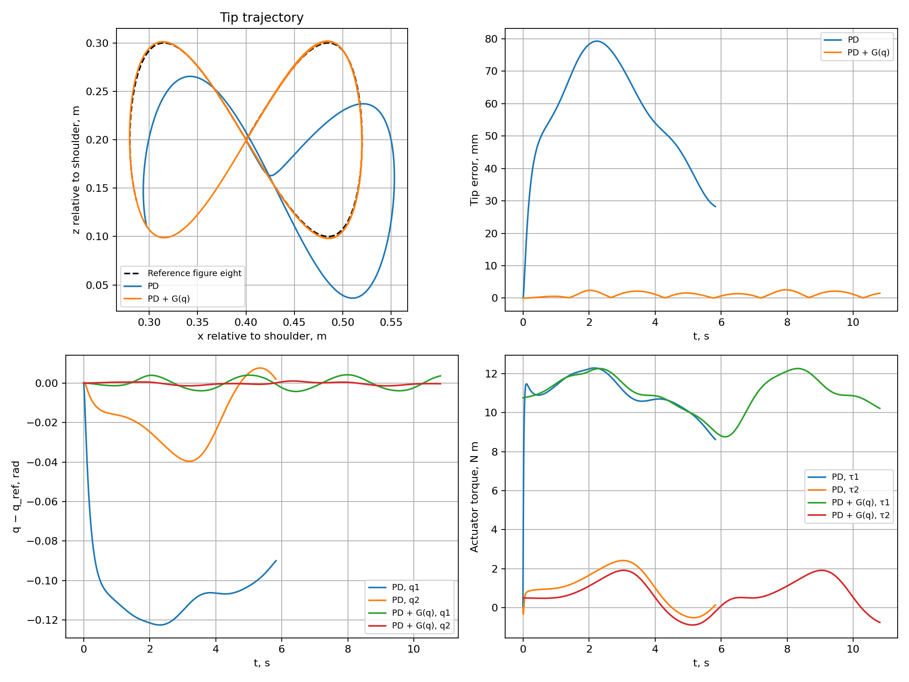

[Русский](lecture_notes.md) | **English**

# Lecture 2. Modeling and Simulating a Two-Link 2R Manipulator

**Interactive HTML presentation:** [open slides](presentation/index.en.html) · [controls and interactive experiments](presentation/README.en.md).

Lecture 1 derived and numerically solved mass–spring–damper dynamics. We now model a robot with two revolute joints, derive its kinematics and dynamics, and test figure-eight tip tracking in MuJoCo.

Sources are the handwritten “ИМРС2025” material, especially pages 5–10, and the [earlier LaTeX notes](../../SRS/lecture_3/lecture_3.pdf), Chapter 3, printed pages 10–14. Equations, XML, and Python share one convention. Dynamics includes both center-of-mass translation and link rotation.

## 1. One system, four different problems

**2R** means two revolute joints. Our open chain consists of a base, two links, and endpoint `tip`. It has two degrees of freedom.

| Problem | Given | Find | Main question |
|---|---|---|---|
| Forward kinematics | Angles $q$ and geometry | Position $p$ and, if needed, orientation | Where is the tip? |
| Inverse kinematics | Desired position $p_d$ and geometry | Suitable angles $q_d$ | How should the joints bend to reach it? |
| Forward dynamics | $q$, $\dot q$, torques $\tau$, physical parameters | Accelerations $\ddot q$ | How will the robot accelerate under the torques? |
| Inverse dynamics | $q$, $\dot q$, required $\ddot q$, physical parameters | Torques $\tau$ | Which torques produce this acceleration? |

Kinematics describes motion geometry without forces. Dynamics relates motion to inertia, gravity, and effort. Inverse kinematics and inverse dynamics solve different problems.

Forward dynamics gives instantaneous acceleration. Motion over time requires initial conditions and integration. Inverse dynamics alone does not correct tracking error; feedback does.

## 2. Coordinates, parameters, and assumptions

The manipulator moves in the **vertical $xz$ plane**. Axis $x$ points right, $z$ upward, and the planar origin is at the shoulder. Gravity acts downward.

- $q_1$ is the first-link angle from positive $x$ toward $+z$.
- $q_2$ is the second-link angle relative to the first.
- The second link's absolute angle is $q_1+q_2$.
- $l_i$ is link length; $r_i$ is proximal-joint-to-CoM distance.
- $m_i$ is link mass; $I_i$ is CoM inertia about the axis normal to the motion plane.
- $\tau_i$ is motor torque, positive toward increasing $q_i$.

MuJoCo joint axes are `axis="0 -1 0"`. By the right-hand rule, positive rotation moves local $+x$ toward $+z$, matching the angle signs.

| Parameter | Value | Units |
|---|---:|---|
| $l_1,l_2$ | 0.4; 0.4 | m |
| $r_1,r_2$ | 0.2; 0.2 | m |
| $m_1,m_2$ | 2; 2 | kg |
| $I_1,I_2$ | $m_i l_i^2/12\approx0.0266667$ | kg·m² |
| $g$ | 9.81 | m/s² |
| $D$ | $\operatorname{diag}(0.05,0.05)$ | N·m·s/rad |
| World shoulder height | 0.3 | m |
| Each torque limit | $\pm35$ | N·m |
| Simulation step | 0.002 | s |

Links are rigid, joints ideal with added viscous resistance. No separate tool mass is included. Contacts and collisions are disabled; the base is fixed. No external load acts on `tip`. Capsules are visual: masses and inertias are specified explicitly.

In Python, `p=(x,z)` is always **relative to the shoulder**. The MuJoCo world tip coordinate is $(x,0,z+0.3)$. Constant base height adds only a potential-energy constant and does not change gravity torques.

## 3. Forward kinematics

Elbow position:

$$p_B=\begin{bmatrix}l_1\cos q_1\\l_1\sin q_1\end{bmatrix}.$$

Second-link tip position:

$$\boxed{p(q)=\begin{bmatrix}
l_1\cos q_1+l_2\cos(q_1+q_2)\\
l_1\sin q_1+l_2\sin(q_1+q_2)
\end{bmatrix}.}$$

At $q_1=q_2=0$ both links point right: $p=(l_1+l_2,0)$. At $q_1=\pi/2$, $q_2=0$ they point upward.

Planar tool orientation, if needed, is $\varphi=q_1+q_2$. We prescribe only two position coordinates. Two joints generally cannot independently prescribe a third quantity, orientation.

Implementation: `forward_kinematics` in [robot_math.py](two_link_robot/robot_math.py).

## 4. Inverse kinematics

For desired point $p_d=(x_d,z_d)$, the cosine rule gives

$$c_2=\frac{x_d^2+z_d^2-l_1^2-l_2^2}{2l_1l_2}.$$

If $|c_2|>1$ the point is unreachable. For $|c_2|\leq1$, choose branch $\sigma\in\{-1,+1\}$:

$$s_2=\sigma\sqrt{1-c_2^2},\qquad q_{2d}=\operatorname{atan2}(s_2,c_2),$$

$$\boxed{q_{1d}=\operatorname{atan2}(z_d,x_d)
-\operatorname{atan2}(l_2s_2,l_1+l_2c_2).}$$

Usually two elbow configurations exist. Preserve a continuous branch during motion: arbitrary switching causes command jumps. Angles are also equivalent modulo $2\pi$; crossing the `atan2` discontinuity requires unwrapping or consistently choosing a nearby configuration.

Geometric reachability without joint limits:

$$|l_1-l_2|\leq\sqrt{x_d^2+z_d^2}\leq l_1+l_2.$$

Branches may merge at boundaries. If $l_1=l_2$ and $p_d=0$, the robot is fully folded and $q_1$ is arbitrary. Our trajectory avoids this point and workspace boundaries.

The code selects $\sigma=+1$. `clip` limits $c_2$ only after reachability checking to remove rounding error, never silently projecting an unreachable target onto the boundary.

## 5. Jacobian and velocities

Differentiating forward kinematics gives

$$\dot p=J(q)\dot q,$$

$$\boxed{J(q)=\begin{bmatrix}
-l_1\sin q_1-l_2\sin(q_1+q_2)&-l_2\sin(q_1+q_2)\\
l_1\cos q_1+l_2\cos(q_1+q_2)&l_2\cos(q_1+q_2)
\end{bmatrix}.}$$

For nonsingular $J(q_d)$, desired joint velocities solve

$$\boxed{J(q_d)\dot q_d=\dot p_d.}$$

Use `np.linalg.solve(J, velocity)` in Python rather than an explicit inverse. Do not substitute $\dot x_d$ and $\dot z_d$ for $\dot q_{1d}$ and $\dot q_{2d}$ in joint PD: these velocities have different spaces and units.

$$\det J=l_1l_2\sin q_2.$$

At $q_2=0$ or $\pi$, the Jacobian is singular. Nearby, small tip velocities may require large joint rates. Change the trajectory or regularize the solve; exact inversion becomes ill-conditioned.

For inverse dynamics, obtain desired accelerations by differentiating the velocity relation again:

$$\ddot p_d=J(q_d)\ddot q_d+\dot J(q_d,\dot q_d)\dot q_d.$$

The current PD example does not use $\ddot q_d$.

## 6. Deriving dynamics through Lagrange's equations

### 6.1. CoM positions and velocities

$$p_{c1}=\begin{bmatrix}r_1\cos q_1\\r_1\sin q_1\end{bmatrix},\qquad
p_{c2}=\begin{bmatrix}l_1\cos q_1+r_2\cos(q_1+q_2)\\l_1\sin q_1+r_2\sin(q_1+q_2)\end{bmatrix}.$$

Squared linear speeds:

$$v_{c1}^2=r_1^2\dot q_1^2,$$

$$v_{c2}^2=l_1^2\dot q_1^2+r_2^2(\dot q_1+\dot q_2)^2
+2l_1r_2\cos q_2\,\dot q_1(\dot q_1+\dot q_2).$$

Link angular speeds in the chosen positive direction are $\dot q_1$ and $\dot q_1+\dot q_2$; energy uses their squares.

### 6.2. Kinetic and potential energies

Rigid-link energy includes CoM translation and rotation about the CoM:

$$T=\frac12m_1v_{c1}^2+\frac12I_1\dot q_1^2
+\frac12m_2v_{c2}^2+\frac12I_2(\dot q_1+\dot q_2)^2.$$

Gravitational potential energy with upward $z$:

$$V=m_1gr_1\sin q_1+m_2g[l_1\sin q_1+r_2\sin(q_1+q_2)].$$

Unlike a mass on a straight guide, $T$ depends on configuration through $\cos q_2$. Relative link arrangement changes system inertia.

Define

$$a=I_1+I_2+m_1r_1^2+m_2(l_1^2+r_2^2),\quad
\beta=m_2l_1r_2,\quad d=I_2+m_2r_2^2.$$

Then

$$T=\frac12(a+2\beta\cos q_2)\dot q_1^2
+(d+\beta\cos q_2)\dot q_1\dot q_2+\frac12d\dot q_2^2.$$

### 6.3. Lagrangian derivatives

Let $L=T-V$. Generalized forces are motor torques and viscous resistance:

$$\frac{d}{dt}\frac{\partial L}{\partial\dot q_i}-\frac{\partial L}{\partial q_i}
=\tau_i-b_i\dot q_i.$$

For the first coordinate:

$$\frac{\partial L}{\partial\dot q_1}=(a+2\beta\cos q_2)\dot q_1+(d+\beta\cos q_2)\dot q_2,$$

$$\frac{d}{dt}\frac{\partial L}{\partial\dot q_1}
=(a+2\beta\cos q_2)\ddot q_1+(d+\beta\cos q_2)\ddot q_2
-\beta\sin q_2(2\dot q_1\dot q_2+\dot q_2^2),$$

$$\frac{\partial L}{\partial q_1}=-G_1(q).$$

For the second coordinate:

$$\frac{\partial L}{\partial\dot q_2}=(d+\beta\cos q_2)\dot q_1+d\dot q_2,$$

$$\frac{d}{dt}\frac{\partial L}{\partial\dot q_2}
=(d+\beta\cos q_2)\ddot q_1+d\ddot q_2-\beta\sin q_2\dot q_1\dot q_2,$$

$$\frac{\partial L}{\partial q_2}=-\beta\sin q_2(\dot q_1^2+\dot q_1\dot q_2)-G_2(q).$$

Subtracting derivatives cancels the mixed term in the second equation, leaving two coupled equations of motion.

### 6.4. Inertia, velocity-product, and gravity terms

$$\boxed{M(q)\ddot q+c(q,\dot q)+G(q)+D\dot q=\tau.}$$

$$M(q)=\begin{bmatrix}
a+2\beta\cos q_2&d+\beta\cos q_2\\
d+\beta\cos q_2&d
\end{bmatrix},$$

$$c(q,\dot q)=\begin{bmatrix}
-\beta\sin q_2(2\dot q_1\dot q_2+\dot q_2^2)\\
\beta\sin q_2\dot q_1^2
\end{bmatrix},$$

$$G(q)=\frac{\partial V}{\partial q}=\begin{bmatrix}
(m_1r_1+m_2l_1)g\cos q_1+m_2gr_2\cos(q_1+q_2)\\
m_2gr_2\cos(q_1+q_2)
\end{bmatrix}.$$

$M$ is symmetric and positive definite for our parameters. Vector $c$ contains Coriolis and centrifugal terms. It is also written $C(q,\dot q)\dot q$; matrix $C$ is not unique. Gravity $G$ is on the **left**, so compensation is $+G(q)$. Its units are N·m, whereas scalar $g$ has m/s² units.

At $q=(0,0)$ gravity terms are positive: motors must lift the horizontal links to hold them. Here $G(0)=(15.696,3.924)^T$ N·m. Without motor torques, initial acceleration follows $M\ddot q=-G$.

**Connection to the earlier LaTeX example.** That energy uses mass translation without separate $I_i\omega_i^2/2$ terms, equivalent to CoM point masses. Here $I_i\ne0$. Coefficient $M_{22}$ must follow from energy: $M_{22}=I_2+m_2r_2^2$. With $I_2=0$ and $r_2=l_2/2$ it equals $m_2l_2^2/4$; the older final matrix's $m_2l_2^2/2$ is inconsistent with that simplification.

### 6.5. Energy balance as a check

For $E=T+V$ along a solution,

$$\dot E=\dot q^T\tau-\dot q^TD\dot q.$$

Mechanical energy is conserved for $\tau=0$, $D=0$ and nonincreasing for $\tau=0$, $D\succeq0$. During tracking, motors do work, so constant energy is not expected. Separate physical balance from integrator error.

## 7. Computing forward and inverse dynamics

**Forward dynamics:** solve a linear system for acceleration:

$$\boxed{M(q)\ddot q=\tau-c(q,\dot q)-G(q)-D\dot q.}$$

Code: `np.linalg.solve(M, tau - c - G - Ddq)`. No explicit $M^{-1}$ is needed.

**Inverse dynamics:** substitute required accelerations into

$$\boxed{\tau=M(q)\ddot q+c(q,\dot q)+G(q)+D\dot q.}$$

Given $q_d(t)$, $\dot q_d(t)$, $\ddot q_d(t)$, this gives nominal trajectory torques. Initial-state or parameter errors make feedforward alone insufficient for exact tracking.

State $y=(q_1,q_2,\dot q_1,\dot q_2)^T$ has dimension four:

$$\dot y=\begin{bmatrix}\dot q\\
M(q)^{-1}[\tau-c(q,\dot q)-G(q)-D\dot q]\end{bmatrix}.$$

Initial state includes angles and rates. Dynamic simulation integrates this system; assigning `qpos=q_ref` every step would be kinematic playback, testing neither the controller nor required torques.

## 8. The figure-eight reference

Specify a curve in tip space:

$$x_d=0.4+0.12\sin\theta(t),\qquad
z_d=0.2+0.10\sin(2\theta(t)).$$

After ramp-up, $\dot\theta=\omega=2\pi/T_p$, $T_p=6$ s. The 1:2 coordinate frequency ratio produces a figure eight. Equal frequencies with a phase shift would usually produce an ellipse.

Reference velocity:

$$\dot x_d=0.12\cos\theta\,\dot\theta,\qquad
\dot z_d=0.20\cos(2\theta)\,\dot\theta.$$

To start from rest, smoothly ramp the phase over the first $T_r=2$ s. For $s=t/T_r\in[0,1]$:

$$\theta=\omega T_r(s^3-\tfrac12s^4),\qquad
\dot\theta=\omega(3s^2-2s^3).$$

For $t\geq T_r$:

$$\theta=\omega(t-T_r/2),\qquad \dot\theta=\omega.$$

Phase, phase rate, and acceleration are continuous at the ramp endpoint. This changes time parameterization, not the geometric curve.

The curve has $x_d\in[0.28,0.52]$ m and $z_d\in[0.10,0.30]$ m. Shoulder distance is at least 0.28 m and at most $\sqrt{0.52^2+0.30^2}<0.8$ m. It is reachable and nonsingular; the IK branch is continuous and avoids the $\pm\pi$ wrap discontinuity.

At every step compute

$$p_d,\dot p_d\ \longrightarrow\ q_d=\mathrm{IK}(p_d)
\ \longrightarrow\ J(q_d)\dot q_d=\dot p_d.$$

Initialize $q(0)=q_d(0)$, $\dot q(0)=0$ once. Thereafter joints move only through commanded torques and MuJoCo dynamics.

## 9. Joint PD control

Errors:

$$e=q_d-q,\qquad \dot e=\dot q_d-\dot q.$$

### 9.1. Plain PD

$$\boxed{\tau_{\mathrm{PD}}=K_pe+K_d\dot e.}$$

Here $K_p=\operatorname{diag}(100,60)$ N·m/rad and $K_d=\operatorname{diag}(20,12)$ N·m·s/rad. Compare positions and rates in joint coordinates.

Proportional action creates restoring torque; derivative action suppresses velocity error. For a stationary target without gravity compensation, equilibrium requires

$$K_p(q_d-q)=G(q).$$

Thus PD needs nonzero error to generate holding torque. Increasing $K_p$ may reduce error but raises actuator and integration-rate demands.

### 9.2. PD with gravity compensation

$$\boxed{\tau_{\mathrm{PD+G}}=K_pe+K_d\dot e+G(q).}$$

Compute compensation at **current** state $q$. For an exact model and a stationary reachable target, $e=0$, $\dot q=0$ is an equilibrium. A moving target still requires inertial, velocity-product, and friction torques; zero error is not guaranteed.

This is PD with model-based gravity compensation, not full feedback linearization. The handwritten material discusses the next step, inverse-dynamics control:

$$v=\ddot q_d+K_d^{a}(\dot q_d-\dot q)+K_p^{a}(q_d-q),$$

$$\tau=M(q)v+c(q,\dot q)+G(q)+D\dot q.$$

With exact model and no limits, this yields $\ddot e+K_d^{a}\dot e+K_p^{a}e=0$. Gains have s⁻¹ and s⁻² units, unlike torque PD. This law is for comparison; the main example uses PD or PD+G.

### 9.3. Torque limits and control spaces

Each motor command is clipped to $[-35,35]$ N·m. Saturation changes the applied torque, invalidating direct use of ideal unsaturated conclusions.

The old LaTeX example also uses Cartesian law $F=K_x(p_d-p)+D_x(\dot p_d-\dot p)$ with $\tau=J(q)^TF$. That is another architecture. Here we solve IK, then use **joint** PD. Never mix Cartesian and joint errors in one law.

## 10. MuJoCo implementation

Files are in [two_link_robot](two_link_robot/README.en.md):

| File | Purpose |
|---|---|
| [robot.xml](two_link_robot/robot.xml) | Nested links, hinges, masses, inertias, motors, gravity |
| [robot_math.py](two_link_robot/robot_math.py) | FK, IK, Jacobian, analytical dynamics, figure eight |
| [simulate.py](two_link_robot/simulate.py) | PD loop, viewer, CSV, figures |
| [verify.py](two_link_robot/verify.py) | Analytical/MuJoCo comparison and tracking checks |

In MJCF, the second `body` is nested inside the first with `pos="0.4 0 0"`, locating the elbow in the first link's frame. Rotating that link moves the elbow too. `q2` is automatically relative to its parent.

Key settings:

```xml
<option timestep="0.002" gravity="0 0 -9.81" integrator="implicitfast"/>
<joint name="shoulder" type="hinge" axis="0 -1 0" damping="0.05"/>
<inertial pos="0.2 0 0" mass="2"
          diaginertia="0.0001 0.02666666666666667 0.02666666666666667"/>
<motor name="shoulder_motor" joint="shoulder" gear="1"
       ctrllimited="true" ctrlrange="-35 35"/>
```

These fragments belong to different XML sections and are not a complete model. A small positive axial inertia, 0.0001 kg·m², completes the spatial tensor; planar dynamics uses transverse inertia 0.0266667 kg·m². Explicit `<inertial>` and `inertiafromgeom="false"` separate physics from visual capsules.

Variable correspondence:

| MuJoCo | This model |
|---|---|
| `data.qpos` | Two angles $q$ |
| `data.qvel` | Two joint rates $\dot q$ |
| `data.ctrl` | Two motor torques with `gear=1` |
| `data.qacc` | Joint accelerations |
| `data.site_xpos[tip]` | World tip position |

`mj_forward` refreshes derived fields without advancing time; `mj_step` advances simulation. These and `mj_inverse` are documented in the [API reference](https://mujoco.readthedocs.io/en/stable/APIreference/APIfunctions.html#main-simulation). Log current target and position after refreshing fields, then step, avoiding comparisons between different times.

MuJoCo `qfrc_bias` includes **both gravity and velocity-product terms**. A separate analytical `gravity(q)` isolates gravity compensation from plain PD. See [General framework](https://mujoco.readthedocs.io/en/stable/computation/#general-framework).

Control updates once per step, with torque held throughout. `implicitfast` differs from full-state backward Euler; see [Numerical integration](https://mujoco.readthedocs.io/en/stable/computation/#numerical-integration).

## 11. Running and results

From the repository root using Python 3.10 or later:

```bash
python -m pip install -r SRS_2026/lecture_2_2R_robot/two_link_robot/requirements.txt

# Two independent experiments without a viewer.
python SRS_2026/lecture_2_2R_robot/two_link_robot/simulate.py

# One experiment with an interactive viewer.
python SRS_2026/lecture_2_2R_robot/two_link_robot/simulate.py --controller pd-gravity --viewer

# Plain PD, same target and physical parameters.
python SRS_2026/lecture_2_2R_robot/two_link_robot/simulate.py --controller pd --viewer

# Verify analytical mechanics and tracking.
python SRS_2026/lecture_2_2R_robot/two_link_robot/verify.py
```

IDE Run and module execution such as `python -m SRS_2026.lecture_2_2R_robot.two_link_robot.simulate` are supported. XML loads relative to the script, not the working directory. Headless calculations need neither display nor OpenGL; `--viewer` needs a graphical session. Use built-in `mujoco.viewer`; package `mujoco_viewer` is unnecessary.

Default duration is 14 s including a two-second ramp. Outputs in `two_link_robot/results/` are `pd.csv`, `pd-gravity.csv`, and `tracking.png`. CSV rows describe states **before** each step: times 0–13.998 s by default. Duration rounds upward to a whole number of steps. Repeated runs overwrite matching filenames.

Measure position error $\varepsilon_n=\|p(q_n)-p_d(t_n)\|_2$ and

$$\mathrm{RMS}=\sqrt{\frac1N\sum_{n=0}^{N-1}\varepsilon_n^2},\qquad
\varepsilon_{\max}=\max_n\varepsilon_n.$$

Verified MuJoCo 3.10.0 results with the listed parameters and 0.002 s step:

| Controller | RMS tip error | Maximum error | Saturated steps |
|---|---:|---:|---:|
| PD | 56.526 mm | 79.255 mm | 0% |
| PD + $G(q)$ | 1.337 mm | 2.564 mm | 0% |



These results describe this model and trajectory, not a guarantee for arbitrary robots. Gravity compensation greatly reduces but does not eliminate error. Figures show trajectories, tip error, joint errors, and motor torques.

`verify.py` compares FK, Jacobian, inertia matrix, $c+G$, forward accelerations, and inverse torques against MuJoCo at 30 states. It also checks both IK branches, velocity conversion, and figure-eight reachability. Reference dynamics discrepancies were below $10^{-9}$ in the relevant SI units.

## 12. Exercises

1. For $q=(0,\pi/2)$, compute tip/CoM positions and $G(q)$; verify in `robot_math.py`.
2. Find both IK branches for one point. Explain why equal tip position does not imply equal configuration.
3. Reduce $K_p$ or $K_d$ and compare figure-eight shape, errors, and torques. Distinguish lag from geometric distortion.
4. Reduce the period with `--period 3`. Inspect error and saturation. Why is gravity compensation insufficient for fast motion?
5. Run `--kp 200 120 --kd 28 17` and compare accuracy/torques with default settings. Higher gains do not universally improve performance.
6. Change XML mass or inertia while retaining the old controller model. Explore parameter sensitivity, then update both consistently and verify again.
7. Implement $\ddot q_d$ and the inverse-dynamics law in Section 9.2; compare with PD+G.
8. Move the trajectory toward full extension. Monitor $\det J$, reference rates, and torques. Do not hide unreachable targets with unconditional `clip`.
9. Compare 0.002 and 0.001 s by changing XML `timestep`. Separate discretization and control-law errors. Tracking checks in `verify.py` assume reference parameters.

## 13. References and documentation

**Kevin M. Lynch, Frank C. Park. _Modern Robotics: Mechanics, Planning, and Control_. Cambridge University Press, 2017.** [Book website and materials](https://modernrobotics.northwestern.edu/). Official chapter explanations:

| Topic | Book section |
|---|---|
| Forward kinematics | Chapter 4; [§4.1, Product of Exponentials](https://modernrobotics.northwestern.edu/nu-gm-book-resource/4-1-1-product-of-exponentials-formula-in-the-space-frame/) |
| Inverse kinematics, including geometric 2R | Chapter 6, §6.1; [Inverse Kinematics of Open Chains](https://modernrobotics.northwestern.edu/nu-gm-book-resource/inverse-kinematics-of-open-chains/) |
| Velocities and Jacobians | Chapter 5, [Velocity Kinematics and Statics](https://modernrobotics.northwestern.edu/nu-gm-book-resource/velocity-kinematics-and-statics/) |
| Energy-based dynamics | Chapter 8, [§8.1, Lagrangian Formulation](https://modernrobotics.northwestern.edu/nu-gm-book-resource/chapter-8-1-lagrangian-formulation-of-dynamics-part-1-of-2/) |
| Inverse dynamics | [§8.3, Newton–Euler Inverse Dynamics](https://modernrobotics.northwestern.edu/nu-gm-book-resource/8-3-newton-euler-inverse-dynamics/) |
| Forward dynamics and simulation | [§8.5, Forward Dynamics of Open Chains](https://modernrobotics.northwestern.edu/nu-gm-book-resource/8-5-forward-dynamics-of-open-chains/) |
| PD and torque control | Chapter 11, [§11.4, Motion Control with Torque or Force Inputs](https://modernrobotics.northwestern.edu/nu-gm-book-resource/11-4-motion-control-with-torque-or-force-inputs-part-1-of-3/) |

**Official MuJoCo documentation:**

- [MJCF: XML Reference](https://mujoco.readthedocs.io/en/stable/XMLreference.html) describes `body`, `joint`, `inertial`, `site`, `motor`, and simulation settings.
- [Python bindings](https://mujoco.readthedocs.io/en/stable/python.html) and [Passive viewer](https://mujoco.readthedocs.io/en/stable/python.html#passive-viewer): model loading, data, viewer.
- [API: Main simulation](https://mujoco.readthedocs.io/en/stable/APIreference/APIfunctions.html#main-simulation) — `mj_forward`, `mj_inverse`, `mj_step`.
- [Computation: General framework](https://mujoco.readthedocs.io/en/stable/computation/#general-framework): dynamics and force conventions.
- [Computation: Numerical integration](https://mujoco.readthedocs.io/en/stable/computation/#numerical-integration): implemented integrators.

`stable` links track documentation updates. This code was verified with MuJoCo 3.10.0; check API and settings when using another version.

