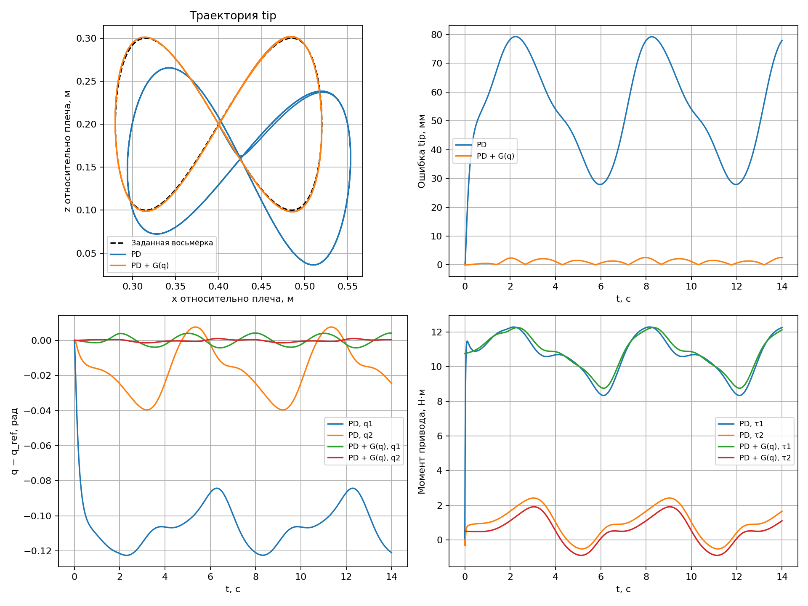

# Лекция 2. Моделирование и имитация двухзвенного 2R-манипулятора

**Интерактивная HTML-презентация:** [открыть слайды](presentation/index.html) · [управление и интерактивные эксперименты](presentation/README.md).

В первой лекции мы получили и численно решили уравнение движения массы, пружины и демпфера. Теперь построим модель робота с двумя вращательными суставами, выведем его кинематику и динамику и проверим следование конца второго звена по восьмёрке в MuJoCo.

Основа лекции — рукописные материалы «ИМРС2025», особенно страницы 5–10, и [предыдущий конспект в LaTeX](../../SRS/lecture_3/lecture_3.pdf), глава 3, страницы с печатной нумерацией 10–14. Обозначения ниже едины для формул, XML-модели и Python-кода. Для динамики учитываем не только поступательную энергию центров масс, но и вращательную энергию звеньев.

## 1. Одна система и четыре разные задачи

**2R** означает два вращательных сустава (*revolute*). Рассматриваем открытую кинематическую цепь: основание, первое звено, второе звено и конечную точку `tip`. Подвижность равна двум.

| Задача | Дано | Найти | Основной вопрос |
|---|---|---|---|
| Прямая кинематика | Углы $q$ и геометрия | Положение $p$ и, при необходимости, ориентацию | Где находится конец робота? |
| Обратная кинематика | Желаемое положение $p_d$ и геометрия | Подходящие углы $q_d$ | Как согнуть суставы, чтобы попасть в точку? |
| Прямая динамика | $q$, $\dot q$, моменты $\tau$ и физические параметры | Ускорения $\ddot q$ | Как робот начнёт двигаться под действием моментов? |
| Обратная динамика | $q$, $\dot q$, требуемые $\ddot q$ и физические параметры | Моменты $\tau$ | Какие моменты нужны для такого ускорения? |

Кинематика описывает геометрию движения без расчёта сил. Динамика связывает движение с инерцией, тяжестью и усилиями. «Обратная кинематика» и «обратная динамика» решают разные задачи.

Прямая динамика даёт ускорение в текущем состоянии. Чтобы получить движение на интервале времени, нужны начальные условия и интегрирование. Обратная динамика сама по себе не исправляет ошибки слежения: для этого нужна обратная связь.

## 2. Координаты, параметры и допущения

Манипулятор движется в **вертикальной плоскости $xz$**. Ось $x$ направлена вправо, $z$ — вверх. Начало плоских координат находится в плечевом суставе. Гравитация направлена вниз.

- $q_1$ — угол первого звена от положительного направления $x$ в сторону $+z$.
- $q_2$ — относительный угол второго звена относительно первого.
- Абсолютный угол второго звена равен $q_1+q_2$.
- $l_i$ — длина звена, $r_i$ — расстояние от его проксимального сустава до центра масс.
- $m_i$ — масса звена, $I_i$ — момент инерции относительно центра масс вокруг оси поперёк плоскости движения.
- $\tau_i$ — момент двигателя, положительный в сторону увеличения $q_i$.

В модели MuJoCo оси суставов заданы как `axis="0 -1 0"`: по правилу правой руки такое вращение переводит локальную ось $+x$ в сторону $+z$. Это согласует знак углов с формулами.

| Параметр | Значение | Единицы |
|---|---:|---|
| $l_1,l_2$ | 0.4; 0.4 | м |
| $r_1,r_2$ | 0.2; 0.2 | м |
| $m_1,m_2$ | 2; 2 | кг |
| $I_1,I_2$ | $m_i l_i^2/12\approx0.0266667$ | кг·м² |
| $g$ | 9.81 | м/с² |
| $D$ | $\operatorname{diag}(0.05,0.05)$ | Н·м·с/рад |
| Высота плеча в мировых координатах | 0.3 | м |
| Предел каждого момента | $\pm35$ | Н·м |
| Шаг симуляции | 0.002 | с |

Звенья жёсткие, суставы идеальные с добавленным вязким сопротивлением. Масса инструмента отдельно не добавляется. Контакты и столкновения отключены, основание неподвижно. Внешней нагрузки на `tip` нет. Геометрия капсул служит для визуализации: массы и инерции заданы отдельно и явно.

В Python `p=(x,z)` всегда выражено **относительно плеча**. Мировая координата конца робота в MuJoCo равна $(x,0,z+0.3)$. Постоянная высота основания добавляет константу в потенциальную энергию и не меняет гравитационные моменты.

## 3. Прямая кинематика

Положение локтя:

$$p_B=\begin{bmatrix}l_1\cos q_1\\l_1\sin q_1\end{bmatrix}.$$

Положение конца второго звена:

$$\boxed{p(q)=\begin{bmatrix}
l_1\cos q_1+l_2\cos(q_1+q_2)\\
l_1\sin q_1+l_2\sin(q_1+q_2)
\end{bmatrix}.}$$

При $q_1=q_2=0$ оба звена направлены вправо: $p=(l_1+l_2,0)$. При $q_1=\pi/2$, $q_2=0$ они направлены вверх.

Если нужна ориентация инструмента в плоскости, она равна $\varphi=q_1+q_2$. В этой лекции задаём только две координаты точки. Два сустава в общем случае не позволяют независимо задать ещё и третью величину — ориентацию.

Реализация: `forward_kinematics` в [robot_math.py](two_link_robot/robot_math.py).

## 4. Обратная кинематика

Пусть задана точка $p_d=(x_d,z_d)$. Из теоремы косинусов:

$$c_2=\frac{x_d^2+z_d^2-l_1^2-l_2^2}{2l_1l_2}.$$

При $|c_2|>1$ точка недостижима. Если $|c_2|\leq1$, выбираем ветвь $\sigma\in\{-1,+1\}$:

$$s_2=\sigma\sqrt{1-c_2^2},\qquad q_{2d}=\operatorname{atan2}(s_2,c_2),$$

$$\boxed{q_{1d}=\operatorname{atan2}(z_d,x_d)
-\operatorname{atan2}(l_2s_2,l_1+l_2c_2).}$$

Обычно существуют две конфигурации локтя. Во время движения нужно сохранять одну непрерывную ветвь: случайное переключение между ними создаст скачок задания. Углы также эквивалентны с точностью до $2\pi$; при пересечении разрыва `atan2` требуется развёртка углов или согласованный выбор ближайшей конфигурации.

Геометрическая область достижимости без ограничений суставов:

$$|l_1-l_2|\leq\sqrt{x_d^2+z_d^2}\leq l_1+l_2.$$

На границах ветви могут сливаться. Особый случай: при $l_1=l_2$ и $p_d=0$ робот полностью сложен, а $q_1$ произволен. В нашем примере траектория не проходит через эту точку или границы рабочего пространства.

В коде выбрана ветвь $\sigma=+1$. `clip` ограничивает $c_2$ только после проверки достижимости, чтобы убрать погрешность округления. Он не используется для молчаливого переноса недостижимой цели на границу.

## 5. Якобиан и скорости

Дифференцируя прямую кинематику, получаем

$$\dot p=J(q)\dot q,$$

$$\boxed{J(q)=\begin{bmatrix}
-l_1\sin q_1-l_2\sin(q_1+q_2)&-l_2\sin(q_1+q_2)\\
l_1\cos q_1+l_2\cos(q_1+q_2)&l_2\cos(q_1+q_2)
\end{bmatrix}.}$$

При невырожденном $J(q_d)$ целевые суставные скорости определяются из линейной системы

$$\boxed{J(q_d)\dot q_d=\dot p_d.}$$

В Python используем `np.linalg.solve(J, velocity)`, не формируем обратную матрицу. Нельзя подставлять $\dot x_d$ и $\dot z_d$ вместо $\dot q_{1d}$ и $\dot q_{2d}$ в суставной PD: это скорости в разных пространствах и с разными единицами.

$$\det J=l_1l_2\sin q_2.$$

При $q_2=0$ или $\pi$ возникает сингулярность. Вблизи неё для небольшой скорости конца могут понадобиться большие скорости суставов. Тогда меняют траекторию или используют регуляризованное решение; точное обращение становится плохо обусловленным.

Если для обратной динамики нужны заданные ускорения, дополнительно дифференцируют связь скоростей:

$$\ddot p_d=J(q_d)\ddot q_d+\dot J(q_d,\dot q_d)\dot q_d.$$

В текущем PD-примере $\ddot q_d$ не используется.

## 6. Вывод динамики через уравнения Лагранжа

### 6.1. Положения и скорости центров масс

$$p_{c1}=\begin{bmatrix}r_1\cos q_1\\r_1\sin q_1\end{bmatrix},\qquad
p_{c2}=\begin{bmatrix}l_1\cos q_1+r_2\cos(q_1+q_2)\\l_1\sin q_1+r_2\sin(q_1+q_2)\end{bmatrix}.$$

Квадраты линейных скоростей:

$$v_{c1}^2=r_1^2\dot q_1^2,$$

$$v_{c2}^2=l_1^2\dot q_1^2+r_2^2(\dot q_1+\dot q_2)^2
+2l_1r_2\cos q_2\,\dot q_1(\dot q_1+\dot q_2).$$

Скалярные угловые скорости звеньев в принятом положительном направлении равны $\dot q_1$ и $\dot q_1+\dot q_2$; в энергии используются их квадраты.

### 6.2. Кинетическая и потенциальная энергии

Для жёстких звеньев учитываем и перенос центра масс, и вращение вокруг него:

$$T=\frac12m_1v_{c1}^2+\frac12I_1\dot q_1^2
+\frac12m_2v_{c2}^2+\frac12I_2(\dot q_1+\dot q_2)^2.$$

Гравитационная потенциальная энергия при $z$ вверх:

$$V=m_1gr_1\sin q_1+m_2g[l_1\sin q_1+r_2\sin(q_1+q_2)].$$

В отличие от массы на прямолинейной направляющей, здесь $T$ зависит и от конфигурации: в ней есть $\cos q_2$. Взаимное расположение звеньев меняет инерционные свойства всей системы.

Введём сокращения

$$a=I_1+I_2+m_1r_1^2+m_2(l_1^2+r_2^2),\quad
\beta=m_2l_1r_2,\quad d=I_2+m_2r_2^2.$$

Тогда

$$T=\frac12(a+2\beta\cos q_2)\dot q_1^2
+(d+\beta\cos q_2)\dot q_1\dot q_2+\frac12d\dot q_2^2.$$

### 6.3. Производные лагранжиана

Пусть $L=T-V$. Обобщённые силы — моменты двигателей и вязкое сопротивление:

$$\frac{d}{dt}\frac{\partial L}{\partial\dot q_i}-\frac{\partial L}{\partial q_i}
=\tau_i-b_i\dot q_i.$$

Для первой координаты:

$$\frac{\partial L}{\partial\dot q_1}=(a+2\beta\cos q_2)\dot q_1+(d+\beta\cos q_2)\dot q_2,$$

$$\frac{d}{dt}\frac{\partial L}{\partial\dot q_1}
=(a+2\beta\cos q_2)\ddot q_1+(d+\beta\cos q_2)\ddot q_2
-\beta\sin q_2(2\dot q_1\dot q_2+\dot q_2^2),$$

$$\frac{\partial L}{\partial q_1}=-G_1(q).$$

Для второй координаты:

$$\frac{\partial L}{\partial\dot q_2}=(d+\beta\cos q_2)\dot q_1+d\dot q_2,$$

$$\frac{d}{dt}\frac{\partial L}{\partial\dot q_2}
=(d+\beta\cos q_2)\ddot q_1+d\ddot q_2-\beta\sin q_2\dot q_1\dot q_2,$$

$$\frac{\partial L}{\partial q_2}=-\beta\sin q_2(\dot q_1^2+\dot q_1\dot q_2)-G_2(q).$$

После вычитания производных смешанное слагаемое во втором уравнении сокращается. Получаем два связанных уравнения движения.

### 6.4. Матрица инерции, скоростные и гравитационные слагаемые

$$\boxed{M(q)\ddot q+c(q,\dot q)+G(q)+D\dot q=\tau.}$$

$$M(q)=\begin{bmatrix}
a+2\beta\cos q_2&d+\beta\cos q_2\\
d+\beta\cos q_2&d
\end{bmatrix},$$

$$c(q,\dot q)=\begin{bmatrix}
-\beta\sin q_2(2\dot q_1\dot q_2+\dot q_2^2)\\
\beta\sin q_2\dot q_1^2
\end{bmatrix},$$

$$G(q)=\frac{\partial V}{\partial q}=\begin{bmatrix}
(m_1r_1+m_2l_1)g\cos q_1+m_2gr_2\cos(q_1+q_2)\\
m_2gr_2\cos(q_1+q_2)
\end{bmatrix}.$$

$M$ симметрична и для наших параметров положительно определена. Вектор $c$ содержит кориолисовы и центробежные слагаемые. Его также записывают как $C(q,\dot q)\dot q$; сама матрица $C$ не единственна. $G$ — гравитационные слагаемые в **левой части** уравнения, поэтому момент компенсации равен $+G(q)$. Это вектор моментов в Н·м, а $g$ — скалярное ускорение в м/с².

При $q=(0,0)$ гравитационные моменты положительны: чтобы удерживать горизонтальные звенья, приводы должны поднимать их. Для наших параметров $G(0)=(15.696,3.924)^T$ Н·м. При отсутствии приводных моментов начальное ускорение определяется $M\ddot q=-G$.

**Связь со старым LaTeX-примером.** Там энергия записана через линейные скорости масс без отдельных членов $I_i\omega_i^2/2$. Это соответствует упрощению до точечных масс в центрах звеньев. В данной модели $I_i\ne0$. Коэффициент $M_{22}$ всегда должен следовать из энергии: $M_{22}=I_2+m_2r_2^2$. При $I_2=0$, $r_2=l_2/2$ он равен $m_2l_2^2/4$; коэффициент $m_2l_2^2/2$ в итоговой матрице старого текста с таким упрощением не согласован.

### 6.5. Баланс энергии как проверка

Для $E=T+V$ вдоль решения

$$\dot E=\dot q^T\tau-\dot q^TD\dot q.$$

При $\tau=0$, $D=0$ механическая энергия сохраняется. При $\tau=0$, $D\succeq0$ она не возрастает. В режиме слежения двигатели совершают работу, поэтому постоянства энергии ожидать не нужно. Проверку физического баланса отделяют от ошибки численного интегратора.

## 7. Прямая и обратная динамика в вычислениях

**Прямая динамика:** решаем линейную систему относительно ускорений:

$$\boxed{M(q)\ddot q=\tau-c(q,\dot q)-G(q)-D\dot q.}$$

В коде: `np.linalg.solve(M, tau - c - G - Ddq)`. Умножать на явно вычисленную $M^{-1}$ не требуется.

**Обратная динамика:** подставляем требуемые ускорения в

$$\boxed{\tau=M(q)\ddot q+c(q,\dot q)+G(q)+D\dot q.}$$

Если заданы $q_d(t)$, $\dot q_d(t)$, $\ddot q_d(t)$, эта формула даёт номинальный момент вдоль траектории. При ошибках начальных условий или параметров одного такого воздействия недостаточно для точного слежения.

Состояние системы $y=(q_1,q_2,\dot q_1,\dot q_2)^T$ имеет размерность 4:

$$\dot y=\begin{bmatrix}\dot q\\
M(q)^{-1}[\tau-c(q,\dot q)-G(q)-D\dot q]\end{bmatrix}.$$

Начальное состояние содержит и углы, и скорости. Динамическая симуляция интегрирует эту систему; мгновенная установка `qpos=q_ref` на каждом шаге была бы кинематическим воспроизведением и не проверяла бы регулятор или требуемые моменты.

## 8. Заданная траектория — восьмёрка

Зададим кривую в пространстве конца робота:

$$x_d=0.4+0.12\sin\theta(t),\qquad
z_d=0.2+0.10\sin(2\theta(t)).$$

После разгона $\dot\theta=\omega=2\pi/T_p$, $T_p=6$ с. Две координаты имеют частоты в отношении 1:2, поэтому получается восьмёрка. Задание обеих координат на одной частоте с фазовым сдвигом обычно дало бы эллипс.

Скорость цели:

$$\dot x_d=0.12\cos\theta\,\dot\theta,\qquad
\dot z_d=0.20\cos(2\theta)\,\dot\theta.$$

Чтобы начать из покоя, в первые $T_r=2$ с плавно разгоняем фазу. Для $s=t/T_r\in[0,1]$:

$$\theta=\omega T_r(s^3-\tfrac12s^4),\qquad
\dot\theta=\omega(3s^2-2s^3).$$

При $t\geq T_r$:

$$\theta=\omega(t-T_r/2),\qquad \dot\theta=\omega.$$

Фаза, её скорость и ускорение непрерывны в момент окончания разгона. Это временная параметризация той же геометрической кривой.

Для всей кривой $x_d\in[0.28,0.52]$ м, $z_d\in[0.10,0.30]$ м. Поэтому расстояние до плеча не меньше 0.28 м и не больше $\sqrt{0.52^2+0.30^2}<0.8$ м. Траектория достижима и не проходит через сингулярности. Выбранная ветвь IK непрерывна и не пересекает разрыв углов $\pm\pi$.

На каждом шаге вычисляем

$$p_d,\dot p_d\ \longrightarrow\ q_d=\mathrm{IK}(p_d)
\ \longrightarrow\ J(q_d)\dot q_d=\dot p_d.$$

В начальный момент один раз устанавливаем $q(0)=q_d(0)$, $\dot q(0)=0$. Далее суставы перемещаются только под действием рассчитанных моментов и динамики MuJoCo.

## 9. Суставной PD-регулятор

Ошибки:

$$e=q_d-q,\qquad \dot e=\dot q_d-\dot q.$$

### 9.1. Обычный PD

$$\boxed{\tau_{\mathrm{PD}}=K_pe+K_d\dot e.}$$

В примере $K_p=\operatorname{diag}(100,60)$ Н·м/рад и $K_d=\operatorname{diag}(20,12)$ Н·м·с/рад. Положения и скорости сравниваются в суставных координатах.

Пропорциональная часть создаёт возвращающий момент, производная подавляет ошибку скорости. Для неподвижной цели без компенсации тяжести условие равновесия:

$$K_p(q_d-q)=G(q).$$

Поэтому ненулевой ошибкой PD создаёт момент удержания. Большой $K_p$ может уменьшить ошибку, но повышает требования к приводу и шагу интегрирования.

### 9.2. PD с компенсацией тяжести

$$\boxed{\tau_{\mathrm{PD+G}}=K_pe+K_d\dot e+G(q).}$$

Компенсация вычисляется по **текущему** состоянию $q$. При точной модели для неподвижной достижимой цели точка $e=0$, $\dot q=0$ является равновесием. Для движущейся цели остаются инерция, скоростные силы и вязкое сопротивление, поэтому идеального нулевого отклонения этот закон не гарантирует.

Это PD с модельной компенсацией тяжести, а не полная линеаризация обратной связью. В рукописных материалах обсуждается следующий шаг — управление по обратной динамике:

$$v=\ddot q_d+K_d^{a}(\dot q_d-\dot q)+K_p^{a}(q_d-q),$$

$$\tau=M(q)v+c(q,\dot q)+G(q)+D\dot q.$$

При точной модели и отсутствии ограничений оно даёт $\ddot e+K_d^{a}\dot e+K_p^{a}e=0$. Здесь коэффициенты имеют единицы с⁻¹ и с⁻², в отличие от моментного PD выше. Этот закон приведён для сравнения, в основном примере используется PD или PD+G.

### 9.3. Ограничения момента и пространства управления

Перед подачей на мотор каждый момент ограничивается интервалом $[-35,35]$ Н·м. При насыщении фактический момент отличается от рассчитанного; выводы для идеального ненасыщенного регулятора уже не применяются напрямую.

В старом LaTeX-примере также есть декартов закон вида $F=K_x(p_d-p)+D_x(\dot p_d-\dot p)$ с преобразованием $\tau=J(q)^TF$. Это другой способ управления. В данной реализации сначала решаем IK и затем используем **суставной** PD. Смешивать декартовы и суставные ошибки в одной формуле нельзя.

## 10. Как модель устроена в MuJoCo

Файлы находятся в [two_link_robot](two_link_robot/README.md):

| Файл | Назначение |
|---|---|
| [robot.xml](two_link_robot/robot.xml) | Два вложенных тела, два шарнира, массы, инерции, моторы и гравитация |
| [robot_math.py](two_link_robot/robot_math.py) | FK, IK, якобиан, аналитическая динамика, восьмёрка |
| [simulate.py](two_link_robot/simulate.py) | Цикл PD-управления, просмотр, CSV и графики |
| [verify.py](two_link_robot/verify.py) | Сопоставление аналитических формул с MuJoCo и проверка слежения |

В MJCF второй `body` вложен в первый с `pos="0.4 0 0"`. Это положение локтя в системе первого звена; при вращении первого звена перемещается и локоть. `q2` автоматически задаётся относительно родительского тела.

Ключевые настройки:

```xml
<option timestep="0.002" gravity="0 0 -9.81" integrator="implicitfast"/>
<joint name="shoulder" type="hinge" axis="0 -1 0" damping="0.05"/>
<inertial pos="0.2 0 0" mass="2"
          diaginertia="0.0001 0.02666666666666667 0.02666666666666667"/>
<motor name="shoulder_motor" joint="shoulder" gear="1"
       ctrllimited="true" ctrlrange="-35 35"/>
```

Это фрагменты разных разделов XML, не самостоятельная полная модель. Малый положительный осевой момент инерции 0.0001 кг·м² нужен для пространственного тензора; в данной плоской динамике участвует поперечный момент 0.0266667 кг·м². Явный `<inertial>` и `inertiafromgeom="false"` отделяют физические параметры от визуальных капсул.

Практическое соответствие величин:

| MuJoCo | В этой модели |
|---|---|
| `data.qpos` | Два угла $q$ |
| `data.qvel` | Две угловые скорости $\dot q$ |
| `data.ctrl` | Два момента моторов при `gear=1` |
| `data.qacc` | Угловые ускорения |
| `data.site_xpos[tip]` | Мировое положение конечной точки |

`mj_forward` обновляет производные поля для текущего состояния без шага времени; `mj_step` продвигает симуляцию. Эти функции и `mj_inverse` описаны в [справочнике API](https://mujoco.readthedocs.io/en/stable/APIreference/APIfunctions.html#main-simulation). В цикле логируем текущую цель и текущее положение после обновления полей, затем выполняем шаг — это исключает сравнение состояний из разных моментов времени.

В MuJoCo `qfrc_bias` включает **и гравитационные, и скоростные** слагаемые. Для сравнения чистого PD с компенсацией только тяжести в коде используется отдельная аналитическая функция `gravity(q)`. Соответствие полей уравнениям объясняется в [General framework](https://mujoco.readthedocs.io/en/stable/computation/#general-framework).

Управление рассчитывается раз в шаг, момент удерживается в течение шага. `implicitfast` не равен полному обратному Эйлеру по всему состоянию; описание схемы находится в [Numerical integration](https://mujoco.readthedocs.io/en/stable/computation/#numerical-integration).

## 11. Запуск и результаты

Из корня репозитория, в окружении с Python 3.10 или новее:

```bash
python -m pip install -r SRS_2026/lecture_2_2R_robot/two_link_robot/requirements.txt

# Два независимых эксперимента, без окна симуляции.
python SRS_2026/lecture_2_2R_robot/two_link_robot/simulate.py

# Один эксперимент с интерактивным окном.
python SRS_2026/lecture_2_2R_robot/two_link_robot/simulate.py --controller pd-gravity --viewer

# Обычный PD, та же цель и те же физические параметры.
python SRS_2026/lecture_2_2R_robot/two_link_robot/simulate.py --controller pd --viewer

# Проверка аналитической модели и слежения.
python SRS_2026/lecture_2_2R_robot/two_link_robot/verify.py
```

Поддерживается запуск файлов через Run в IDE и запуск модулем, например `python -m SRS_2026.lecture_2_2R_robot.two_link_robot.simulate`. Модель XML загружается относительно файла скрипта, а не текущего рабочего каталога. Для расчёта без окна дисплей и OpenGL не требуются; для `--viewer` нужен графический сеанс. Используется штатный `mujoco.viewer`, пакет `mujoco_viewer` не нужен.

По умолчанию симуляция длится 14 с, включая двухсекундный разгон. Результаты сохраняются в `two_link_robot/results/`: `pd.csv`, `pd-gravity.csv`, `tracking.png`. Строки CSV соответствуют состояниям **до** каждого шага: для стандартного запуска времена лежат от 0 до 13.998 с. Общая длина расчёта округляется вверх до целого числа шагов. Повторный запуск перезаписывает одноимённые файлы.

Оцениваем позиционную ошибку $\varepsilon_n=\|p(q_n)-p_d(t_n)\|_2$ и

$$\mathrm{RMS}=\sqrt{\frac1N\sum_{n=0}^{N-1}\varepsilon_n^2},\qquad
\varepsilon_{\max}=\max_n\varepsilon_n.$$

Результат проверенного запуска с MuJoCo 3.10.0, указанными параметрами и шагом 0.002 с:

| Регулятор | RMS ошибки конца | Максимальная ошибка | Доля шагов с насыщением |
|---|---:|---:|---:|
| PD | 56.526 мм | 79.255 мм | 0% |
| PD + $G(q)$ | 1.337 мм | 2.564 мм | 0% |



Эти числа относятся к конкретной модели и траектории, а не гарантируют такую точность для любого робота. В эталонном примере компенсация тяжести существенно уменьшает ошибку, но не устраняет её полностью. В графиках показаны траектория, ошибка конца, ошибки углов и моменты приводов.

`verify.py` проверяет не только красивую картинку: сопоставляет FK и якобиан с MuJoCo, матрицу инерции, $c+G$, ускорения прямой динамики и моменты обратной динамики в 30 состояниях. Также проверяет обе ветви IK, преобразование скоростей и достижимость восьмёрки. На эталонном запуске максимальные расхождения динамических величин были меньше $10^{-9}$ в соответствующих единицах СИ.

## 12. Практические задания

1. Для $q=(0,\pi/2)$ вычислите положение конца, центры масс и $G(q)$. Проверьте результат в `robot_math.py`.
2. Получите обе ветви IK одной точки. Объясните, почему одинаковое положение конца не означает одинаковую конфигурацию робота.
3. Уменьшите $K_p$ или $K_d$ и сравните форму восьмёрки, ошибки и моменты. Отличите отставание по времени от геометрического искажения.
4. Уменьшите период: `--period 3`. Проверьте, как изменяются ошибки и насыщение. Почему компенсации тяжести недостаточно для быстрых движений?
5. Запустите `--kp 200 120 --kd 28 17`. Сравните точность и моменты с исходным вариантом. Повышение коэффициентов не является универсальной гарантией улучшения.
6. Измените массу или инерцию в XML, сохранив старую модель в регуляторе. Исследуйте чувствительность компенсации к ошибкам параметров. Затем согласованно обновите оба описания и повторите проверку.
7. Реализуйте вычисление $\ddot q_d$ и закон управления по обратной динамике из раздела 9.2. Сравните его с PD+G.
8. Приблизьте траекторию к полному разгибанию. Проследите за $\det J$, целевыми скоростями и моментами. Не заменяйте ошибку достижимости безусловным `clip`.
9. Сравните шаги 0.002 и 0.001 с, меняя `timestep` в XML. Отделите ошибку дискретизации от ошибки закона управления. Проверка `verify.py` на слежение настроена на эталонные параметры.

## 13. Литература и документация

**Kevin M. Lynch, Frank C. Park. _Modern Robotics: Mechanics, Planning, and Control_. Cambridge University Press, 2017.** [Сайт книги и материалы](https://modernrobotics.northwestern.edu/). Ссылки ниже ведут на официальные пояснения к соответствующим разделам:

| Тема лекции | Раздел книги и ссылка |
|---|---|
| Прямая кинематика | Глава 4; [§ 4.1, формула произведения экспонент](https://modernrobotics.northwestern.edu/nu-gm-book-resource/4-1-1-product-of-exponentials-formula-in-the-space-frame/) |
| Обратная кинематика, включая геометрический пример 2R | Глава 6, § 6.1; [Inverse Kinematics of Open Chains](https://modernrobotics.northwestern.edu/nu-gm-book-resource/inverse-kinematics-of-open-chains/) |
| Скорости и якобианы | Глава 5, [Velocity Kinematics and Statics](https://modernrobotics.northwestern.edu/nu-gm-book-resource/velocity-kinematics-and-statics/) |
| Вывод динамики из энергий | Глава 8, [§ 8.1, Lagrangian Formulation of Dynamics](https://modernrobotics.northwestern.edu/nu-gm-book-resource/chapter-8-1-lagrangian-formulation-of-dynamics-part-1-of-2/) |
| Обратная динамика | [§ 8.3, Newton–Euler Inverse Dynamics](https://modernrobotics.northwestern.edu/nu-gm-book-resource/8-3-newton-euler-inverse-dynamics/) |
| Прямая динамика и симуляция | [§ 8.5, Forward Dynamics of Open Chains](https://modernrobotics.northwestern.edu/nu-gm-book-resource/8-5-forward-dynamics-of-open-chains/) |
| PD и управление моментами | Глава 11, [§ 11.4, Motion Control with Torque or Force Inputs](https://modernrobotics.northwestern.edu/nu-gm-book-resource/11-4-motion-control-with-torque-or-force-inputs-part-1-of-3/) |

**Официальная документация MuJoCo:**

- [MJCF: XML Reference](https://mujoco.readthedocs.io/en/stable/XMLreference.html) — описание `body`, `joint`, `inertial`, `site`, `motor` и параметров симуляции.
- [Python bindings](https://mujoco.readthedocs.io/en/stable/python.html) и [Passive viewer](https://mujoco.readthedocs.io/en/stable/python.html#passive-viewer) — загрузка модели, данные и окно просмотра.
- [API: Main simulation](https://mujoco.readthedocs.io/en/stable/APIreference/APIfunctions.html#main-simulation) — `mj_forward`, `mj_inverse`, `mj_step`.
- [Computation: General framework](https://mujoco.readthedocs.io/en/stable/computation/#general-framework) — уравнения движения и соглашения о силах.
- [Computation: Numerical integration](https://mujoco.readthedocs.io/en/stable/computation/#numerical-integration) — реализованные интеграторы.

Ссылки `stable` обновляются вместе с документацией. Код этой лекции проверен на MuJoCo 3.10.0; при работе с другой версией сверяйте её API и доступные настройки.

[English](lecture_notes.en.md)
