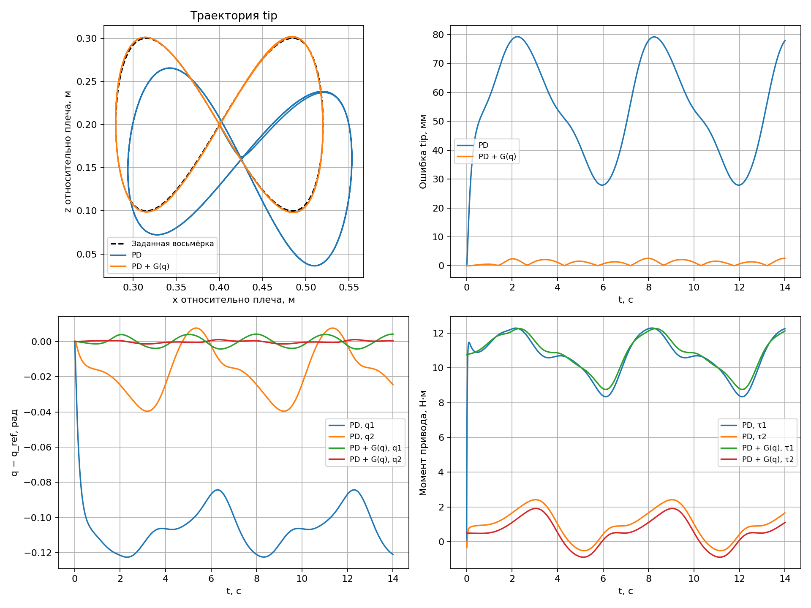

# 2R-манипулятор: восьмёрка и PD в MuJoCo

[Конспект второй лекции](../lecture_notes.md) содержит вывод кинематики и динамики. Модель движется в вертикальной плоскости с гравитацией. Сравниваются обычный суставной PD и PD с компенсацией тяжести; моменты ограничены ±35 Н·м.

## Запуск

В Python-окружении (Python 3.10+, проверено с MuJoCo 3.10.0):

```bash
python -m pip install -r SRS_2026/lecture_2_2R_robot/two_link_robot/requirements.txt

# Сравнение без графического окна: CSV, PNG, ошибки в терминале.
python SRS_2026/lecture_2_2R_robot/two_link_robot/simulate.py

# Интерактивная симуляция с движущейся красной целью.
python SRS_2026/lecture_2_2R_robot/two_link_robot/simulate.py --controller pd-gravity --viewer

# Для сравнения: тот же робот без компенсации тяжести.
python SRS_2026/lecture_2_2R_robot/two_link_robot/simulate.py --controller pd --viewer

# Проверка формул и качества слежения без окна.
python SRS_2026/lecture_2_2R_robot/two_link_robot/verify.py
```

Команды выше выполняются из корня репозитория. Прямой запуск по абсолютному пути работает из любого каталога, включая Run в IDE. Также поддерживается `python -m SRS_2026.lecture_2_2R_robot.two_link_robot.simulate` из корня. На macOS для пассивного viewer используйте `mjpython` вместо `python`.

`--viewer` требует графического сеанса и выбора одного регулятора. Для расчётов без viewer дисплей не нужен. Внешний пакет `mujoco_viewer` не используется. `--help` показывает все аргументы.

## Состав примера

| Файл | Что читать |
|---|---|
| [robot.xml](robot.xml) | Плоскость xz, оси суставов `0 -1 0`, два звена длиной 0.4 м и массой 2 кг, явные инерции |
| [robot_math.py](robot_math.py) | Прямая/обратная кинематика, якобиан, M, c, G, прямая/обратная динамика и задание восьмёрки |
| [simulate.py](simulate.py) | Получение q_ref и dq_ref, PD, компенсация G, насыщение, mj_step, логирование и графики |
| [verify.py](verify.py) | Сопоставление аналитики с MuJoCo и проверка обеих ветвей IK и слежения |

Начните с `forward_kinematics`, `inverse_kinematics`, `jacobian`, затем прочитайте `reference` и цикл `run`. Вектор скорости цели в м/с преобразуется якобианом в суставные скорости в рад/с; в регулятор подаются величины в одинаковых координатах.

Положение `(x,z)` в формулах отсчитывается от плеча. В мировых координатах MuJoCo плечо расположено на высоте 0.3 м. Восьмёрка: `x=0.4+0.12*sin(phase)`, `z=0.2+0.10*sin(2*phase)`. В первые 2 с скорость фазы плавно разгоняется от нуля. После разгона период составляет 6 с.

Начальное состояние задаётся по IK только один раз. Затем робот движется под действием моментов; `qpos` на целевую траекторию не переставляется. Гравитация включена. Контакты и столкновения отключены. Красный `site` обозначает цель и не создаёт механических сил.

PD+G добавляет только гравитационные моменты, а не весь `qfrc_bias` (он содержит также скоростные слагаемые). Компенсация инерционных моментов в этом контроллере не реализована.

## Изменение эксперимента

```bash
# Ускорить движение.
python SRS_2026/lecture_2_2R_robot/two_link_robot/simulate.py --period 3

# Изменить усиления (два числа для двух суставов).
python SRS_2026/lecture_2_2R_robot/two_link_robot/simulate.py --kp 200 120 --kd 28 17

# Сохранить в другой каталог.
python SRS_2026/lecture_2_2R_robot/two_link_robot/simulate.py --duration 8 --output /tmp/2r-results
```

Изменяя длины, массы, инерции или высоту основания, согласуйте `robot.xml` и `Parameters` в `robot_math.py`. `verify.py` проверяет эталонную модель; после изменения параметров сравнение слежения может потребовать других допусков.

## Результаты

По умолчанию файлы сохраняются в `results/` рядом со скриптом. Повторный запуск перезаписывает одноимённые результаты. PNG содержит четыре панели: геометрическая траектория, ошибка конца, ошибки суставов и моменты. CSV включает время, текущие/целевые углы и скорости, текущие/целевые координаты, моменты, позиционную ошибку и флаг насыщения. Все величины в СИ.

Проверенный запуск, 14 с, шаг 0.002 с:

| Регулятор | RMS ошибки конца | Максимум | Насыщение |
|---|---:|---:|---:|
| PD | 56.526 мм | 79.255 мм | 0% |
| PD+G | 1.337 мм | 2.564 мм | 0% |



Показатели считаются по узлам до каждого шага, включая разгон. Они характеризуют этот эксперимент; при иной траектории, параметрах или усилениях будут другими. Графическое окно на результат не влияет, если не добавлять возмущения через viewer.
