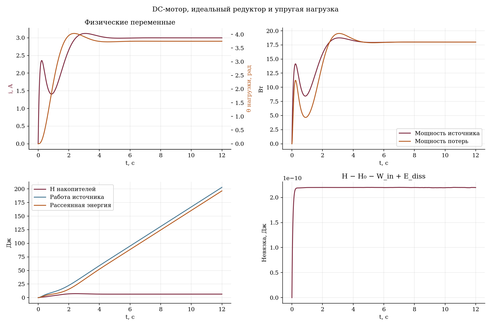

# Bond graphs: механика, RLC и электромеханический привод

Три примера к [конспекту](../lecture_notes.md) и [интерактивной презентации](../presentation/index.html). Графы и уравнения выведены в лекции; Python вручную реализует эти конкретные модели, а не компилирует произвольные bond graphs.

## Запуск

Из корня репозитория, Python 3.10+:

```bash
python -m pip install -r SRS_2026/lecture_3_bond_graphs/examples/requirements.txt

# Все модели: CSV + графики.
python SRS_2026/lecture_3_bond_graphs/examples/simulate.py --plot

# По одной модели, без графиков требуется только NumPy.
python SRS_2026/lecture_3_bond_graphs/examples/simulate.py --model msd
python SRS_2026/lecture_3_bond_graphs/examples/simulate.py --model rlc --plot
python SRS_2026/lecture_3_bond_graphs/examples/simulate.py --model motor --gear 3 --plot

# Физические проверки.
python SRS_2026/lecture_3_bond_graphs/examples/verify.py
```

Прямой запуск по абсолютному пути работает из любого каталога, включая Run в IDE. Поддерживается и `python -m SRS_2026.lecture_3_bond_graphs.examples.simulate`. Окно и OpenGL не нужны; используется Matplotlib Agg. Параметры: `--model`, `--step`, `--duration`, `--gear`, `--plot`, `--output`. Численный шаг по умолчанию 0.001 с; метод RK4.

## Модели и состояния

| Модель | Состояния | Структура |
|---|---|---|
| `msd` | Деформация x и импульс p | Se:u−mg, 1-узел, C:1/k, R:b, I:m |
| `rlc` | Заряд и потокосцепление | Se:U, 1-узел с общим током, C:C, R:R, I:L |
| `motor` | Потокосцепление, приведённый момент импульса, угол нагрузки | Электрическая цепь, GY:K, TF:n, инерции, демпферы и торсионная пружина |

Для `msd` ось x направлена вверх; гравитация включена как внешний Se. Поэтому энергия накопителей `H_J` не включает `mg*x`. Полная механическая энергия отдельно записана в колонку `mechanical_energy_J`. В графе пружина и демпфер принимают усилия `kx` и `bv`; в уравнении массы они вычитаются.

Для двигателя `n=omega_motor/omega_load`. Приведённые к двигателю инерция и демпфирование равны `Jm+Jl/n**2` и `bm+bl/n**2`. При жёстком редукторе скорости двигателя и нагрузки зависимы; две инерции нельзя считать двумя независимыми скоростными состояниями.

## Что читать в коде

[models.py](models.py) содержит классы моделей. В каждом:

- `initial` задаёт начальное состояние;
- `rhs` реализует уравнения из правил bonds и узлов;
- `ports` возвращает переменные порта и мощности;
- `energy` задаёт энергию накопителей;
- `gradient` используется для независимой проверки дифференциального баланса энергии.

`simulate` добавляет интегралы работы источника и потерь к физическим состояниям и решает расширенную систему тем же RK4. [simulate.py](simulate.py) отвечает за CLI, CSV и рисунки. [verify.py](verify.py) проверяет модели и численную сходимость.

## Результаты и проверки

Файлы по умолчанию сохраняются в `results/` рядом со скриптами: `msd.csv/png`, `rlc.csv/png`, `motor.csv/png`. Повторный запуск перезаписывает одноимённые файлы. Параметр `--output` позволяет указать другой каталог.

CSV содержит состояния, наблюдаемые физические величины, мощности, H, работу источника, рассеянную энергию и невязку `H-H0-work+dissipation`. На графике первые две физические величины разделены по осям с указанными единицами.

Проверенный запуск, h=0.001 с:

| Модель | Максимальная абсолютная невязка, Дж |
|---|---:|
| msd, 10 с | 7.996×10⁻¹¹ |
| rlc, 4 с | 5.957×10⁻¹¹ |
| motor, 12 с | 2.202×10⁻¹⁰ |

Помимо малого интегрального остатка, проверяется `gradient(H) @ rhs = power_in - power_loss`, неотрицательность потерь, равенство мощностей GY и TF, статические равновесия и сходимость RK4 при уменьшении шага. Энергия не заменяет проверку геометрии, топологии и каждого физического закона.



Практическое задание: измените `K*omega` в электрическом уравнении двигателя, оставив механический момент `K*i`. Проверьте, почему возникает нарушение локального и интегрального балансов. Неправильную физическую связь нельзя исправить уменьшением численного шага.
