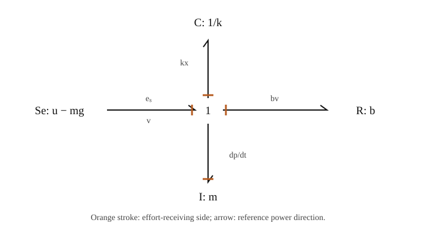
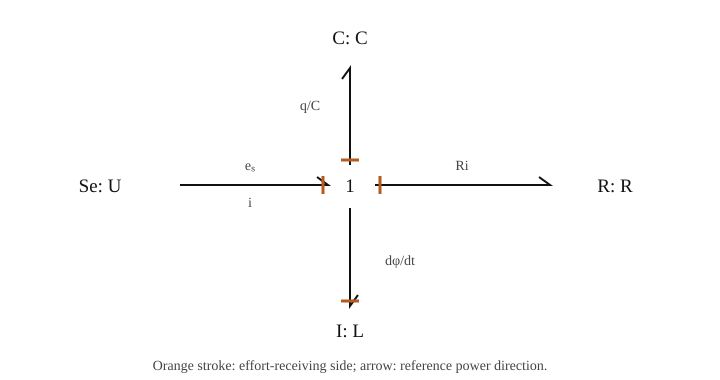
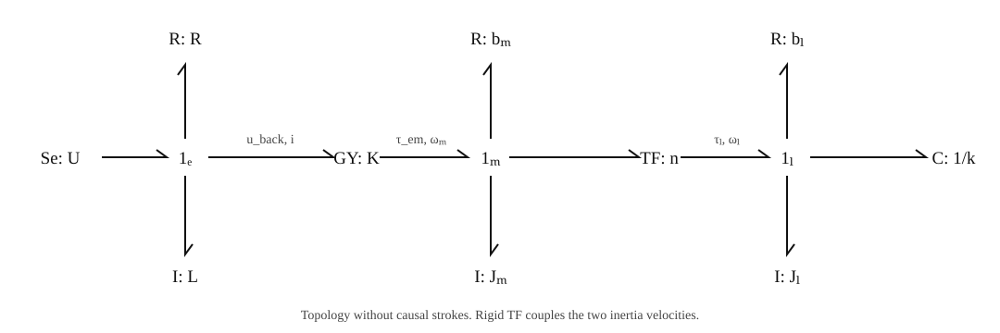
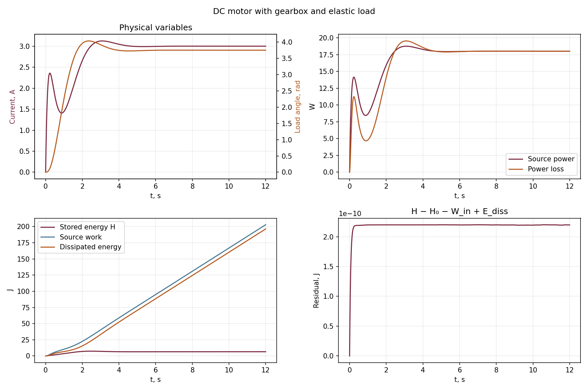

[Русский](lecture_notes.md) | **English**

# Lecture 3. Bond Graph Modeling

**Interactive presentation:** [open slides](presentation/index.en.html) · [controls](presentation/README.en.md). **Python lab:** [examples and running](examples/README.en.md).

Main source: [SRS/lecture_2/lecture_2.pdf](../../SRS/lecture_2/lecture_2.pdf), Chapter 2, printed pages 5–9. Explore sign and causality conventions through mechanical, electrical and electromechanical examples.

## 1. Why mechatronics needs a common language

Mechatronic systems combine mechanics, circuits, drives, and other domains. Separate block diagrams can obscure signs, reaction forces, and energy constraints.

**A bond graph describes energy connections between component ports.** Each port has two conjugate variables whose product is power. Component laws and junction rules yield simulation equations.

It is not an integration method. A graph can yield ODEs, DAEs, or additional constraints. Select a numerical solver after analyzing the model.

A graph separates three questions:

1. **Physical structure:** what connects to what, and how is energy transferred?
2. **Computational structure:** which quantities are known and which are computed?
3. **Numerical solution:** how do states and algebraic variables evolve over time?

## 2. Ports, effort, flow, and power

Port variables are traditionally called **effort** $e$ and **flow** $f$. These are generic names, not necessarily force and fluid flow.

$$\boxed{P=e f.}$$

A vector port (*multibond*) uses the inner product $P=e^Tf$. Spatial force/torque form a wrench; linear/angular velocity form a twist. Frames and component order must match. Here e is a column. Spatial Lectures 5–6 use row W=eᵀ, giving the same power WT.

| Domain | Effort $e$ | Flow $f$ | Power |
|---|---|---|---|
| Translation | Force $F$, N | Velocity $v$, m/s | $Fv$ |
| Rotation | Torque $\tau$, N·m | Angular velocity $\omega$, rad/s | $\tau\omega$ |
| Electricity | Voltage $U$, V | Current $i$, A | $Ui$ |
| Hydraulics | Pressure difference $\Delta p$, Pa | Volumetric flow $Q$, m³/s | $\Delta p\,Q$ |

Mechanical power uses velocity, not displacement. Electrical flow is current, not charge. Thermal models need care: temperature times heat flow is not power. A true energy port pairs temperature with entropy flow; heat-flow-as-flow models are often called pseudo bond graphs. We restrict attention to the table above.

## 3. Half-arrow and causal stroke are different

### 3.1. Power direction

A bond is a line with a **half-arrow** defining positive reference power, for example A to B. For $ef>0$ energy flows along it; for $ef<0$ it flows oppositely.

The half-arrow permits energy return; it does not mean one-way signal transmission. Springs and masses exchange energy in both directions.

Below, bonds point **into** storage and resistance elements. Then $ef$ is input power, nonnegative for passive R. Sources point toward the system: $ef$ is supplied power, possibly negative when the source absorbs energy.

### 3.2. The causal stroke

Our convention places the **stroke at the effort-receiving side**. That side computes and returns flow. The other side computes effort and receives flow.

```text
A ─────────│ B     stroke at B: effort A → B; flow B → A
```

The ASCII diagram specifies stroke placement; subsequent figures use half-arrows for reference power. Moving the stroke changes computational causality, not the element law or reference power direction.

Causality does not assert that force always physically causes velocity. Connected variables jointly satisfy equations; the stroke assigns who computes each one.

## 4. Se and Sf sources

**Se** prescribes effort $e=e_s(t)$, such as ideal voltage or specified force. **Sf** prescribes flow $f=f_s(t)$, such as current or ideal-drive speed.

A source defines one variable; the connected system determines the other. Constant voltage therefore does not imply constant power.

**MSe/MSf** denote modulated sources in some conventions. The principle remains a known time function or control signal. An ideal prescribed-speed source does not automatically capture motor current/torque limits.

For our vertical mass, choose an upward axis and source

$$e_s=u(t)-mg.$$

Without additional force, $e_s=-mg$. During downward motion $v<0$, gravity supplies positive power: $P_g=(-mg)v>0$.

## 5. C and I storage, R resistance

### 5.1. C element

C stores the integral of flow:

$$\dot q=f,\qquad e=\frac{\partial H_C}{\partial q}.$$

For linear capacitance or compliance:

$$e=\frac{q}{C},\qquad H_C=\frac{q^2}{2C},\qquad \dot H_C=ef.$$

Here $q$ is a generalized storage variable, not necessarily electric charge or joint angle.

| C element | $q$ | Parameter C | Law |
|---|---|---|---|
| Spring | Deformation $x$ | Compliance $C_s=1/k$ | $F=kx$ |
| Capacitor | Charge $q_e$ | Capacitance | $U=q_e/C$ |

**Spring stiffness k is not compliance C.** Increasing k decreases $C_s$.

In integral causality, C accepts and integrates flow and returns effort. Include its initial condition explicitly: $q(t)=q_0+\int_{t_0}^t f(s)\,ds$.

### 5.2. I element

I stores the integral of effort:

$$\dot p=e,\qquad f=\frac{\partial H_I}{\partial p}.$$

For linear inertia:

$$f=\frac{p}{I},\qquad H_I=\frac{p^2}{2I},\qquad \dot H_I=ef.$$

| I element | $p$ | Parameter I | Law |
|---|---|---|---|
| Mass | Momentum $p=mv$ | Mass m | $v=p/m$ |
| Rotational inertia | Angular momentum $p_\omega=J\omega$ | Inertia J | $\omega=p_\omega/J$ |
| Inductor | Flux linkage $\phi=Li$ | Inductance L | $i=\phi/L$ |

In integral causality, I accepts and integrates effort and returns flow. For a mass, $F=\dot p=m\dot v$, **not $F=p$**.

Effort/flow integrals are storage or energy variables, not energies in joules. Energy is a function $H(q,p)$.

### 5.3. R element

Resistance stores no energy in this model:

$$e=Rf,\qquad P_R=ef=Rf^2\geq0\quad (R\geq0).$$

For a damper this is $F_b=bv$ at the passive port; for a resistor, $U_R=Ri$. Actual damper force enters the mass equation negatively: the damper absorbs $bv^2$ while the mass experiences $-bv$.

R supports either computational direction, $e=Rf$ or $f=e/R$, when invertible. Do not divide by R at $R=0$. Check nonlinear characteristics and passivity separately.

## 6. Integral and derivative causality

Preferred storage causality:

| Element | Known input | State equation | Returned output |
|---|---|---|---|
| C, integral | Flow f | $\dot q=f$ | $e=\partial H_C/\partial q$ |
| I, integral | Effort e | $\dot p=e$ | $f=\partial H_I/\partial p$ |

Linear elements also admit derivative forms:

$$\text{C: }f=C\dot e,\qquad \text{I: }e=I\dot f.$$

Integral form suits initial-value problems and noisy signals. Differentiation amplifies high-frequency noise; an ideal differentiator is not a proper transfer function with bounded high-frequency gain. However, **it is incorrect to claim derivatives necessarily require future values**. Smooth-signal derivatives can use left limits; implementation, regularity, and equation structure are the issues.

Derivative causality may indicate dependent storage variables. Rigidly connected masses share one velocity, so their momenta cannot be independently initialized. Combine inertias or solve a constrained DAE.

Assign sources first, then junction rules; prefer integral storage causality and propagate restrictions. A conflict calls for checking the model and idealization, not merely moving strokes until the warning disappears.

## 7. 0 and 1 junctions

Neither junction stores, generates, or dissipates energy:

$$\sum_j\sigma_j e_jf_j=0,$$

Here $\sigma_j=+1$ for incoming bonds and $-1$ for outgoing bonds. Equations below use consistent variable orientations and signs.

### 7.1. 0 junction: common effort

$$\boxed{e_1=e_2=\dots=e_n,\qquad \sum_j\sigma_j f_j=0.}$$

One incoming and two outgoing bonds:

$$e_1=e_2=e_3,\qquad f_1=f_2+f_3.$$

The electrical analogy is parallel branches sharing voltage and balancing currents. Only one port determines common effort; others use it to compute flows.

### 7.2. 1 junction: common flow

$$\boxed{f_1=f_2=\dots=f_n,\qquad \sum_j\sigma_j e_j=0.}$$

One incoming and three outgoing bonds:

$$f_s=f_C=f_R=f_I=f,\qquad e_s=e_C+e_R+e_I.$$

This is common mechanical velocity or series-circuit current. One port determines flow; the others jointly determine missing effort. **0 and 1 are neither bond counts nor Boolean values.**

Equation $f_1=f_2+f_3$ is a 0-junction balance, not a 1-junction common-flow rule. Physically parallel mass, spring, and damper use a 1 junction because velocity is common. Mechanical parallel geometry does not automatically imply electrical parallel topology.

## 8. Example 1: vertical mass–spring–damper



Se points toward the 1 junction; bonds to C,R,I point into the elements. C and I have integral causality. I supplies common velocity; C and R return efforts.

**Computation sequence:**

1. From I's state: $v=p/m$.
2. Common junction flow: $f_C=f_R=f_I=v$.
3. From C: $e_C=kx$; from R: $e_R=bv$.
4. Remaining effort for I: $\dot p=e_I=e_s-e_C-e_R$.
5. For C: $\dot x=v$.

$$\boxed{\dot x=\frac{p}{m},\qquad \dot p=u-mg-kx-\frac{b}{m}p.}$$

Eliminating p recovers the familiar equation:

$$m\ddot x+b\dot x+kx+mg=u.$$

Here $p$ is momentum, not position or power P. Positive x points upward; zero denotes an undeformed spring. With $u=0$, equilibrium is $x_{eq}=-mg/k$.

### 8.1. Why storage H differs from total mechanical energy

Gravity is an external Se in this graph:

$$H=\frac{p^2}{2m}+\frac{kx^2}{2},\qquad
\dot H=(u-mg)v-bv^2.$$

Gravity can increase H by transferring energy to the mass and spring during descent. Total mechanical energy includes gravitational potential:

$$E_{mech}=H+mgx,\qquad \dot E_{mech}=uv-bv^2.$$

Alternatively include gravitational potential inside the model boundary. Do not simultaneously treat it as internal storage and the same external power flow: that doubles gravity's contribution.

For $b>0$ the system dissipates energy and is not conservative. For $u=0$, $b=0$, $E_{mech}$ is conserved while H alone may vary.

## 9. Example 2: series RLC circuit



Voltage source Se, resistor R, capacitor C, and inductor I share current i through a 1 junction. States are charge $q_e$ and flux linkage $\phi$:

$$i=\frac{\phi}{L},\quad U_C=\frac{q_e}{C},\quad U_R=Ri,$$

$$\boxed{\dot q_e=\frac{\phi}{L},\qquad
\dot\phi=U-R\frac{\phi}{L}-\frac{q_e}{C}.}$$

Effort balance gives inductor voltage $U_L=U-U_R-U_C$: Kirchhoff's loop law expressed by 1-junction rules.

$$H=\frac{q_e^2}{2C}+\frac{\phi^2}{2L},\qquad
\dot H=Ui-Ri^2.$$

This matches mechanical structure with $m\leftrightarrow L$, $b\leftrightarrow R$, $k\leftrightarrow1/C$, $v\leftrightarrow i$. It is a force/impedance analogy, not equality of physical values or units.

## 10. Two-port TF and GY elements

Port 1 points **into** the converter; port 2 points **out**. Power conservation is $e_1f_1=e_2f_2$. With both arrows inward, change the sign of the second flow or its equation.

### 10.1. TF: like-variable conversion

For ratio n:

$$\boxed{e_2=ne_1,\qquad f_1=nf_2.}$$

TF relates effort to effort and flow to flow, with reciprocal directions consistent with power. For a gearbox, $n=\omega_m/\omega_l$:

$$\omega_l=\frac{\omega_m}{n},\qquad \tau_l=n\tau_{in}.$$

A gearbox increases torque while reducing speed; it does not multiply power by n. A TF ratio need not be dimensionless: a drum radius connects rotation and translation.

### 10.2. GY: effort on one side, flow on the other

$$\boxed{e_1=Kf_2,\qquad e_2=Kf_1.}$$

Ideal motor electromechanical conversion:

$$e_{back}=K_e\omega_m,\qquad \tau_{em}=K_ti.$$

In consistent SI units, ideal coefficients $K_e$ and $K_t$ are numerically equal. Call them K. Then

$$e_{back}i=\tau_{em}\omega_m.$$

Winding resistance, inductance, and mechanical losses are separate R and I elements, not unexplained losses inside ideal GY.

## 11. Example 3: motor, gearbox, elastic load



Winding source U, resistance R, inductance L, and GY electrical port share current. The GY mechanical port produces shaft torque. An ideal TF connects the shaft to load inertia, a damper, and a torsional spring fixed at its other end.

The full topology has two inertias, but rigid gearing imposes $\omega_m=n\omega_l$. Their speeds are not independent states. Reflect load inertia and losses to the motor shaft:

$$J_{eq}=J_m+\frac{J_l}{n^2},\qquad b_{eq}=b_m+\frac{b_l}{n^2}.$$

For consistent zero initial angles, $\theta_l=\theta_m/n$; motor-side spring torque is $k\theta_l/n$. Equivalent stiffness for coordinate $\theta_m$ is $k/n^2$ and compliance $n^2/k$.

Choose three states: flux linkage $\phi$, reflected angular momentum $p_m=J_{eq}\omega_m$, and load angle $\theta_l$:

$$\boxed{\begin{aligned}
\dot\phi &= U-R\frac{\phi}{L}-K\frac{p_m}{J_{eq}},\\
\dot p_m &= K\frac{\phi}{L}-b_{eq}\frac{p_m}{J_{eq}}-\frac{k}{n}\theta_l,\\
\dot\theta_l &= \frac{p_m}{nJ_{eq}}.
\end{aligned}}$$

Their energy and balance:

$$H=\frac{\phi^2}{2L}+\frac{p_m^2}{2J_{eq}}+\frac{k\theta_l^2}{2},$$

$$\boxed{\dot H=Ui-Ri^2-b_m\omega_m^2-b_l\omega_l^2
=Ui-Ri^2-b_{eq}\omega_m^2.}$$

Internal GY and TF powers cancel, so they appear as neither sources nor losses in the final balance.

A separate TF check must use **gearbox input torque**, not total electromagnetic torque: part of $\tau_{em}$ accelerates motor inertia and overcomes $b_m\omega_m$. At the gearbox output,

$$\tau_l=J_l\dot\omega_l+b_l\omega_l+k\theta_l,\qquad
\tau_{in}=\tau_l/n,\qquad \tau_{in}\omega_m=\tau_l\omega_l.$$

At steady state with constant U:

$$\omega_m=\omega_l=0,\quad i=U/R,\quad \theta_l=\frac{nKU}{Rk}.$$

The rotor stops, but the winding still draws holding current; all steady electrical power dissipates in R.

## 12. Python examples

Files: [models.py](examples/models.py), [simulate.py](examples/simulate.py), [verify.py](examples/verify.py).

This is not a universal bond-graph compiler. The three causal models are implemented by hand to expose the path from element law to junction rule to state derivative.

| Scenario | Parameters | States | Duration |
|---|---|---|---|
| `msd` | m=1, k=20, b=0.5, g=9.8, u=0 in SI | x,p | 10 s |
| `rlc` | L=0.5 H, C=0.02 F, R=2 Ω, U=5 V | $q_e$, φ | 4 s |
| `motor` | L=0.2 H, R=2 Ω, K=0.2, $J_m$=0.01, $J_l$=0.05 kg·m², $b_m$=0.002, $b_l$=0.02 N·m·s/rad, k=0.8 N·m/rad, n=5, U=6 V | φ, $p_m$, $\theta_l$ | 12 s |

For `msd`, initial x₀=0.5 m and p₀=0. Other storage starts uncharged. Sources are constant from the start. Integration is RK4 with default 0.001 s step.

From the repository root, Python 3.10+:

```bash
python -m pip install -r SRS_2026/lecture_3_bond_graphs/examples/requirements.txt

# All examples; CSV and PNG.
python SRS_2026/lecture_3_bond_graphs/examples/simulate.py --plot

# Separate experiments.
python SRS_2026/lecture_3_bond_graphs/examples/simulate.py --model msd --plot
python SRS_2026/lecture_3_bond_graphs/examples/simulate.py --model rlc --plot
python SRS_2026/lecture_3_bond_graphs/examples/simulate.py --model motor --gear 3 --plot

# Physical and numerical checks.
python SRS_2026/lecture_3_bond_graphs/examples/verify.py
```

IDE execution and module command `python -m SRS_2026.lecture_3_bond_graphs.examples.simulate` work. CSV without `--plot` requires only NumPy. No viewer/OpenGL is needed. Results go to `examples/results/`; change the directory with `--output`.

### 12.1. Energy verification

Alongside states, integrate

$$\dot W_{in}=P_{in},\qquad \dot E_{diss}=P_{loss}.$$

Then compute the residual

$$\boxed{r_H(t)=H(t)-H(0)-W_{in}(t)+E_{diss}(t).}$$

It is zero for the exact solution. Work and losses use the same RK4 stages as states, preventing crude quadrature from masking accuracy. Numerical residual need not be exactly zero.

`verify.py` checks identity $\nabla H^T\dot y=P_{in}-P_{loss}$ at random states, nonnegative losses, GY/TF power conservation, equilibria, and integration order. Integral balance does not replace independent checks: mutually incorrect equations and energy can agree.

### 12.2. Reference results

At 0.001 s, maximum absolute r_H residuals were 7.996×10⁻¹¹ J for mechanics, 5.957×10⁻¹¹ J for RLC, and 2.202×10⁻¹⁰ J for the drive. These characterize the experiments, not universal model tolerances.



At n=5, U=6 V, steady current is i=3 A and angle θ_l=3.75 rad. At 12 s, θ_l≈3.750005 rad and i≈3.000005 A. Storage includes winding magnetic and spring elastic energy.

## 13. Checking formulas and common mistakes

When reading the source:

1. Printed page 7: a 0 junction has equal $e_i$, not $e_1=e_2+e_3+e_4$.
2. Page 8: a 1 junction has equal $f_i$, not $f_1=f_2+f_3+f_4$. Effort balance respects bond directions.
3. Page 7: an I mass has $F=m\dot v=\dot p$, not p.
4. Page 8: spring compliance is $C_s=1/k$; labeling stiffness k must not imply $C=k$.
5. Page 8: a system with nonzero damping is not conservative.
6. Page 9: velocity integrates as $v(t)=v_0+\frac1m\int F\,dt$, not force equaling an acceleration integral.
7. Derivative causality does not necessarily require future values; Section 6 explains why integral form is preferred.

## 14. Exercises

1. At x=−0.49 m, v=−0.2 m/s, find each mechanical port effort and power. Why does R dissipate for either velocity sign?
2. Assign causal strokes: who supplies the common flow, and how is I effort computed?
3. Build a parallel RC circuit driven by a current source through a 0 junction. Derive $C\dot U=i_s-U/R$ and energy balance.
4. Set b=0 in `msd`. Compare conservation of H and $E_{mech}$; explain Se:−mg.
5. Vary R in the RLC circuit. Compare its effect with mechanical damping.
6. Increase n from 3 to 5. How do reflected inertia, load speed, static angle, and losses change? Do not assume power multiplies by n.
7. Remove back-EMF $K\omega_m$ while retaining torque Ki. Identify the violated power identity.
8. Halve the step and inspect energy residual. Separate physical-connection and integrator errors.
9. Extend to an elastic gearbox with independent motor/load angles. Which states are added, and why is rigid inertia reflection insufficient?

## 15. References and documentation

- [Original notes: Bond graphs modeling for simulation](../../SRS/lecture_2/lecture_2.pdf), Chapter 2; corrections above.
- Henry M. Paynter. *Analysis and Design of Engineering Systems*. MIT Press, 1961: classic methodology reference in the source bibliography.
- Vincent Duindam, Alessandro Macchelli, Stefano Stramigioli, Herman Bruyninckx (eds.). *Modeling and Control of Complex Physical Systems: The Port-Hamiltonian Approach*. Springer, 2009: energy modeling and port-Hamiltonian systems, also cited in the source.
- Official 20-sim help: [bonds and causality](https://www.20sim.com/webhelp/modeling_tutorial_bond_graphs_bonds.php), [assigning causality](https://www.20sim.com/webhelp/modeling_tutorial_bond_graphs_causality.php).
- Junction rules: [0-junction](https://www.20sim.com/webhelp/modeling_tutorial_bond_graphs_0junction.php), [1-junction](https://www.20sim.com/webhelp/library_bond_graph_onejunction.php).
- Two-port elements: [TF](https://www.20sim.com/webhelp/library_bond_graph_tf.php), [GY](https://www.20sim.com/webhelp/library_bond_graph_gy.php).

Related lectures: [mass–spring–damper](../lecture_1_modelling_n_simulation/lecture_notes.en.md) and [2R dynamics](../lecture_2_2R_robot/lecture_notes.en.md). A bond graph organizes a physical model; it is not another MuJoCo integrator.

