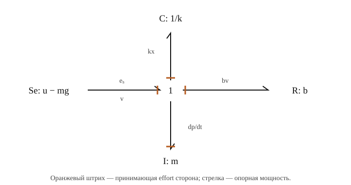
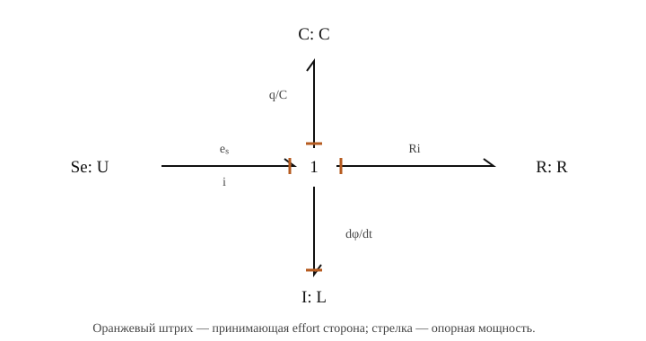
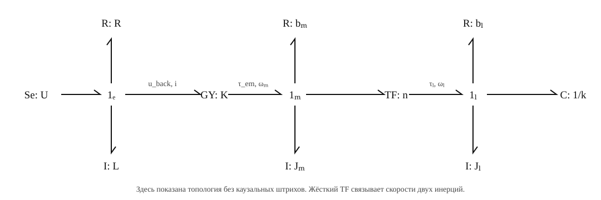
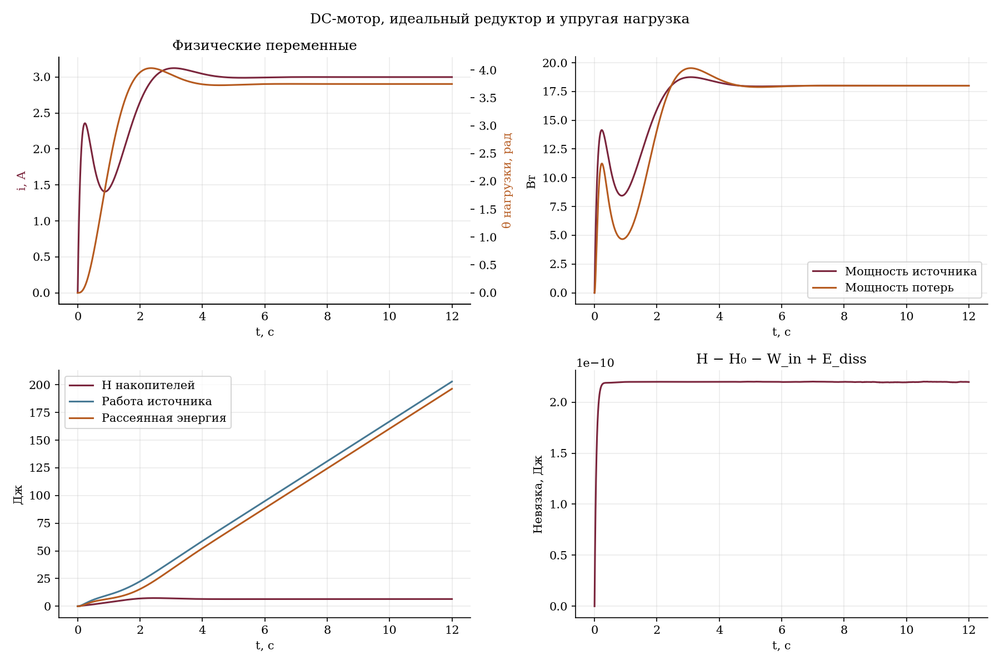

# Лекция 3. Моделирование в графах связей — bond graphs

**Интерактивная презентация:** [открыть слайды](presentation/index.html) · [управление](presentation/README.md). **Python-практикум:** [примеры и запуск](examples/README.md).

Основной материал — [SRS/lecture_2/lecture_2.pdf](../../SRS/lecture_2/lecture_2.pdf), глава 2, печатные страницы 5–9. Здесь уточнены соглашения о знаках и причинности, исправлены опечатки исходника и добавлены электрический и электромеханический примеры.

## 1. Зачем мехатронике общий язык

Мехатронная система объединяет механику, электрические цепи, приводы и другие физические области. Если моделировать каждый компонент отдельной блок-схемой, легко потерять смысл знаков, сил обратного действия и энергетических ограничений.

**Bond graph — граф энергетических связей между портами компонентов.** Каждый порт описывается двумя сопряжёнными переменными, произведение которых равно мощности. Модель строят из законов элементов и правил соединения, а затем получают уравнения для симуляции.

Это не отдельный метод интегрирования. Один и тот же граф может привести к ОДУ, дифференциально-алгебраической системе или системе с дополнительными ограничениями. Численный решатель выбирают после анализа модели.

Граф позволяет обсуждать три разных вопроса:

1. **Физическая структура:** что с чем соединено и как передаётся энергия?
2. **Вычислительная структура:** какие величины известны и какие определяются из них?
3. **Численное решение:** как вычислить состояние и алгебраические переменные во времени?

## 2. Порт, effort, flow и мощность

Переменные порта традиционно называют **effort** $e$ — усилие и **flow** $f$ — поток. Это общие названия, а не обязательно механическая сила и расход жидкости.

$$\boxed{P=e f.}$$

Для векторного порта (*multibond*) используется скалярное произведение $P=e^Tf$. Например, пространственные силы и моменты образуют wrench, а линейные и угловые скорости — twist; компоненты должны быть согласованы по системе координат и порядку.

| Область | Effort $e$ | Flow $f$ | Мощность |
|---|---|---|---|
| Поступательная механика | Сила $F$, Н | Скорость $v$, м/с | $Fv$ |
| Вращение | Момент $\tau$, Н·м | Угловая скорость $\omega$, рад/с | $\tau\omega$ |
| Электричество | Напряжение $U$, В | Ток $i$, А | $Ui$ |
| Гидравлика | Перепад давления $\Delta p$, Па | Объёмный расход $Q$, м³/с | $\Delta p\,Q$ |

Скорость, а не перемещение, является механической переменной мощности. В электрической области flow — ток, а не заряд. Для тепловых моделей нужно отдельное внимание: пара «температура — тепловой поток» не даёт мощность простым произведением. В истинном энергетическом порте температуре соответствует поток энтропии; модели с тепловым потоком как flow часто называют псевдографами связей. В этой лекции ограничимся таблицей выше.

## 3. Полустрелка и каузальный штрих — разные обозначения

### 3.1. Направление мощности

Связь изображают линией с **полустрелкой**. Она задаёт положительное, опорное направление мощности, например от A к B. Если $ef>0$, энергия передаётся в этом направлении; если $ef<0$ — в противоположном.

Полустрелка не запрещает возврат энергии и не означает «сигнал может идти только туда». Пружина и масса регулярно обмениваются энергией в обе стороны.

Для накопителей и сопротивлений далее направляем bond **к элементу**. Тогда $ef$ — мощность, поступающая в этот элемент; для пассивного R она неотрицательна. Источник направлен к остальной системе: его $ef$ — подводимая к системе мощность, которая может быть отрицательной при приёме энергии источником.

### 3.2. Каузальный штрих

В принятом здесь соглашении **штрих находится со стороны, принимающей effort**. Эта сторона вычисляет и отдаёт flow. На другом конце effort вычисляется, а flow принимается.

```text
A ─────────│ B     штрих у B: effort A → B; flow B → A
```

В ASCII-строке важно положение штриха; на рисунках далее направление опорной мощности показано обычной полустрелкой. Перенос штриха меняет вычислительную причинность, но сам по себе не меняет физический закон элемента или опорное направление мощности.

Не нужно понимать причинность как утверждение, что «сила физически всегда вызывает скорость». В соединённой модели эти величины совместно удовлетворяют уравнениям; штрих назначает, какая сторона вычисляет каждую из них.

## 4. Источники Se и Sf

**Se** задаёт effort: $e=e_s(t)$. Примеры — идеальный источник напряжения или заданная сила. **Sf** задаёт flow: $f=f_s(t)$, например заданный ток или скорость идеального привода.

Источник определяет одну переменную; вторую определяет подключённая система. Поэтому источник постоянного напряжения не обязан отдавать постоянную мощность.

В нотации с отдельными обозначениями **MSe / MSf** используют для модулируемых источников. В уравнениях принцип один: задаётся известная функция времени или сигнал управления. Идеальный источник заданной скорости не описывает автоматически ограничения реального двигателя по току и моменту.

Для нашей вертикальной массы выбираем ось вверх и источник

$$e_s=u(t)-mg.$$

Если дополнительной силы нет, $e_s=-mg$. При движении вниз $v<0$ сила тяжести совершает положительную работу: $P_g=(-mg)v>0$.

## 5. Накопители C и I, сопротивление R

### 5.1. C-элемент

C накапливает интеграл потока:

$$\dot q=f,\qquad e=\frac{\partial H_C}{\partial q}.$$

Для линейной ёмкости или податливости:

$$e=\frac{q}{C},\qquad H_C=\frac{q^2}{2C},\qquad \dot H_C=ef.$$

Переменная $q$ здесь — обобщённая переменная накопления, а не обязательно электрический заряд или угол робота.

| C-элемент | $q$ | Параметр C | Закон |
|---|---|---|---|
| Пружина | Деформация $x$ | Податливость $C_s=1/k$ | $F=kx$ |
| Конденсатор | Заряд $q_e$ | Электрическая ёмкость | $U=q_e/C$ |

**Жёсткость пружины k не является её податливостью C.** Увеличение k уменьшает $C_s$.

В интегральной причинности C принимает flow, интегрирует его и возвращает effort. Начальное условие учитывается явно: $q(t)=q_0+\int_{t_0}^t f(s)\,ds$.

### 5.2. I-элемент

I накапливает интеграл усилия:

$$\dot p=e,\qquad f=\frac{\partial H_I}{\partial p}.$$

Для линейной инерции:

$$f=\frac{p}{I},\qquad H_I=\frac{p^2}{2I},\qquad \dot H_I=ef.$$

| I-элемент | $p$ | Параметр I | Закон |
|---|---|---|---|
| Масса | Импульс $p=mv$ | Масса m | $v=p/m$ |
| Вращательная инерция | Момент импульса $p_\omega=J\omega$ | Момент инерции J | $\omega=p_\omega/J$ |
| Катушка | Потокосцепление $\phi=Li$ | Индуктивность L | $i=\phi/L$ |

В интегральной причинности I принимает effort, интегрирует его и возвращает flow. Для массы $F=\dot p=m\dot v$, **а не $F=p$**.

Интегралы effort и flow называют переменными накопления/энергетическими переменными, но они не равны энергии в джоулях. Энергия — функция $H(q,p)$.

### 5.3. R-элемент

Сопротивление не хранит энергию в рассматриваемой модели:

$$e=Rf,\qquad P_R=ef=Rf^2\geq0\quad (R\geq0).$$

Для демпфера это $F_b=bv$ в пассивном порте, для резистора — $U_R=Ri$. Знак реальной силы демпфера в уравнении массы будет отрицательным: демпфер принимает мощность $bv^2$, а масса испытывает сопротивление $-bv$.

R допускает вычисление в обе стороны: $e=Rf$ или $f=e/R$, если соответствующее обращение корректно. При $R=0$ делить на R нельзя. Для нелинейного сопротивления проверяют его характеристику и пассивность отдельно.

## 6. Интегральная и дифференциальная причинность

Предпочтительная причинность накопителей:

| Элемент | Известный вход | Вычисление | Возвращаемый выход |
|---|---|---|---|
| C, интегральная | flow f | $\dot q=f$ | $e=\partial H_C/\partial q$ |
| I, интегральная | effort e | $\dot p=e$ | $f=\partial H_I/\partial p$ |

Для линейных элементов возможна и дифференциальная форма:

$$\text{C: }f=C\dot e,\qquad \text{I: }e=I\dot f.$$

Интегральная форма удобнее для задачи Коши и работы с шумными сигналами. Дифференцирование усиливает высокочастотный шум; идеальный дифференциатор не является обычной правильной передаточной функцией с ограниченным высокочастотным усилением. Но **неправильно объяснять это тем, что любая производная обязательно требует будущих значений**. Производную гладкого сигнала можно определять через левосторонний предел; проблема в реализации, регулярности и структуре уравнений.

Дифференциальная причинность может указывать на зависимые переменные накопления. Например, две массы, жёстко связанные без возможности относительного движения, имеют общую скорость: их импульсы нельзя независимо задавать при произвольных начальных условиях. Возможно объединение инерций или решение DAE с ограничениями.

Практическое назначение причинности: сначала источники, затем правила соединений; далее по возможности назначают интегральную причинность накопителям и распространяют ограничения. Каузальный конфликт — повод проверить модель и выбранную идеализацию, а не просто переставить штрихи до исчезновения ошибки.

## 7. Узлы 0 и 1

В обоих узлах нет собственного накопления, генерации и рассеяния энергии:

$$\sum_j\sigma_j e_jf_j=0,$$

где $\sigma_j=+1$ для bonds к узлу и $-1$ для bonds от узла. Уравнения ниже используют согласованные направления и знаки переменных.

### 7.1. 0-узел: общее усилие

$$\boxed{e_1=e_2=\dots=e_n,\qquad \sum_j\sigma_j f_j=0.}$$

Один bond входит, два выходят:

$$e_1=e_2=e_3,\qquad f_1=f_2+f_3.$$

Электрическая аналогия — параллельное соединение ветвей с общим напряжением и балансом токов. Только один присоединённый порт задаёт общее effort; остальные используют его для расчёта flows.

### 7.2. 1-узел: общий поток

$$\boxed{f_1=f_2=\dots=f_n,\qquad \sum_j\sigma_j e_j=0.}$$

Один bond входит, три выходят:

$$f_s=f_C=f_R=f_I=f,\qquad e_s=e_C+e_R+e_I.$$

Это общая скорость в механическом примере или общий ток последовательной цепи. Один порт задаёт flow; остальные совместно определяют недостающее effort. **Цифры 0 и 1 не обозначают количество связей и не являются логическими значениями.**

Равенство $f_1=f_2+f_3$ не является правилом общего потока 1-узла: это правило баланса для 0-узла. Физически параллельные масса, пружина и демпфер соединяются 1-узлом из-за общей скорости; механическая картинка «параллельно» не переносится автоматически на электрическую топологию.

## 8. Пример 1: вертикальная масса–пружина–демпфер



Источник Se направлен к 1-узлу; связи от узла к C, R, I направлены в элементы. C и I имеют интегральную причинность. I задаёт общую скорость, C и R возвращают усилия.

**Последовательность вычисления:**

1. По состоянию I: $v=p/m$.
2. Общий flow 1-узла: $f_C=f_R=f_I=v$.
3. По состоянию C: $e_C=kx$; для R: $e_R=bv$.
4. Для I остаётся $\dot p=e_I=e_s-e_C-e_R$.
5. Для C: $\dot x=v$.

$$\boxed{\dot x=\frac{p}{m},\qquad \dot p=u-mg-kx-\frac{b}{m}p.}$$

Исключая p, получаем уже знакомое уравнение:

$$m\ddot x+b\dot x+kx+mg=u.$$

Здесь $p$ — импульс, а не положение или мощность P. Положительное направление x — вверх; ноль — при недеформированной пружине. При $u=0$ равновесие $x_{eq}=-mg/k$.

### 8.1. Почему H накопителей не равно полной механической энергии

В этом графе гравитация представлена внешним Se:

$$H=\frac{p^2}{2m}+\frac{kx^2}{2},\qquad
\dot H=(u-mg)v-bv^2.$$

Тяжесть может увеличивать H: при падении источник передаёт энергию в массу и пружину. Полная механическая энергия включает гравитационный потенциал:

$$E_{mech}=H+mgx,\qquad \dot E_{mech}=uv-bv^2.$$

Можно иначе выбрать границу модели и включить гравитационный потенциал в энергию. Но нельзя одновременно считать его и внутренним накопителем, и тем же внешним потоком мощности: это удвоит вклад тяжести.

При $b>0$ система рассеивает энергию, поэтому назвать её консервативной нельзя. При $u=0$, $b=0$ сохраняется $E_{mech}$, а H отдельно может изменяться.

## 9. Пример 2: последовательная RLC-цепь



Источник напряжения Se, резистор R, конденсатор C и индуктивность I соединены 1-узлом с общим током i. Состояния — заряд $q_e$ и потокосцепление $\phi$:

$$i=\frac{\phi}{L},\quad U_C=\frac{q_e}{C},\quad U_R=Ri,$$

$$\boxed{\dot q_e=\frac{\phi}{L},\qquad
\dot\phi=U-R\frac{\phi}{L}-\frac{q_e}{C}.}$$

Напряжение на катушке определяется из баланса усилий: $U_L=U-U_R-U_C$. Это закон Кирхгофа для контура, выраженный через правила 1-узла.

$$H=\frac{q_e^2}{2C}+\frac{\phi^2}{2L},\qquad
\dot H=Ui-Ri^2.$$

Структура совпадает с механическим примером при сопоставлении $m\leftrightarrow L$, $b\leftrightarrow R$, $k\leftrightarrow1/C$, $v\leftrightarrow i$. Это силовая/импедансная аналогия, а не утверждение о равенстве численных значений или единиц физических величин.

## 10. Двухпортовые элементы TF и GY

Далее порт 1 направлен **в преобразователь**, порт 2 — **из него**. Поэтому условие сохранения мощности записывается как $e_1f_1=e_2f_2$. Если обе стрелки направить внутрь, знак второго потока или соответствующего уравнения изменится.

### 10.1. TF: преобразование одинаковых типов переменных

При выбранном коэффициенте n:

$$\boxed{e_2=ne_1,\qquad f_1=nf_2.}$$

TF связывает effort с effort и flow с flow, а коэффициенты во взаимных направлениях согласованы по мощности. Для редуктора $n=\omega_m/\omega_l$:

$$\omega_l=\frac{\omega_m}{n},\qquad \tau_l=n\tau_{in}.$$

Редуктор увеличивает момент, уменьшая скорость; он не умножает мощность на n. Коэффициент идеального TF не всегда безразмерный: например, радиус барабана связывает вращение с поступательным движением.

### 10.2. GY: effort одной стороны связан с flow другой

$$\boxed{e_1=Kf_2,\qquad e_2=Kf_1.}$$

Идеальный электромеханический преобразователь двигателя:

$$e_{back}=K_e\omega_m,\qquad \tau_{em}=K_ti.$$

В согласованных единицах СИ для идеального преобразования численные значения $K_e$ и $K_t$ равны. Обозначим их общим K. Тогда

$$e_{back}i=\tau_{em}\omega_m.$$

Сопротивление обмотки, индуктивность и механические потери моделируются отдельными R и I, а не «теряются» внутри идеального GY.

## 11. Пример 3: двигатель, редуктор и упругая нагрузка



Обмотка: источник U, сопротивление R, индуктивность L и электрический порт GY имеют общий ток. Механический порт GY создаёт момент на валу. Вал связан через идеальный TF с инерцией нагрузки, демпфером и торсионной пружиной, второй конец которой закреплён.

В полной топологии две механические инерции, но жёсткая связь задаёт $\omega_m=n\omega_l$. Их скорости не являются независимыми состояниями. Приведём инерцию и потери нагрузки к валу двигателя:

$$J_{eq}=J_m+\frac{J_l}{n^2},\qquad b_{eq}=b_m+\frac{b_l}{n^2}.$$

Для нагрузки $\theta_l=\theta_m/n$ при согласованных нулевых начальных углах; момент пружины со стороны двигателя равен $k\theta_l/n$. Эквивалентная жёсткость при координате $\theta_m$ — $k/n^2$, податливость — $n^2/k$.

Выберем три независимых состояния: потокосцепление $\phi$, приведённый момент импульса $p_m=J_{eq}\omega_m$ и угол нагрузки $\theta_l$:

$$\boxed{\begin{aligned}
\dot\phi &= U-R\frac{\phi}{L}-K\frac{p_m}{J_{eq}},\\
\dot p_m &= K\frac{\phi}{L}-b_{eq}\frac{p_m}{J_{eq}}-\frac{k}{n}\theta_l,\\
\dot\theta_l &= \frac{p_m}{nJ_{eq}}.
\end{aligned}}$$

Их энергия и баланс:

$$H=\frac{\phi^2}{2L}+\frac{p_m^2}{2J_{eq}}+\frac{k\theta_l^2}{2},$$

$$\boxed{\dot H=Ui-Ri^2-b_m\omega_m^2-b_l\omega_l^2
=Ui-Ri^2-b_{eq}\omega_m^2.}$$

При выводе сокращаются внутренние мощности GY и TF. Поэтому они не появляются как потери или источники в итоговом балансе.

Для отдельной проверки TF важно использовать **момент на входе редуктора**, а не весь электромагнитный момент: часть $\tau_{em}$ ускоряет собственную инерцию двигателя и преодолевает $b_m\omega_m$. На выходе редуктора

$$\tau_l=J_l\dot\omega_l+b_l\omega_l+k\theta_l,\qquad
\tau_{in}=\tau_l/n,\qquad \tau_{in}\omega_m=\tau_l\omega_l.$$

При постоянном U в установившемся состоянии:

$$\omega_m=\omega_l=0,\quad i=U/R,\quad \theta_l=\frac{nKU}{Rk}.$$

Ротор перестаёт вращаться, но обмотка продолжает потреблять ток для удержания упругой нагрузки; вся стационарная электрическая мощность рассеивается в R.

## 12. Как устроены Python-примеры

Файлы: [models.py](examples/models.py), [simulate.py](examples/simulate.py), [verify.py](examples/verify.py).

Код не является универсальным компилятором произвольных графов. В нём вручную реализованы уравнения трёх разобранных каузальных моделей. Такой формат позволяет проследить путь «элемент → правило узла → производная состояния».

| Сценарий | Параметры | Состояния | Время |
|---|---|---|---|
| `msd` | m=1, k=20, b=0.5, g=9.8, u=0 в СИ | x, p | 10 с |
| `rlc` | L=0.5 Гн, C=0.02 Ф, R=2 Ом, U=5 В | $q_e$, φ | 4 с |
| `motor` | L=0.2 Гн, R=2 Ом, K=0.2, $J_m$=0.01, $J_l$=0.05 кг·м², $b_m$=0.002, $b_l$=0.02 Н·м·с/рад, k=0.8 Н·м/рад, n=5, U=6 В | φ, $p_m$, $\theta_l$ | 12 с |

В `msd` начальное состояние x₀=0.5 м, p₀=0; в остальных примерах накопители изначально не заряжены. Источники постоянны с начала расчёта. Метод интегрирования — RK4, шаг по умолчанию 0.001 с.

Из корня репозитория, Python 3.10+:

```bash
python -m pip install -r SRS_2026/lecture_3_bond_graphs/examples/requirements.txt

# Все примеры; CSV и PNG.
python SRS_2026/lecture_3_bond_graphs/examples/simulate.py --plot

# Отдельные опыты.
python SRS_2026/lecture_3_bond_graphs/examples/simulate.py --model msd --plot
python SRS_2026/lecture_3_bond_graphs/examples/simulate.py --model rlc --plot
python SRS_2026/lecture_3_bond_graphs/examples/simulate.py --model motor --gear 3 --plot

# Физические и численные проверки.
python SRS_2026/lecture_3_bond_graphs/examples/verify.py
```

Работает прямой запуск из IDE и запуск модулем `python -m SRS_2026.lecture_3_bond_graphs.examples.simulate`. CSV без `--plot` требует только NumPy. Окно и OpenGL не нужны. Результаты сохраняются в `examples/results/`, каталог можно изменить через `--output`.

### 12.1. Проверка энергии

Вместе с состояниями интегрируются

$$\dot W_{in}=P_{in},\qquad \dot E_{diss}=P_{loss}.$$

Затем вычисляется невязка

$$\boxed{r_H(t)=H(t)-H(0)-W_{in}(t)+E_{diss}(t).}$$

Для точного решения она равна нулю. Работа и потери интегрируются тем же RK4 на тех же промежуточных стадиях, чтобы ошибка простой квадратуры не маскировала точность проверки. Численная невязка не обязана быть строго нулевой.

`verify.py` проверяет локальное тождество $\nabla H^T\dot y=P_{in}-P_{loss}$ в случайных состояниях, неотрицательность потерь, сохранение мощности GY и TF, статические равновесия и порядок сходимости интегратора. Интегральный баланс не заменяет эти независимые проверки: ошибочные уравнения и ошибочно подогнанная к ним энергия тоже могут согласоваться друг с другом.

### 12.2. Результаты эталонного запуска

При шаге 0.001 с максимальные абсолютные невязки r_H составили 7.996×10⁻¹¹ Дж для механики, 5.957×10⁻¹¹ Дж для RLC и 2.202×10⁻¹⁰ Дж для привода. Это показатели выбранного численного эксперимента, а не универсальные допуски модели.



Для двигателя при n=5 и U=6 В получаем статические значения i=3 А и θ_l=3.75 рад. К 12 с расчёт даёт примерно θ_l=3.750005 рад, i=3.000005 А; энергия накопителей включает и магнитную энергию обмотки, и упругую энергию пружины.

## 13. Уточнения к исходному PDF

При чтении исходного материала учитывайте:

1. Печатная страница 7: в описании 0-узла должны совпадать $e_i$, а не выполняться $e_1=e_2+e_3+e_4$.
2. Страница 8: для 1-узла должны совпадать $f_i$, а не выполняться $f_1=f_2+f_3+f_4$. Баланс усилий учитывает направления bonds.
3. Страница 7: для I-массы $F=m\dot v=\dot p$, а не p.
4. Страница 8: у пружины податливость $C_s=1/k$; подпись параметра k не должна означать $C=k$.
5. Страница 8: при ненулевом демпфере система не консервативна.
6. Страница 9: корректная интегральная запись скорости — $v(t)=v_0+\frac1m\int F\,dt$, а не равенство силы интегралу ускорения.
7. Дифференциальную причинность не следует объяснять обязательным «заглядыванием в будущее»; причины предпочтения интегральной формы разобраны в разделе 6.

## 14. Практические задания

1. При x=−0.49 м и v=−0.2 м/с найдите усилия и мощности каждого порта механического графа. Почему R рассеивает энергию при любом знаке v?
2. Назначьте штрихи механическому графу: откуда 1-узел получает общий flow и как рассчитывается effort I?
3. Соберите параллельную RC-цепь от источника тока через 0-узел. Получите $C\dot U=i_s-U/R$ и баланс энергии.
4. В `msd` положите b=0. Сравните сохранение H и $E_{mech}$. Объясните роль Se:−mg.
5. Измените R в RLC-цепи. Сравните затухание с изменением демпфирования механической системы.
6. Увеличьте n с 3 до 5. Как меняются приведённая инерция, скорость нагрузки, статический угол и потери? Не предполагайте, что мощность увеличивается в n раз.
7. Уберите противо-ЭДС $K\omega_m$ из электрического уравнения, оставив момент Ki. Проверьте, какое тождество мощности нарушится.
8. Уменьшите шаг вдвое и исследуйте невязку энергии. Отличите ошибки физических связей от ошибки интегратора.
9. Предложите расширение: упругий редуктор с независимыми углами двигателя и нагрузки. Какие новые состояния появятся и почему прежнее приведение инерции уже недостаточно?

## 15. Литература и документация

- [Исходный конспект: Bond graphs modeling for simulation](../../SRS/lecture_2/lecture_2.pdf), глава 2. Уточнения к нему приведены выше.
- Henry M. Paynter. *Analysis and Design of Engineering Systems*. MIT Press, 1961 — классическая работа по методологии, указанная в библиографии исходного материала.
- Vincent Duindam, Alessandro Macchelli, Stefano Stramigioli, Herman Bruyninckx (eds.). *Modeling and Control of Complex Physical Systems: The Port-Hamiltonian Approach*. Springer, 2009 — связь энергетического моделирования с порт-гамильтоновым подходом; также указана в исходной библиографии.
- Официальное руководство 20-sim: [bonds и причинность](https://www.20sim.com/webhelp/modeling_tutorial_bond_graphs_bonds.php), [назначение причинности](https://www.20sim.com/webhelp/modeling_tutorial_bond_graphs_causality.php).
- Правила соединений 20-sim: [0-junction](https://www.20sim.com/webhelp/modeling_tutorial_bond_graphs_0junction.php), [1-junction](https://www.20sim.com/webhelp/library_bond_graph_onejunction.php).
- Двухпортовые элементы 20-sim: [TF](https://www.20sim.com/webhelp/library_bond_graph_tf.php), [GY](https://www.20sim.com/webhelp/library_bond_graph_gy.php).

Для связи с предыдущими лекциями: [масса–пружина–демпфер](../lecture_1_modelling_n_simulation/lecture_notes.md) и [динамика 2R-манипулятора](../lecture_2_2R_robot/lecture_notes.md). Bond graph — способ организовать физическую модель, а не ещё один интегратор MuJoCo.
